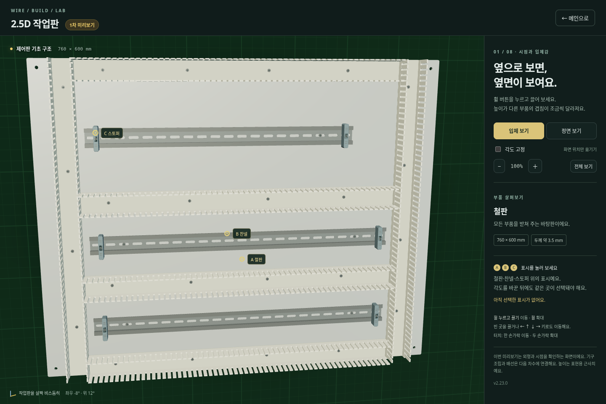
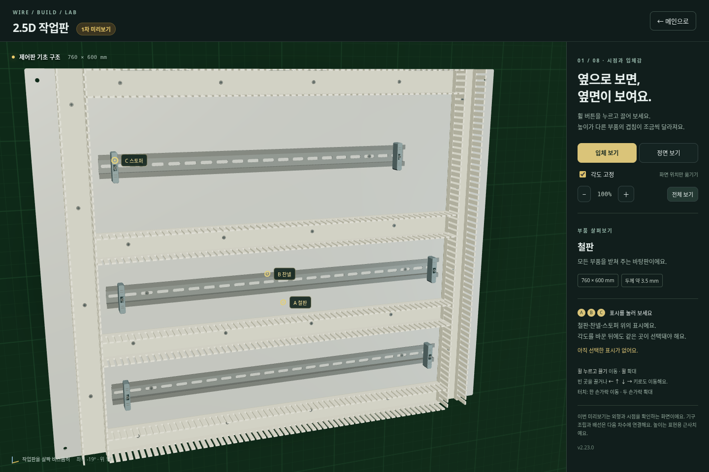

# 2.23.0 · 2.5D 1차: 시점과 입체감

메인 아래 **2.5D 미리보기 · 1차**를 누릅니다. [preview25d.html](../preview25d.html)을 직접 열어도 실행됩니다. 브라우저와 Electron 모두 사용할 수 있으며 라이브러리·재질을 내장해 인터넷 연결이 필요하지 않습니다.

철판 760×600, 40×40 덕트 여섯 개, 35mm DIN 찬넬 세 개, 스토퍼 여섯 개를 기존 제어판 배치에 맞춰 표현합니다. 부품은 두께가 있는 형상이며 화면 이동에 따라 보이는 옆면과 겹침이 달라집니다. 기구·배선 조작은 [전체 계획](2.5d-plan.md)의 다음 차수입니다. 현재 작업과 채점은 이 시연이 변경하지 않습니다.

## 조작

| 조작 | 동작 |
|---|---|
| 휠 버튼 누르고 끌기 | 화면 이동, 제한된 범위에서 시점 각도 변화 |
| 왼쪽 버튼으로 끌기 / 화살표 키 | 화면 이동 |
| 휠 / ＋·− | 포인터 지점을 유지하며 확대·축소 |
| 정면 보기 | 각도 0도, 각도 고정 |
| 입체 보기 | 입체 시점으로 전환 |
| 각도 고정 | 현재 각도를 유지하며 위치만 이동. 해제 순간에는 시점이 튀지 않음 |
| 전체 보기 / 0 | 작업판 중심과 기본 배율로 복귀. 고정한 각도는 유지 |
| 부품 클릭 | 이름·역할·표현용 높이 확인 |
| A / B / C 표시 클릭 | 철판·찬넬·스토퍼의 서로 다른 높이에서 선택 위치 확인 |
| 터치 | 한 손가락 이동, 두 손가락 이동·확대 |
| 메인으로 / Esc | 앱 안에서는 미리보기 종료. 독립 HTML에서는 메인 링크 사용 |

일반 마우스 이동으로 각도가 바뀌지 않습니다. 드래그를 놓은 뒤 자동으로 되돌아가는 애니메이션이나 계속 그리는 반복 루프도 사용하지 않습니다.

## 실제 실행 화면

처음 보이는 입체 시점:

이동해서 각도를 바꾼 뒤, 그 각도를 고정하고 전체 보기로 맞춘 모습:

## 구현과 실행

- `preview25d/scene.js`: 철판·덕트 빗살·타공한 DIN 레일·스토퍼 형상. 길이는 기존 mm 좌표를 사용하고, 높이는 표현용 근사치입니다.
- `preview25d/camera.js`: 제한된 원근 카메라, 화면 이동과 각도 연동, 투영·철판 교차점 계산.
- `preview25d/main.js`: 실제 형상과 교차하는 클릭 판정, 마우스·터치, 필요할 때만 그리기, WebGL 중단 안내와 복구.
- `npm run preview:build`: Three.js 0.180.0을 포함한 단일 `preview25d.html` 생성. CDN·원격 이미지·별도 모델 파일을 사용하지 않습니다. `preview25d/licenses/three.txt`에 MIT 라이선스를 포함합니다.
- Electron 준비 단계에서 두 HTML에 별도의 스크립트 해시 정책을 적용합니다. 시연은 외부 접속을 허용하지 않으며, 앱은 이 두 로컬 페이지를 정확한 주소로 제공합니다.

미리보기를 열 때만 렌더러를 만들고 닫으면 프레임을 해제합니다. 덕트 빗살은 같은 형상을 묶어 그리고, 카메라 입력은 프레임 단위로 처리합니다. WebGL2를 사용할 수 없으면 안내를 표시하고 기존 게임으로 돌아갈 수 있습니다. 아직 학교 PC에서의 FPS를 보장하는 단계는 아닙니다.

## 검증

- 화면 이동 전후 및 정면·확대·창 크기 변경에서 A/B/C의 실제 높이와 일치하는 선택.
- 각도 고정 중에는 위치만 변경, 마우스 이동·버튼 해제 뒤 각도 유지, 멈춘 화면의 불필요한 재렌더 없음.
- 좁은 화면의 터치 이동·핀치 확대와 가로 넘침 방지.
- 메인에서 열고 Esc 또는 닫기 버튼으로 돌아온 뒤 작업·점수·모드별 저장 유지.
- WebGL2 사용 불가 안내와 기존 자유 모드 복귀.
- Electron의 오프라인 실행, 시연 페이지 스크립트 정책과 Node 접근 차단, 저장·복원·업데이트 검사.

명령: `CHROMIUM_PATH=/usr/bin/chromium node --test tests/preview25d.test.cjs`, `npm test`, `npm run test:desktop`. Windows 설치 파일도 CI에서 실제 실행 검사를 수행합니다.
