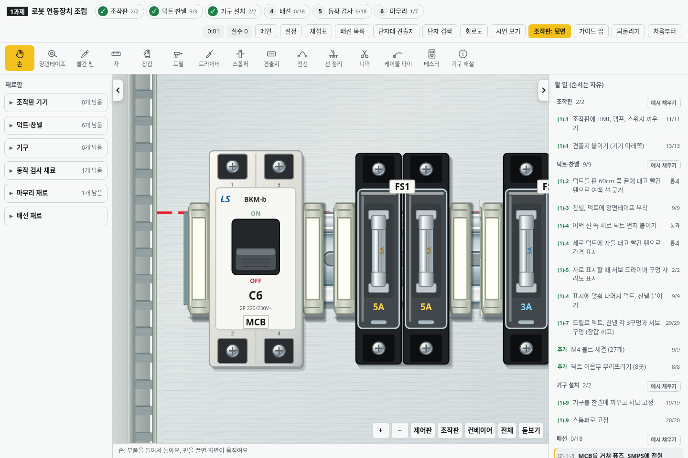

# v2.24.0 · 기본 화면의 은은한 입체감과 UA-52 스토퍼

기본 시뮬레이터에 그대로 적용됩니다. 기존 작업판에서 휠 버튼으로 화면을 옮겨 보세요. 오른쪽으로 시야를 옮기면 오른쪽 옆면이 조금씩 더 보이고, 반대로 옮기면 왼쪽 면이 드러납니다. 새로운 메뉴나 별도 시연 화면에 들어갈 필요가 없습니다.

## 이번 적용 범위

철판·덕트·찬넬·스토퍼 뒤에 얕은 옆면과 접촉 그림자를 추가했습니다. 윗면과 단자 위치는 유지합니다. 제품 전체를 회전하거나 새로운 입체 모델로 교체하지 않습니다. 다음 기구들은 [수정된 8차 계획](2.5d-plan.md)에 따라 표현을 확장합니다.

설정의 **은은한 입체감**을 끄면 이동에 따른 옆면 표현을 숨깁니다. 효과는 기본으로 켜져 있고 작업 내용과 별도로 설정을 저장합니다.

## 실제 학교 스토퍼

사용자가 제공한 사진과 치수도를 기준으로 **SEOIL UA-52** 외형을 수정했습니다.

- 두께 8mm, 몸체 길이 42mm·걸림부 포함 45mm, 높이 30mm, DIN 35mm 걸림부.
- 회색 플라스틱, 윗면의 흰 견출지 자리와 성형 이음선.
- 옆면의 홈·중앙 리브·하단 걸림턱과 금속 스프링 부분.
- 이전의 중앙 나사는 제거. 나사 조이기 작업을 추가하지 않습니다.

위에서 보는 기본 화면에서는 좁고 긴 윗면이 보입니다. 넓은 성형 홈은 옆면이 드러날 때 일부 보이도록 표현합니다. 설치 폭과 묶음 양끝 판정, 기존 설치·제거 방식과 저장은 유지합니다.

## 검증

좌우 화면 이동에서 옆면의 방향이 바뀌고 폭이 제한 범위에 들어오는지 검사합니다. 이동 전후 단자 좌표·배선 경로·회로 판정·점수·작업 상태와 기존 SVG 노드가 유지되는지 확인합니다. 실제 마우스 클릭으로 UA-52를 빼고 다시 끼우는 동작, 표시 설정의 저장과 복원도 검사합니다.

`npm test`, `npm run test:desktop`, `npm run benchmark:pan`으로 확인합니다. 입력 묶음 검사는 카메라 갱신 횟수와 계산량을 확인하는 것이며 학교 PC의 실제 FPS를 의미하지 않습니다.

v2.23.0의 별도 시연과 Three.js·빌드 도구는 제거했습니다. 옛 시연 주소는 기본 시뮬레이터로 이동합니다.
