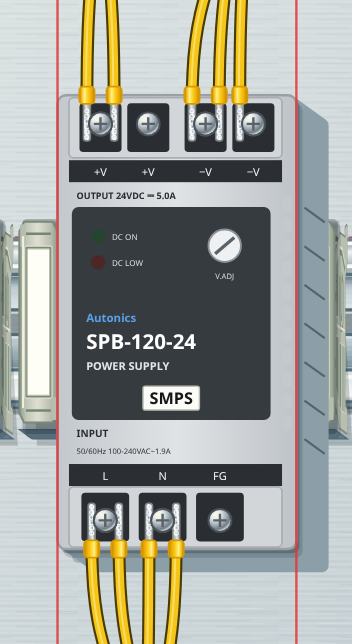
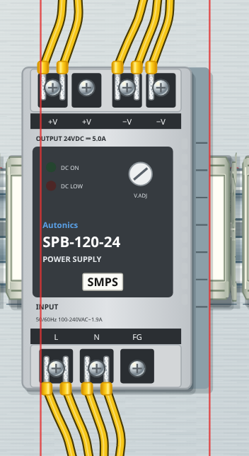
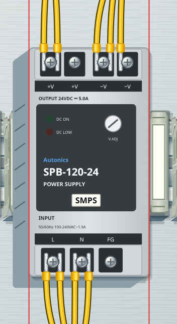
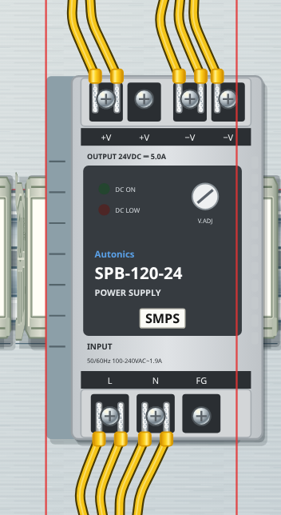

# v2.29.0 · 고정된 바닥과 움직이는 윗면

사용자가 제공한 비교 그림의 오른쪽을 기준으로 표시 방식을 수정했습니다. 이전에는 윗면을 원래 자리에 두고 옆면을 바깥으로 늘렸습니다. 이번에는 바닥을 원래 설치 좌표에 두고 윗면을 이동하며 그 둘을 옆면으로 잇습니다.

| 부분 | 화면 이동 때 동작 |
|---|---|
| 바닥면·설치 기준 | 철판·찬넬 위의 원래 위치에 고정 |
| 윗면과 부품 세부 그림 | 시점과 부품 높이에 맞춰 함께 이동 |
| 옆면 | 고정된 바닥 가장자리와 이동한 윗면 가장자리를 연결 |
| 나사·단자·전선 끝 | 연결된 표면의 이동을 따라 정렬 |
| 전선 경로의 표시 | 단자·기구·덕트 높이에 맞춰 화면 경로를 투영 |
| 전기 연결·설치·채점·저장 좌표 | 기존 모델 좌표 사용 |
| 마우스·터치 | 보이는 위치에서 모델 좌표로 역변환해 작업 |

같은 작업판은 공통 시점 방향을 사용합니다. 같은 높이의 가로·세로 덕트가 동일하게 움직여서 이음부의 윗면이 벌어지지 않습니다. 닫힌 PLC·IO링크 커버는 기구 윗면을 받침으로 삼습니다. 소켓 위 릴레이·타이머처럼 겹친 부품은 아래 부품의 이동과 자체 높이를 함께 적용합니다. 철판·덕트·찬넬·스토퍼, 제어판 기구, 조작판 앞뒤와 HMI·원형 버튼, 컨베이어·모터·센서·콘센트에도 같은 원리를 적용합니다. 제품에 새 구멍이나 장식을 추가하는 변경은 아닙니다.

## 실제 화면 비교

빨간 세로선은 부품 바닥의 좌우 설치 기준입니다. 비교 촬영용으로만 표시했으며 게임에 새 표시 버튼을 추가하지 않았습니다.

오른쪽에서 본 변경 전: 윗면이 기준선에 붙고 옆면이 바깥으로 늘어납니다.

오른쪽에서 본 변경 후: 윗면이 왼쪽으로 옮겨지고 오른쪽 옆면의 바닥 끝은 원래 기준선에 붙습니다.

왼쪽에서 본 변경 전:

왼쪽에서 본 변경 후:

## 확인

좌우 시점에서 실제 SVG 윗면의 이동 방향, 옆면의 고정된 바닥 꼭짓점, 나사와 배선 쪽 나사 그림의 일치를 검사합니다. 가로·세로 화면 이동 후 덕트 이음부 8곳의 윗면이 맞닿는지도 검사합니다. 크게 이동한 시점에서 실제로 단자를 눌러 전선을 선택하고 차단기 손잡이를 눌러 켭니다. 기존 모델 좌표·회로·점수·저장과 SVG 노드, 배선 경로 계산 결과가 유지되는지도 확인합니다.

카메라는 기존 프레임 단위 갱신을 사용합니다. 경로 명령과 높이 연결을 재사용하고 표시용 경로·윗면 변환만 갱신합니다. 합성 입력 120개에서 카메라 적용과 viewBox 쓰기는 각각 1회, 작업판 크기 재조회는 0회였습니다. 이 수치는 작업 횟수이며 실제 PC의 화면 FPS를 측정한 값은 아닙니다.

설정에서 입체감을 끄면 윗면 이동과 표시 경로의 투영을 함께 해제합니다. 새 저장 형식이나 별도 3D 화면은 사용하지 않습니다.
