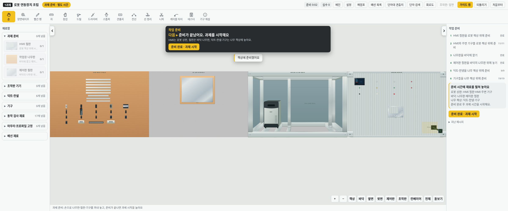
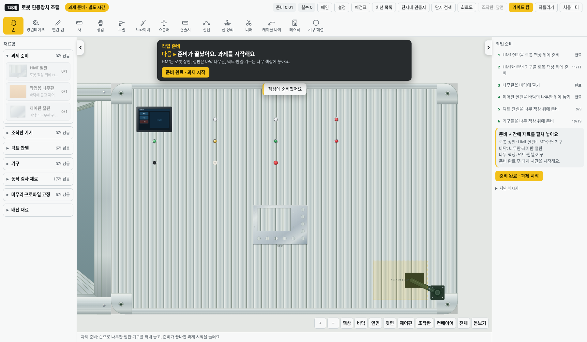
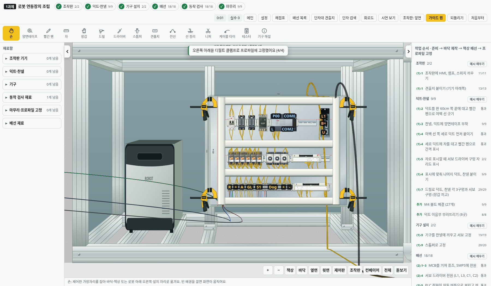

# v2.44.0 · 준비부터 프로파일 고정까지

작업 순서는 **재료 준비 → 바닥에서 철판 제작 → 나무 책상에서 기구·배선·검사 → 로봇 옆면 클램프 고정**입니다.

1. 준비 시간에는 로봇 책상 위에 HMI 철판과 HMI·주변 기구 11개를 펼쳐 놓습니다. 바닥에는 나무판을 깔고 제어판 철판을 올립니다. 나무 책상에는 덕트·찬넬 9개와 기구 19개를 놓습니다. 종류와 수량, 놓인 장소를 확인한 뒤 **준비 완료 · 과제 시작**을 누릅니다. 준비 시간은 과제 시간과 따로 기록합니다.
2. 과제를 시작하면 HMI 철판을 상판 거치대에 부착하고 준비한 HMI 기구와 견출지를 조립합니다. 제어판 철판은 바닥의 나무판 위에서 작업합니다. 덕트를 대고 빨간 펜으로 여백 선을 긋고, 책상의 덕트·찬넬 뒷면에 양면테이프를 붙입니다. 부품을 들어 철판에 배치하고, 자로 간격과 서보 구멍 자리를 표시합니다. 장갑을 끼고 구멍을 뚫은 뒤 M4 나사를 체결합니다. 이 작업을 마친 철판을 나무 책상으로 옮깁니다.
3. 책상에 준비한 기구를 찬넬에 끼우고 스토퍼로 고정합니다. 배선과 선 정리를 마치고, 전원 케이블·컨베이어·퓨즈·릴레이·타이머를 연결해 **동작 검사**를 받습니다. 표시·덕트/찬넬 부착·드릴·나사 작업은 바닥, 기구·스토퍼 설치·배선·검사는 나무 책상에서 진행합니다.
4. 동작 검사를 통과하면 MCB를 내리고 **연결 해제**를 눌러 전원선·컨베이어 선을 뺍니다. 손 도구로 철판 어디든 잡아 옮깁니다. 누른 채 좌우 화살표에 1초 머물면 철판을 든 상태로 이웃 칸으로 이동하며, 로봇 책상 옆면 설치 자리에 끌어 놓습니다. **마무리·프로파일 고정 → 디월트 퀵그립 클램프**를 집어 왼쪽 위·아래, 오른쪽 위·아래 네 자리를 각각 고정합니다. 클램프 4개가 모두 물려야 설치가 완료됩니다.

v2.48.0의 설치 클램프는 실물 사진을 기준으로 별도의 입체 모델을 사용합니다. 앞쪽 고무 패드는 철판에, 뒤쪽 패드는 세로 프로파일 뒤에 닿으며 검은 바가 앞뒤로 이어집니다. 손잡이는 좌우 바깥쪽 90도 방향이고, 검은 곡선 트리거가 노란 손잡이 위에 있습니다. 철판에 자동으로 네 개를 붙이지 않고 한 자리씩 직접 물립니다. [현재 화면과 조작](workspace-carry-and-clamps.md)

클램프가 하나라도 물려 있으면 철판을 들 수 없습니다. 전원을 내리고 손으로 각 클램프를 눌러 풀면 여러 개를 한꺼번에 들 수 있습니다. 네 개를 모두 풀어 재료함에 돌려놓은 뒤 철판을 다시 옮길 수 있습니다. 부분 고정, 해제, 수량과 위치는 저장·되돌리기를 지원합니다.

연습에는 마지막 프로파일 고정 레슨을 추가하고, 시연도 바닥에서 나사 작업까지 마친 뒤 책상에서 배선·검사, 마지막 네 클램프 고정 순서로 진행합니다. 기존 저장의 배선·기구·점수·검사 기록은 유지합니다. 예전 작업에 클램프가 없으면 남은 재료 4개로 표시하며 자동 설치하지 않습니다.

전원 플러그는 바닥 오른쪽 위에 고정된 5구 멀티탭에 꽂습니다. 운반을 위한 외부 선 분리만으로는 통과한 동작 검사와 점수가 사라지지 않습니다. 내부 배선·기구를 바꾸거나 다른 단자로 잘못 다시 연결하면 검사 기록은 무효가 되어 재검사가 필요합니다.
