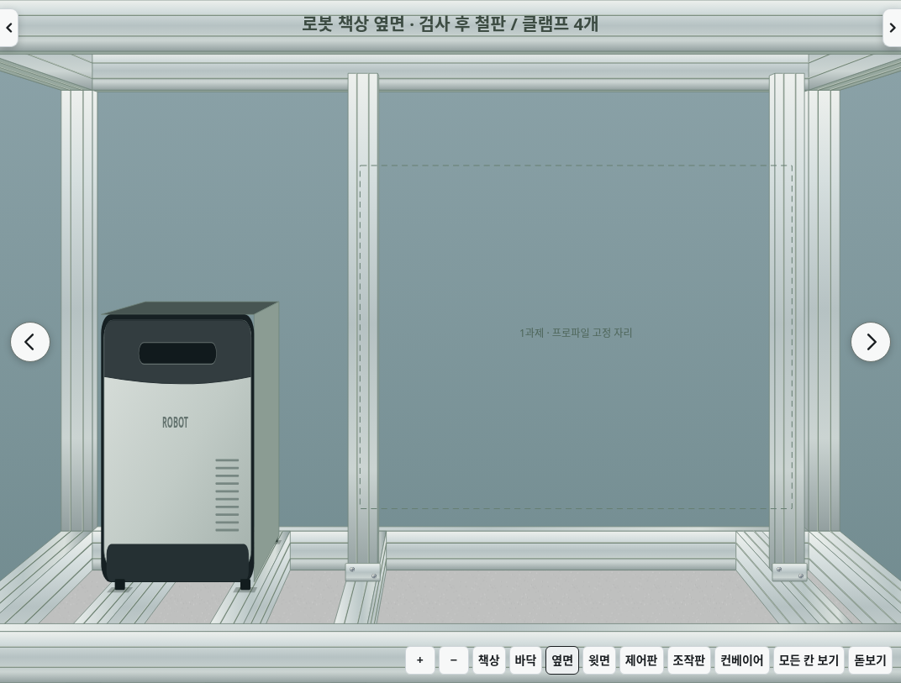
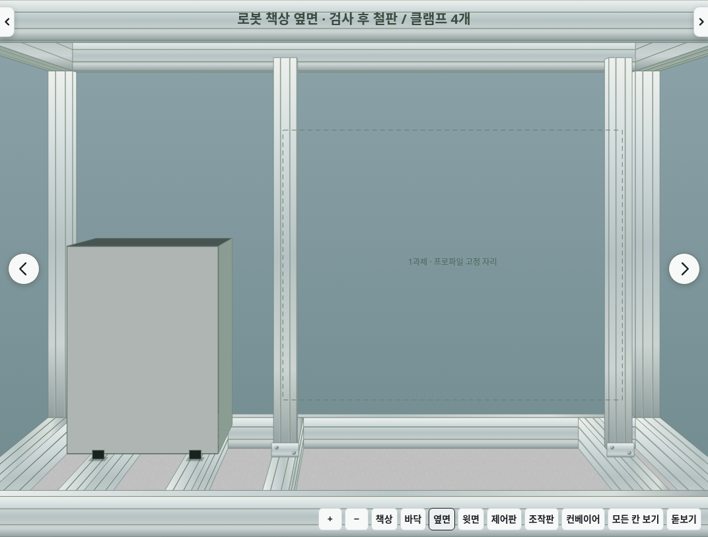
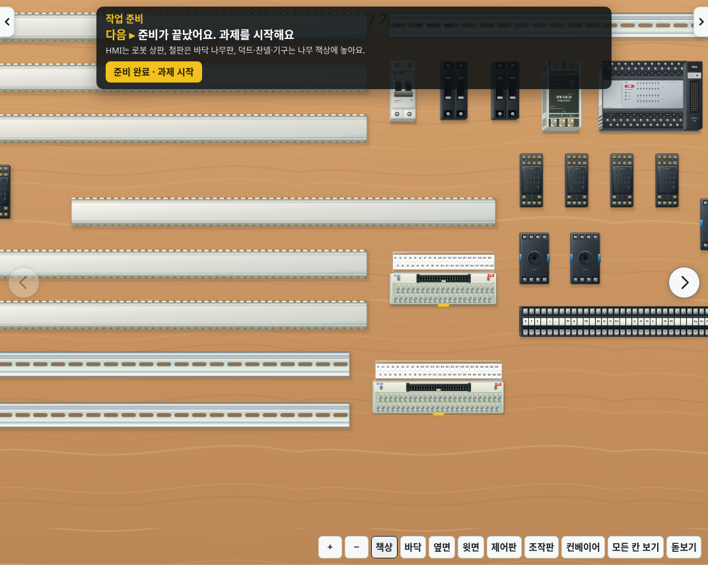

> 지도와 이동 방식은 v2.50.0에서 변경되었습니다. [현재 2×2 배치와 조작 방법](workspace-grid.md)을 확인하세요. 아래는 해당 버전의 변경 기록입니다.

# v2.47.0 · 기구가 크게 보이는 작업 공간

오른쪽 로봇 상판을 제외한 작업 책상·바닥·로봇 옆면은 가로·세로를 각각 절반으로 줄였습니다. 책상과 바닥에 준비하는 기구·철판의 실제 치수는 유지해, 선택한 칸에서 더 크게 보입니다. 로봇 상판과 HMI 배치는 유지합니다. 한 칸 보기의 이동·확대 제한, 좌우 화살표와 모든 칸 보기, 카메라 이동 중 내부 프레임 전달도 함께 사용합니다.

로봇 제어기를 누르면 90도 회전해 오른쪽 면이 보이고, 다시 누르면 앞면으로 돌아옵니다. 오른쪽 면은 사용자 요청에 따라 회색 단색입니다. 실제 옆면 사진을 받기 전까지 단자·통풍구 등의 외형을 추정해 넣지 않습니다. 제어기 발과 작은 접촉 그림자는 두 받침 프로파일 위에 맞춥니다. 빈 공간을 가로지르는 바닥 그림자는 만들지 않습니다.

재료를 내려놓을 때 본체뿐 아니라 열린 아이오 링크 뚜껑과 입체 외형의 여유 공간까지 검사합니다. 겹치는 위치는 놓기 전에 막고 손에 든 재료와 수량을 유지합니다. 철판·컨베이어·콘센트·전원 케이블도 다른 준비 재료를 덮는 위치에 놓을 수 없습니다. 나무판 위에 철판을 올리고 찬넬에 기구를 끼우는 작업은 허용합니다. 책상 위 재료 아래에는 가까운 접촉 그림자를 넣으며 그림자 설정을 끄면 함께 사라집니다.

PLC와 위치 결정 카드는 처음부터 붙어 있는 **PLC** 한 묶음으로 제공합니다. 재료함·준비·집기·설치에서 함께 움직이며, 기존 PLC 단자와 배선·채점 기준은 유지합니다. 독립 재료 수는 19개에서 18개로 바뀝니다.

이전 저장의 준비 재료는 새 칸에 들어가도록 재배치합니다. 기존 PLC와 위치 결정 카드를 한 묶음으로 정리하고, 배선·기구·검사 기록·점수를 보존합니다. 같은 저장을 다시 열어도 보정을 반복하지 않습니다.

| 앞면과 프로파일 받침 | 회전한 오른쪽 단색 면 |
|---|---|
|  |  |

브라우저에서 실제 클릭을 통한 앞·옆면 전환과 재실행, 프로파일 위 접촉 위치, 준비 재료 38개의 SVG 외곽 겹침 여부, 화면 이동과 그림자 끄기, PLC 한 묶음 설치·집기, v2.46 저장의 배선·채점·검사 기록 보존을 검사합니다. 철판과 다른 재료의 겹침 거부, 전원 케이블·콘센트·컨베이어 조작도 확인합니다.
