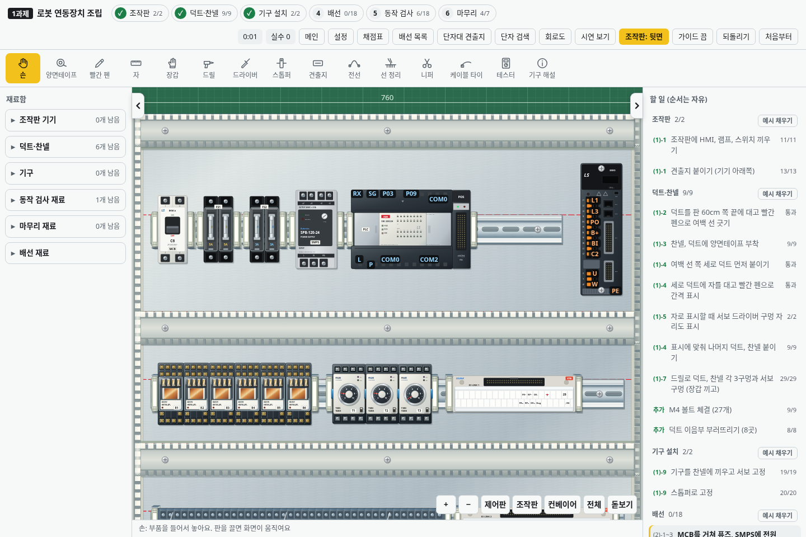
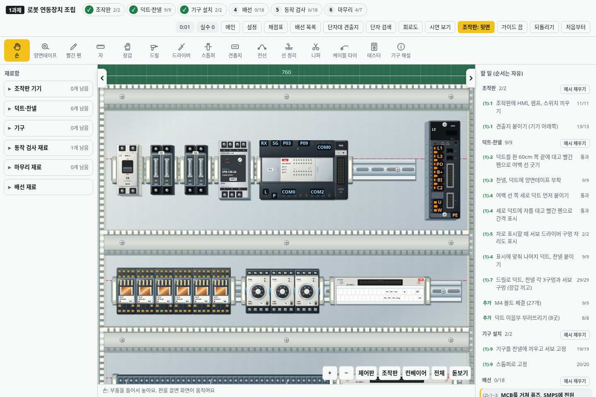
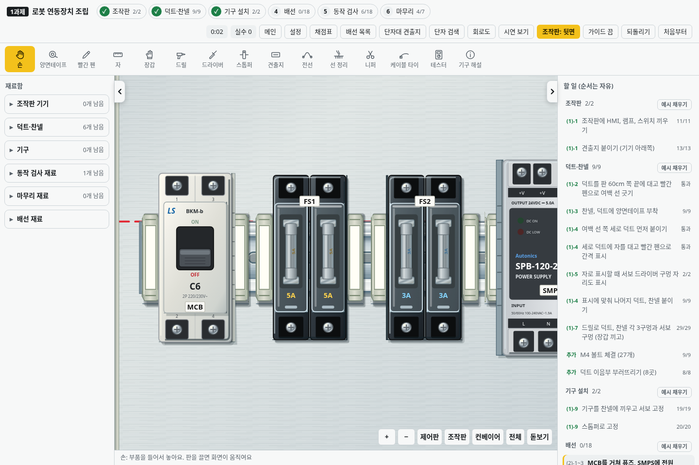
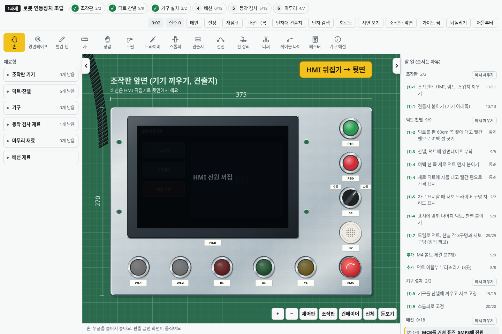

# v2.27.0 · 기구 전체의 입체감과 재질

별도 화면을 만들지 않고 기본 시뮬레이터에 적용합니다. 화면 이동에 따라 옆면이 조금씩 달라지고, 부품과 덮개·소켓·본체의 층 높이를 구분합니다. 기존 그림과 단자·클릭 좌표를 유지하며, 높이는 실제 제품 치수를 보증하는 값이 아닌 표시용 근사치입니다.

| 대상 | 개선 |
|---|---|
| MCB | 성형 몸체·돌출 전면의 두 층, 밝은 외장, 금형 이음선·모서리 반사 |
| 퓨즈 홀더 | 검정 성형 외장, 금속 클립, 투명 캐리어의 두께와 반사 |
| SMPS·서보 | 높은 금속 옆면과 방열 홈, 외장 모서리 |
| PLC·POS | 검정 하우징, 열린/닫힌 덮개와 몸체의 높이 차이 |
| 릴레이·타이머 | 낮은 소켓 위에 높은 본체, 투명 케이스와 밝은 타이머 외장 |
| 단자대·아이오 링크 | 성형 외장·두께·모서리와 별도 덮개 |
| 조작판 | HMI 앞뒤와 버튼·표시등·스위치의 높이. 원형 부품은 둥근 옆면과 그림자 |
| 컨베이어·콘센트 | 프레임·모터·센서·접지 콘센트의 두께와 재질 |

유리관·구리 코일·접점·다이얼·나사·명판은 기존 세부 그림과 상태 표시를 사용합니다. 재료함에서도 같은 외장 그림을 사용합니다. 설정의 **은은한 입체감**으로 화면 이동에 따른 옆면을 켜고 끌 수 있습니다.

## 실제 화면

변경 전:

변경 후:

MCB·퓨즈·SMPS 확대:

조작판 앞면:

## 확인

모든 장착 기구의 옆면 생성, 조작판 앞뒤, 카메라 이동 후 작업·점수·단자 좌표·기존 SVG 노드 유지, 회로 동작, MCB·릴레이·타이머·램프·뚜껑·배선 및 저장을 기존 회귀 검사와 함께 확인합니다. 프레임마다 옆면 경로만 갱신하고 전체 기구와 전선을 다시 만들지 않습니다. 입력 120개를 한 번의 카메라 갱신으로 처리하는 구조를 유지합니다. 이는 실제 학교 PC에서 60FPS를 보장한다는 뜻은 아닙니다.
