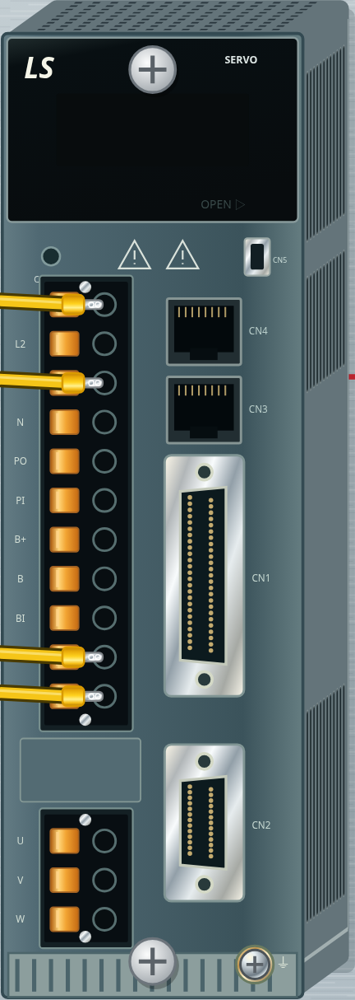
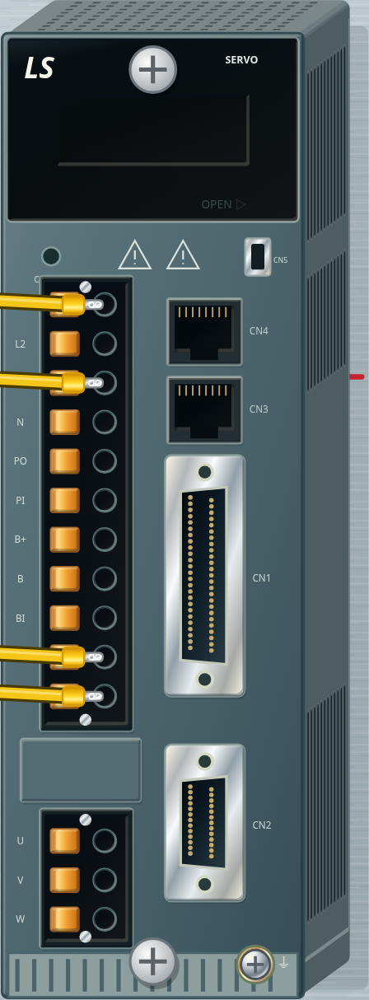
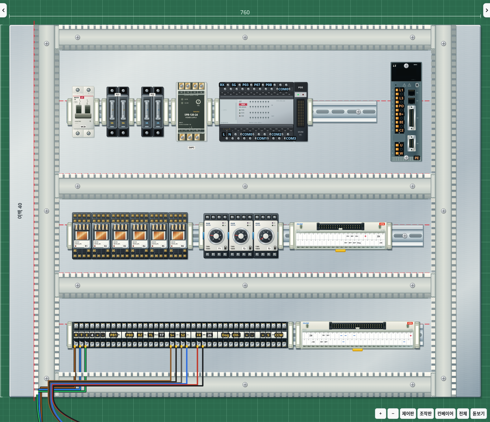
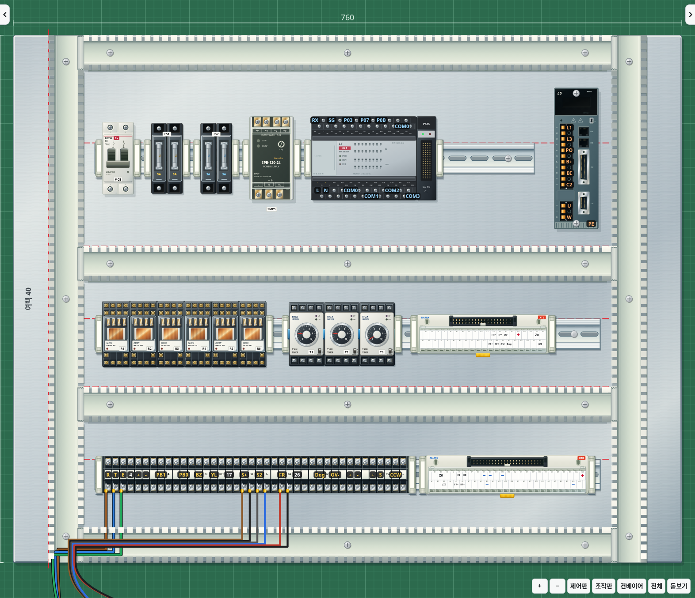
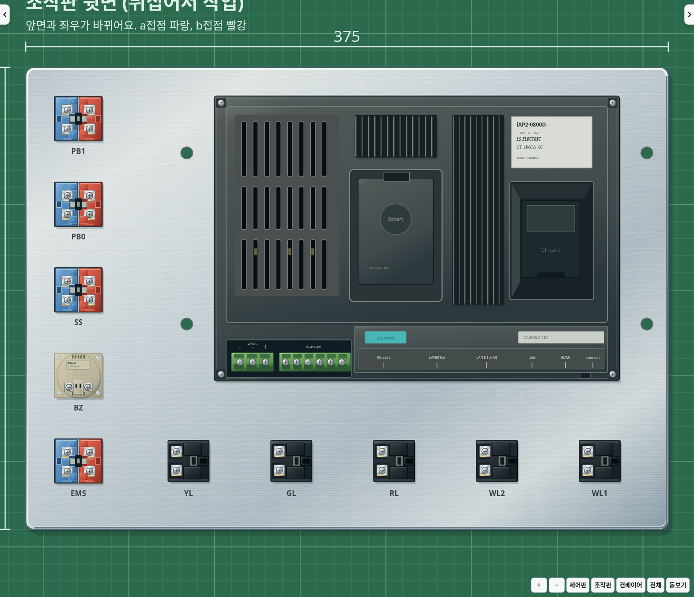
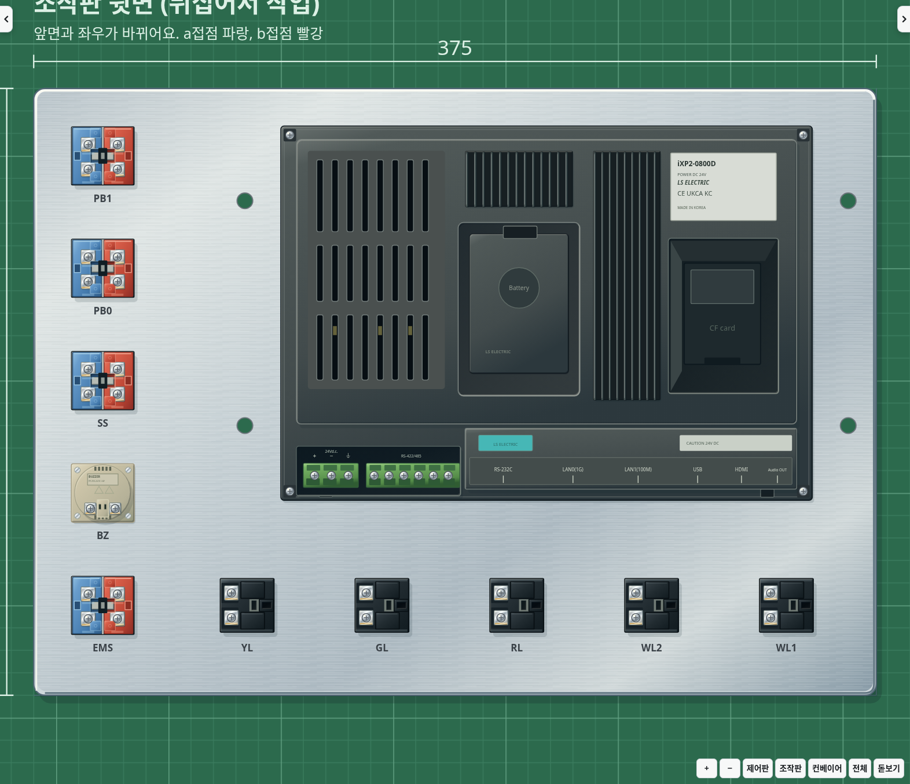
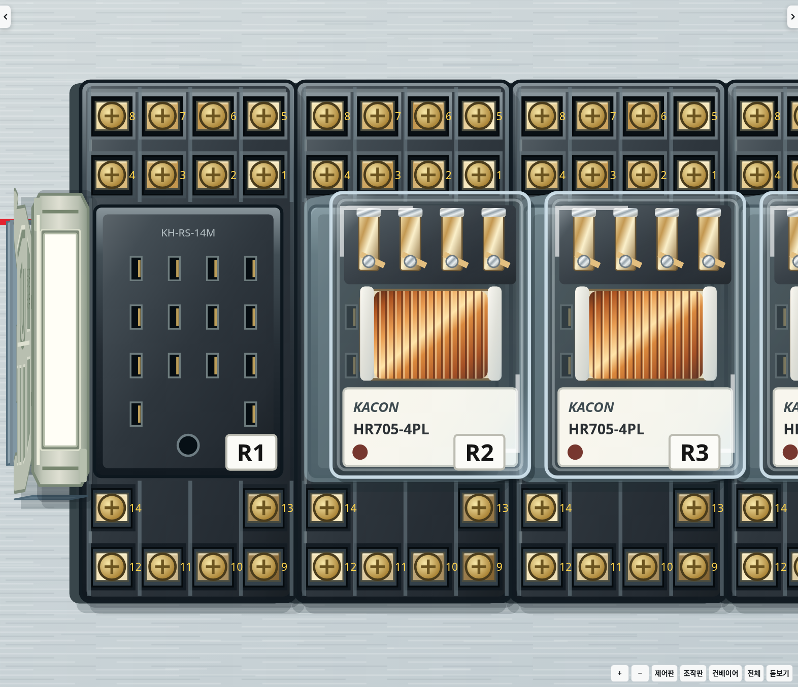
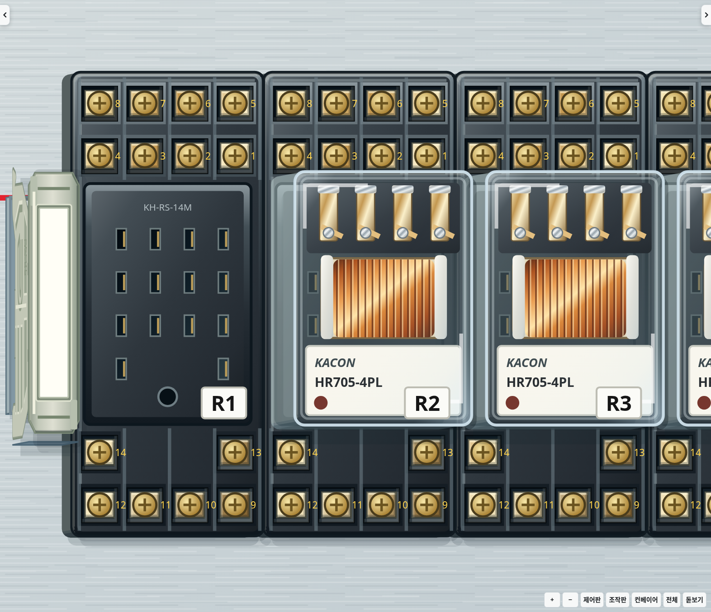
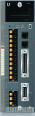

# v2.32.0 · 왼쪽 위 고정 광원

사용자가 지적한 돌출부와 들어간 홈의 모호함을 줄이기 위해 조명을 한 방향으로 맞췄습니다. 광원은 작업판의 왼쪽 위에 고정합니다. 카메라를 움직여도 빛이 카메라를 따라 돌지 않습니다.

| 부분 | 표현 |
|---|---|
| 몸체·덮개·레버·금속 조임판 | 실제 외곽 안쪽에 위·왼쪽 밝은 모서리와 아래·오른쪽 어두운 모서리 |
| 단자 구멍·포트·소켓 홈 | 위·왼쪽 안쪽 벽의 그림자, 바닥의 약한 밝기 변화와 아래·오른쪽 턱의 반사광 |
| 옆면 | 면이 향하는 방향에 맞춰 왼쪽·윗면은 약하게 밝고 오른쪽·아랫면은 어둡게 표시 |
| 원형 부품·둥근 모서리 | 외곽 곡선을 작은 면으로 나눠 같은 광원 방향을 적용 |
| 바닥 그림자 | 오른쪽 아래 방향. 높은 기구일수록 조금 더 길어지며 과한 검정 그림자는 줄임 |
| 덕트·찬넬 | 내부 바닥에 들어가는 방향의 음영. 세로 덕트도 왼쪽 위 광원이 유지되도록 방향 보정 |
| 스토퍼 | 실제 성형 외곽의 모서리와 측면에 음영을 적용 |

기구 전체의 윗면과 옆면에 공통 적용하고, 서보의 돌출된 검정 플러그·주황 레버와 들어간 전선 구멍·통신 포트, MCB 단자 자리·손잡이, 퓨즈 홀더·금속 클립, SMPS·단자대의 나사 받침, 릴레이·타이머 소켓 단자, 조작판 접점·표시등 소켓, HMI 배터리·CF카드 홈과 커넥터에 세부 표현을 더했습니다. 기존 금속·플라스틱·투명 커버의 재질 차이는 유지합니다.

모서리 음영은 실제 도형의 안쪽에 그립니다. 새 구멍이나 도형 밖의 테두리를 만들지 않습니다. 덕트의 빗살과 파손 구간, 찬넬 구멍에는 외곽 사각형을 덧씌우지 않습니다. 글자·견출지·상태 표시등을 어둡게 덮는 전체 화면 필터도 사용하지 않습니다.

## 실제 화면 비교

같은 설치 상태와 시점에서 촬영했습니다. 서보 확대는 실제 배선을 포함하며, 나머지 비교에서는 재질을 보기 쉽게 배선을 숨겼습니다.

| 부분 | 변경 전 | 변경 후 |
|---|---|---|
| 서보·단자와 포트 |  |  |
| 기구·덕트·찬넬·단자대 |  |  |
| 조작판 뒷면 |  |  |
| 소켓과 조임판 |  |  |

반대쪽 시점에서도 왼쪽 위 광원을 유지합니다.

## 구현과 확인

흐림 필터 대신 얇은 면과 그라데이션을 사용합니다. 바뀌지 않은 모서리 도형은 재사용하고, 화면 이동 시에는 기존 옆면과 음영 경로를 함께 갱신합니다. 음영 도형은 클릭을 가로채지 않으며 전선 경로·단자 위치·채점·저장 형식을 바꾸지 않습니다.

실제 서보 레버의 위쪽 밝은 면·아래쪽 어두운 면과, 실제 포트 홈의 반대 방향 음영을 SVG 면 내부 점 검사로 확인합니다. 좌우 시점에서 보이는 옆면의 밝기 방향, 윗면 조명의 고정과 SVG 노드 재사용도 검사합니다. 기준 회로·채점, 단자·전선 끝 정렬, 스토퍼 가림·클릭, 덕트 파손 구간, HMI 단자 홈, SMPS 개폐, 기구 해설, 동작 중 화면 갱신 및 Electron 실행 검사를 함께 수행합니다.

관련 검사와 Electron 실행·저장 복원 검사를 통과했습니다. 합성 화면 이동 입력 120개에서 카메라 적용 1회·viewBox 쓰기 1회·작업판 크기 재조회 0회였습니다. 이는 처리 횟수 확인이며 실제 PC의 FPS 측정은 아닙니다.
