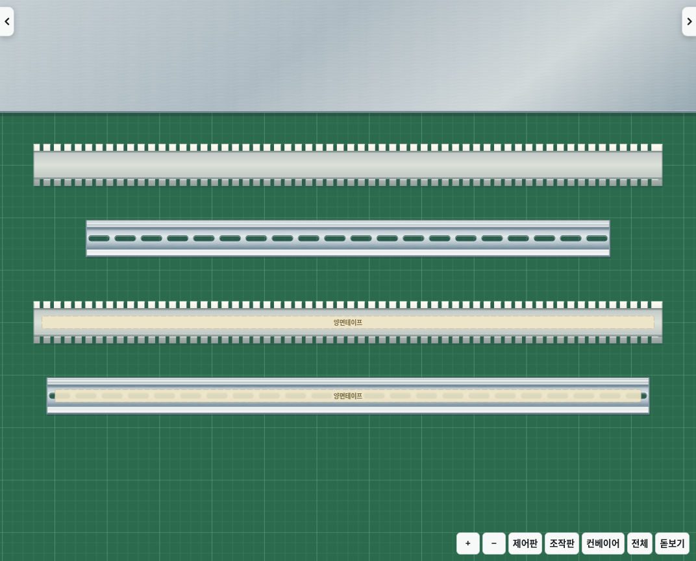
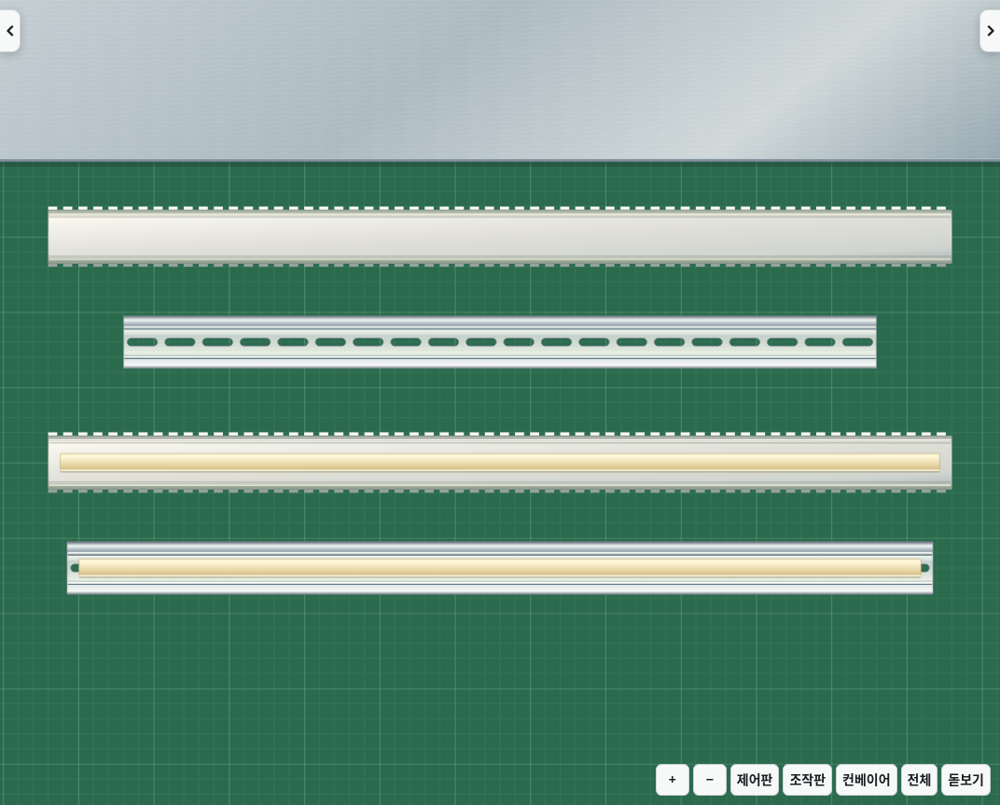

# v2.28.0 · 덕트·찬넬의 뒷면 접착 과정

덕트와 500·575 찬넬 모두 꺼냈을 때와 바닥에 놓았을 때 뒷면을 표시합니다. 덕트는 열린 전선 통로가 아니라 평평한 밑바닥을, 찬넬은 뒤집힌 중심 면을 표시합니다. 바닥에서 양면테이프 도구로 누르면 그 뒷면에 테이프가 붙습니다.

손으로 다시 들어 맞는 철판 자리에 놓으면 정면으로 뒤집어 설치합니다. 테이프는 아래에 가려지고 덕트 통로와 찬넬의 기구 장착 면이 위로 보입니다. 테이프가 없으면 붙지 않습니다. 설치할 자리에 올린 미리 보기는 설치 후의 정면을, 바닥에서 들고 있는 모습은 뒷면을 보여줍니다.

테이프를 붙인 채 재료함에 돌려놓았다가 다시 꺼내도 원래 상태가 유지됩니다. 새 저장 필드를 추가하지 않으며 기존 `taped`, `slot`, `stuck` 상태로 면을 구분합니다. 저장·다시 열기·되돌리기도 같은 상태를 사용합니다.

변경 전: 바닥에도 열린 정면 위에 테이프가 표시됐습니다.

변경 후: 위 두 개는 뒷면, 아래 두 개는 그 뒷면에 테이프를 붙인 상태입니다.

덕트와 찬넬 두 길이에 대해 실제 재료함·도구·작업판 클릭으로 미접착 설치 거부, 뒷면 테이프 표시, 저장 후 복원, 정면 설치와 테이프 가림, 되돌리기를 검사합니다. 기존 회로·덕트 파손·배선 진입·옆면·Electron 실행 검사도 확인합니다.

IO링크는 새로 제공된 실물 사진을 기준으로 별도 개선했습니다. MCB·SMPS·PLC·카드 등에 추측으로 추가했던 통풍구와 형태 변경은 배포에서 제외했습니다. 이 기구들은 v2.27.1의 정면을 유지하며, 실물 원본 사진을 다시 확인한 뒤 사진에 있는 구조와 표면을 재현하는 작업으로 이어갑니다. 보관된 `lab-3d/reference/*.svg`와 Godot의 PNG는 예전 시뮬레이터 그림이며 실물 사진으로 간주하지 않습니다.
