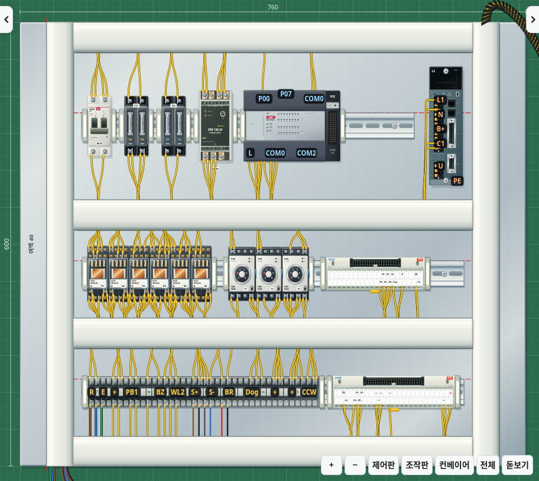
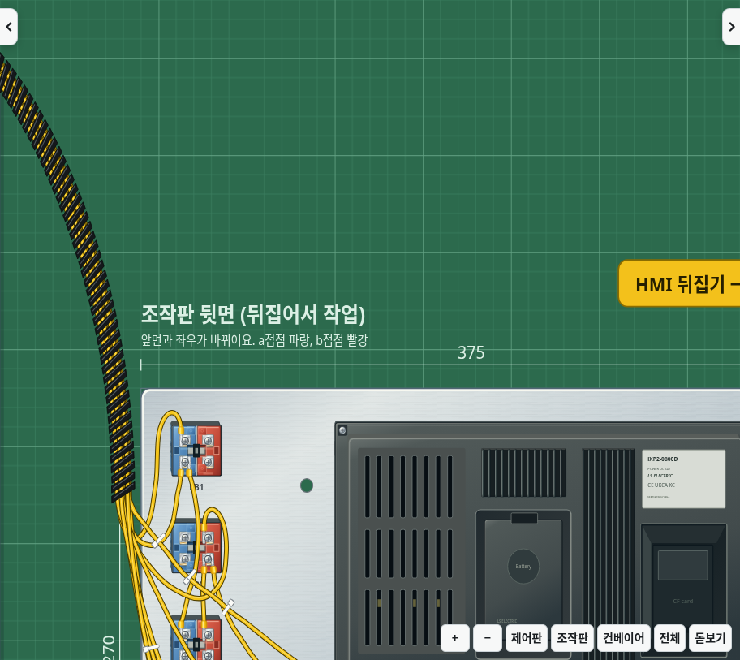

# v2.34.0 · 최고 그래픽을 유지하는 최적화

모든 그래픽 효과를 켠 상태의 계산을 줄입니다. 새 설정을 켤 필요 없이 적용되며, 기존 그래픽 설정은 유지합니다. 효과를 꺼 두었다면 **설정 → 그래픽·성능 → 그래픽 모두 켜기**로 복원할 수 있습니다.

## 변경

- 전선의 각 점이 어떤 기구 위에 놓여 있는지와 원래 좌표·좌표계를 재사용합니다. 화면 이동 때는 높이에 따른 이동량만 갱신합니다. 기구·덮개·배선의 형상이 바뀌면 필요한 연결 관계를 다시 계산합니다.
- 경로에 영향을 주는 면의 이동량이 같으면 계산한 전선 경로를 재사용합니다. 전선의 곡선·곡률·끝점과 기존 좌표 반올림은 유지합니다.
- 화면 내용이 바뀌지 않았으면 기구·단자·전선의 투영 준비를 다시 하지 않습니다. 부품 장착·배선·덮개 개폐와 실제 표시 상태가 바뀌면 갱신합니다.
- 카메라 이동 때 화면 너비를 반복 조회하지 않고 창 크기 변경 관찰값을 사용합니다. 화면 맞춤·확대와 창 크기 변경에서는 이미 읽은 크기를 전달합니다.

## 화질 확인

v2.33.0과 동일한 작업·창 크기·시점을 비교했습니다. 모든 효과는 켜 둡니다. 제어판 확대, 왼쪽 시점, 오른쪽 시점, HMI 확대의 네 비교 화면에서 변경된 픽셀은 각각 **0개**였습니다. 작업 상태와 단자 좌표도 동일합니다.

| 부분 | 변경 전 | 변경 후 |
|---|---|---|
| 제어판 |  |  |
| HMI |  |  |

## 처리 시간 비교

`CHROMIUM_PATH=/usr/bin/chromium npm run benchmark:full-graphics -- /path/to/index.html`로 같은 브라우저·화면·기준 작업에서 측정합니다. 각 작업을 5번 측정한 중앙값이며, 실제 화면의 FPS 측정은 아닙니다. 사용자 PC에서의 개선 폭은 달라질 수 있습니다.

| 항목 | v2.33.0 | v2.34.0 |
|---|---:|---:|
| 모든 그래픽 효과 | 켜짐 | 켜짐 |
| 작업판 SVG 노드 | 12,737 | 12,737 |
| 모서리·측면 조명 레이어 | 699 | 699 |
| 드래그와 같은 화면 이동 6회 | 380.0ms | 189.8ms |
| 자동 이동과 같은 카메라 적용 6회 | 608.2ms | 182.5ms |
| 내용이 같은 장면 갱신 5회 | 404.3ms | 55.1ms |
| 측정 중 전선 점의 부품 연결 관계 조회 | 622,908회 | 0회 |
| 측정 중 내용이 같은 장면의 투영 준비 | 5회 | 0회 |
| 기준 작업 점수 | 30 | 30 |

CPU 프로파일에서 기존의 주요 비용은 전선 점마다 반복되는 부품 연결 관계 조회와 경로 계산, 반복 레이아웃 조회였습니다. 위 결과는 계산·레이아웃 비용을 줄인 것으로, 도형 삭제·조명 약화·갱신 빈도 제한·해상도 축소를 적용하지 않았습니다.

## 검증

새 브라우저 검사는 원래의 점별 투영 알고리즘을 독립 기준으로 사용해 곡선·호·회전 좌표계와 실제 전선 경로가 같은 좌표를 내는지 비교합니다. 좌우 시점·확대·조작판 앞뒤·단자 덮개·배선 변경 뒤의 결과를 포함합니다. 최고 그래픽에서 도형과 노드 재사용, 반복 조회 생략, 작업·단자 좌표 유지도 검사합니다.

기존의 면·단자·전선 정렬, 실제 클릭, 스토퍼 가림, 고정 광원, 모든 효과 끄기와 실시간 동작 검사도 함께 사용합니다. Electron 오프라인 실행·내보내기·업데이트 전 저장·앱 재시작 뒤의 작업 복원 검사를 통과했습니다.

서버 검사 결과는 실행 요약에도 게시해 중복 실행의 실패 항목을 확인할 수 있게 했습니다.
