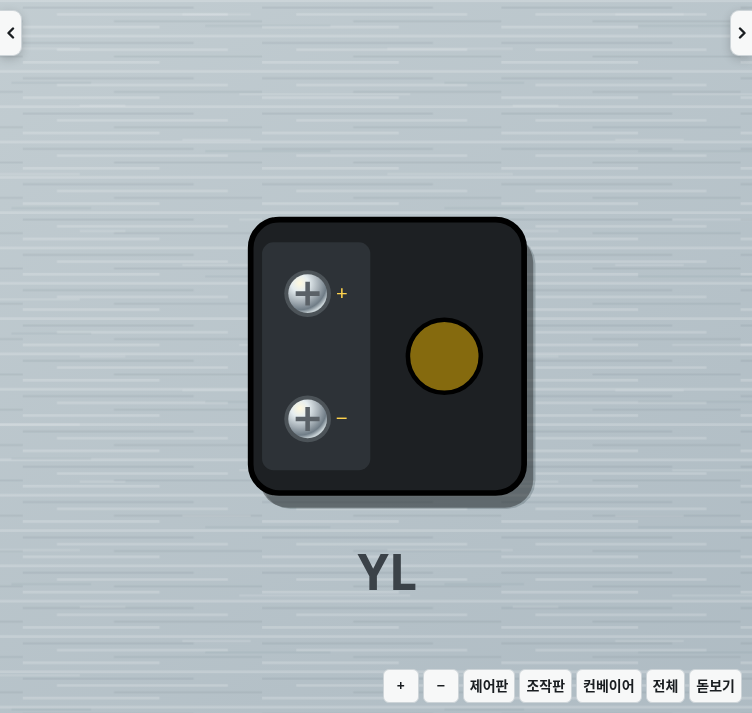
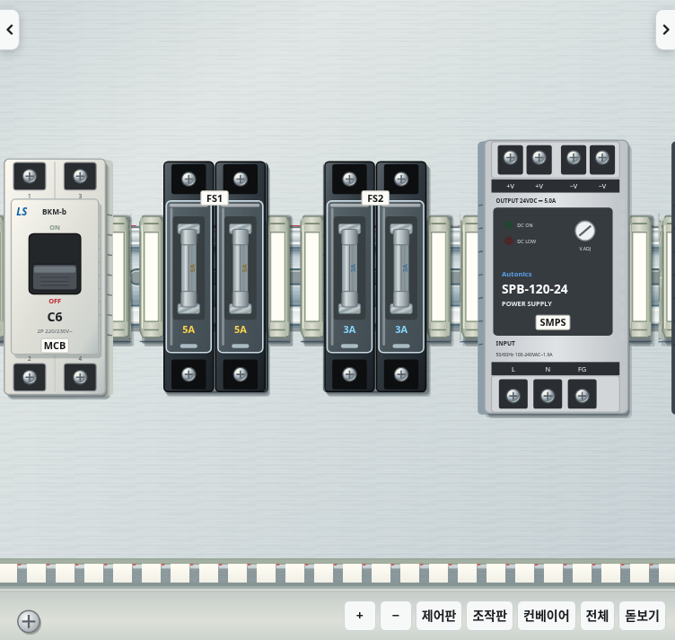
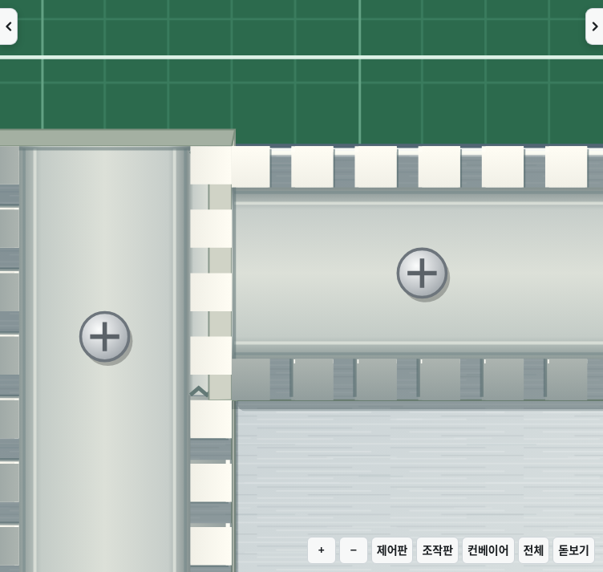
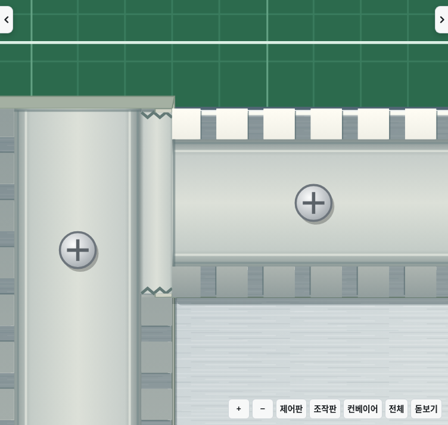

# v2.27.1 · 외곽선과 덕트 이음부 표시 수정

기구의 옆면을 별도 테두리로 둘러 그리던 방식에서, 원래 몸체의 외곽에 맞닿는 채워진 면으로 변경했습니다. 중복 외장 선과 긴 옆면 경계선을 제거하고 둥근 모서리도 따라갑니다. 조작판 뒤 표시등(24×24), 스위치(28×26), HMI는 실제 그림의 외곽과 같은 기준을 사용합니다.

표시등 수정 전:

표시등 수정 후:

MCB·퓨즈·SMPS 수정 전:

MCB·퓨즈·SMPS 수정 후:

덕트는 전선 위에 덧그리는 이빨이 파손 상태를 무시하던 문제를 수정했습니다. 연결부를 부러뜨리면 해당 구간의 이빨을 제외하고, 연결되는 두 덕트의 깊이 방향 면도 통로에서 제거합니다. 나머지 벽과 파손 흔적은 남습니다.

덕트 수정 전:

덕트 수정 후:

자동 검사에서는 8곳을 실제 손 도구 클릭으로 파손하고 통로 위 이빨의 제거, 되돌리기와 저장 후 복원을 확인합니다. 조작판 뒤 모든 기구의 몸체 크기와 옆면 기준, 화면 좌우 이동 후 외곽선 제거와 작업 상태 유지도 검사합니다. 기존 전선 진입·커버·회로·학습·랭킹·저장 검사와 Electron 실행 검사를 함께 실행합니다.

사진은 변경 전후 같은 작업 상태와 카메라 위치에서 촬영한 실제 SVG 작업 화면입니다. 기존 작업 좌표·클릭 영역·회로 판정과 저장 형식은 유지합니다.
