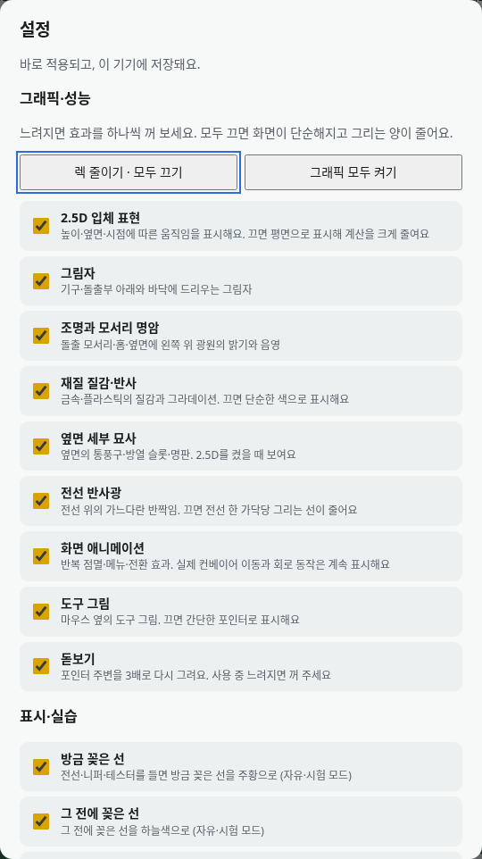
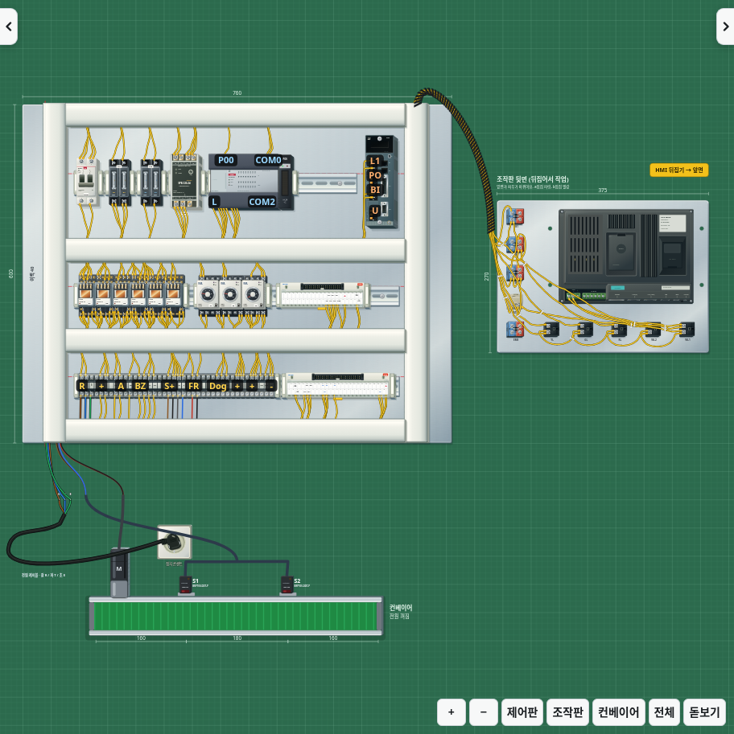
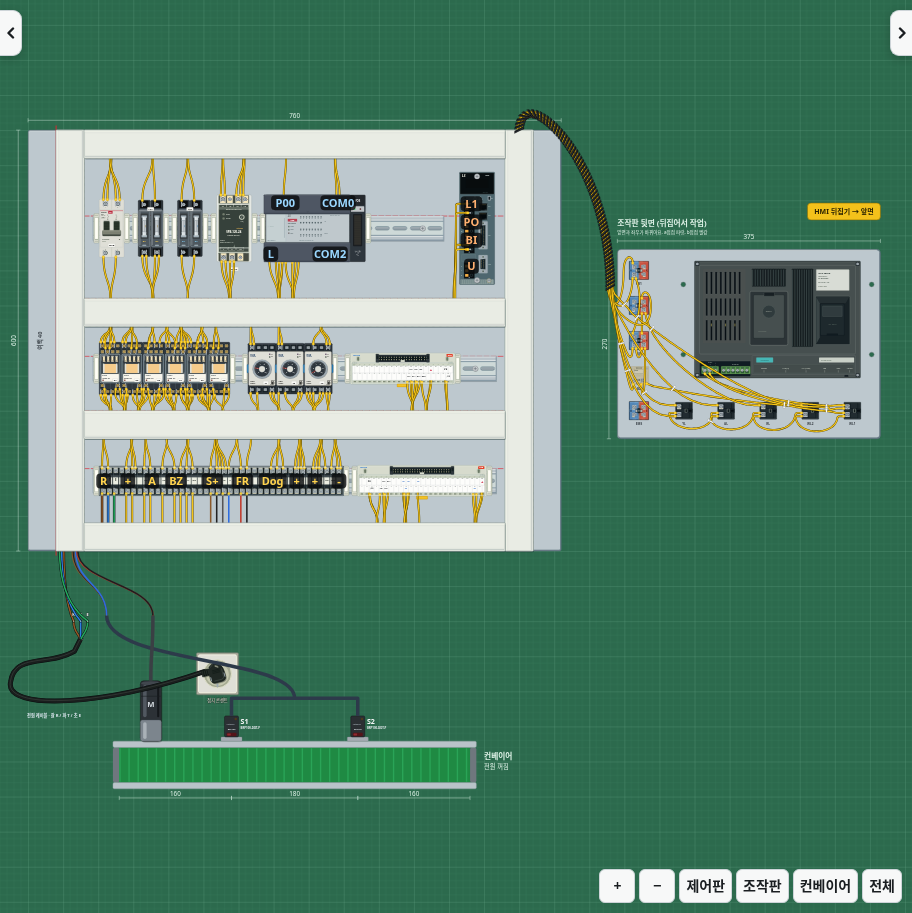
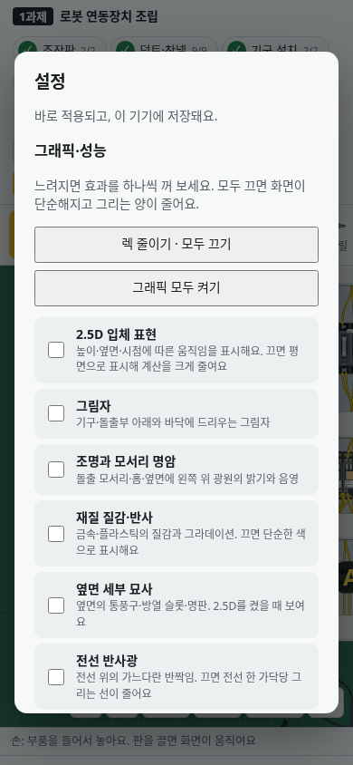

# v2.33.0 · 그래픽·성능 설정

**설정 → 그래픽·성능 → 렉 줄이기 · 모두 끄기**로 효과를 한 번에 끕니다. 필요한 효과만 다시 켜거나 **그래픽 모두 켜기**로 복원할 수 있습니다. 자유·시험·연습·고장 모드에서 공통으로 사용하며 다음 실행에도 유지됩니다. 표시·실습 설정과 테마는 그래픽 일괄 버튼의 영향을 받지 않습니다.

| 항목 | 껐을 때 |
|---|---|
| 2.5D 입체 표현 | 평면으로 표시. 옆면 도형과 카메라에 따른 면·단자·전선 투영 및 깊이 정렬 계산 생략 |
| 그림자 | 바닥·돌출부의 그림자 도형 생성과 그림자 경로 계산 생략 |
| 조명과 모서리 명암 | 돌출·홈의 밝고 어두운 모서리, 내부 명암, 측면 광원 레이어 생성 생략 |
| 재질 질감·반사 | 금속·성형 질감 패턴을 빼고 그라데이션을 단색으로 변환. 투명 커버의 투명도 유지 |
| 옆면 세부 묘사 | 측면 통풍구·방열 슬롯·명판 생략. 2.5D를 켜 두면 단순한 옆면은 유지 |
| 전선 반사광 | 가닥마다 덧그리던 반사광 경로 생략 |
| 화면 애니메이션 | 반복 점멸·배경·전환 효과 정지. 실제 컨베이어 이동과 회로 동작은 계속 표시 |
| 도구 그림 | 마우스 옆 도구 그림 대신 간단한 포인터 표시 |
| 돋보기 | 확대 화면을 다시 그리지 않고 확대 버튼 숨김 |

배선 색상·전원·단자 위치·기구 덮개·동작 상태·회로 계산·채점과 작업 저장 형식은 유지합니다. 닫힌 덮개와 덕트의 배선 잠금도 동일합니다. 기본값은 기존 그래픽을 모두 켠 상태이며, 이전에 입체감을 꺼 둔 설정은 유지합니다.

## 같은 작업의 화면 비교

| 모두 켜기 | 모두 끄기 |
|---|---|
|  |  |

## 확인

`CHROMIUM_PATH=/usr/bin/chromium npm run benchmark:graphics`는 동일한 기준 작업에서 실제 SVG 도형과 카메라 처리 횟수를 비교합니다.

| 측정 항목 | 모두 켜기 | 모두 끄기 |
|---|---:|---:|
| 작업판 SVG 노드 | 12,737 | 8,903 |
| 모서리·측면 조명 레이어 | 699 | 0 |
| 전선 반사광 경로 | 122 | 0 |
| 투영 대상 전선 경로 | 395 | 0 |
| 화면 이동 6회 중 기구 면 갱신 | 594 | 0 |
| 화면 이동 6회 중 경로 재투영 | 1,596 | 0 |
| 화면 이동 6회 중 깊이 정렬 갱신 | 6 | 0 |

작업판 노드는 약 30% 줄었습니다. 같은 측정에서 카메라 처리 시간은 536.6ms와 36.0ms였으며, 이는 이 환경의 합성 입력 측정으로 사용자 PC의 FPS나 속도 향상 비율을 보장하는 수치가 아닙니다. 두 모드에서 작업 상태·단자 좌표는 동일하고 기준 작업 점수는 30점입니다.

브라우저 검사에서 효과의 독립 전환·복원, 일괄 끄기, 노드 감소, 꺼진 투영 계산 생략, 실제 평면 단자 클릭과 PLC 덮개 개폐·배선, 점수 유지, 재시작 뒤 설정 복원과 모바일 화면 폭을 확인합니다. 기존 입체 표현·광원·스토퍼 가림·SMPS 덮개·실시간 화면 갱신 검사도 함께 사용합니다.

관련 브라우저 검사와 Electron 오프라인 실행·내보내기·저장 복원 검사를 통과했습니다. 설치형 검사에서도 그래픽 효과를 모두 끈 뒤 앱을 종료·재실행해 설정과 작업이 함께 복원되는 것을 확인했습니다.
