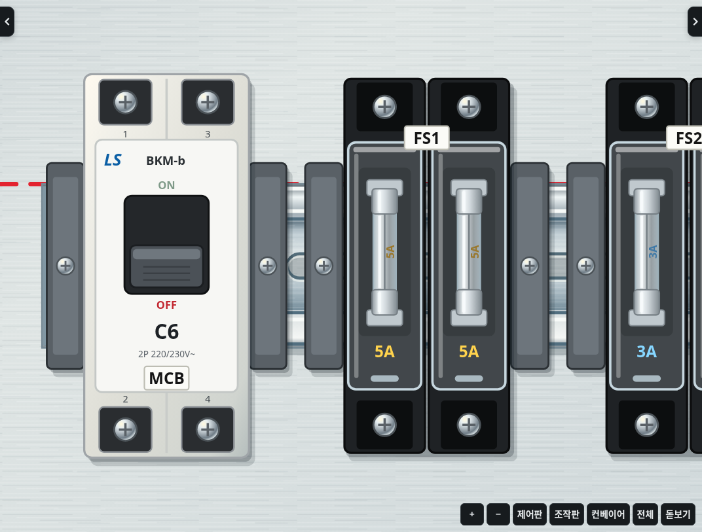
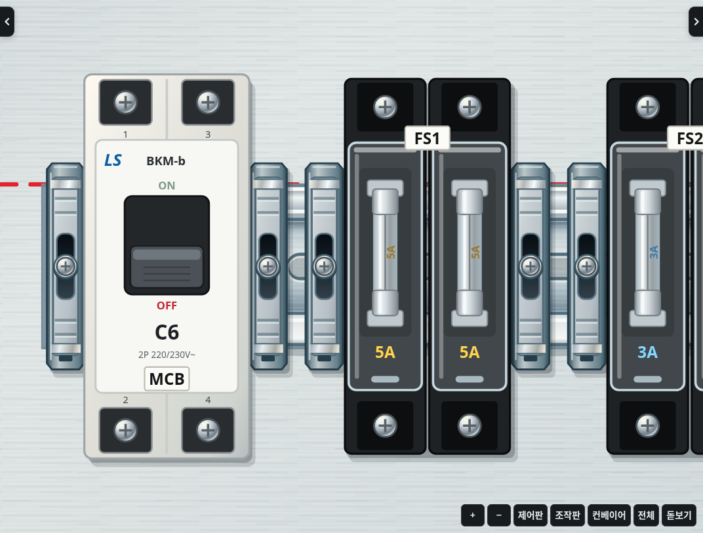

# 2.22.0 · 스토퍼 외형 개선

찬넬 끝 고정용 스토퍼에 성형 외장과 홈, 위아래 걸림턱, 금속 고정부와 중앙 나사의 깊이를 표현했습니다. 손에 든 스토퍼 그림도 설치된 부품과 같은 그림을 사용합니다.

폭 8mm, 설치 위치와 기구 묶음 끝 판정, 다시 눌러 제거하는 동작, 기존 저장 형식을 유지합니다. 나사는 외형 표현이며 별도의 나사 조이기 작업을 추가한 것은 아닙니다.

참고: [2.5D 작업판 계획](2.5d-plan.md). 이번 버전은 스토퍼 외형 업데이트이며 2.5D 카메라는 아직 적용하지 않습니다.
