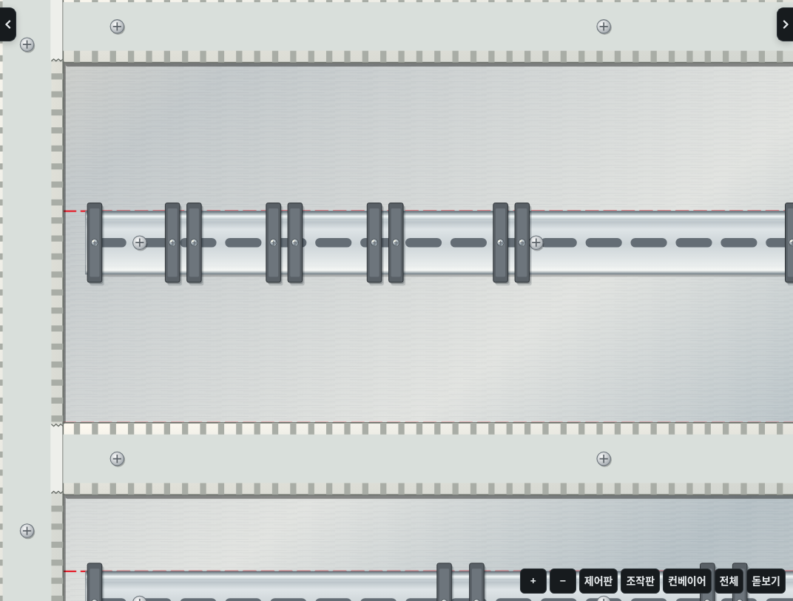
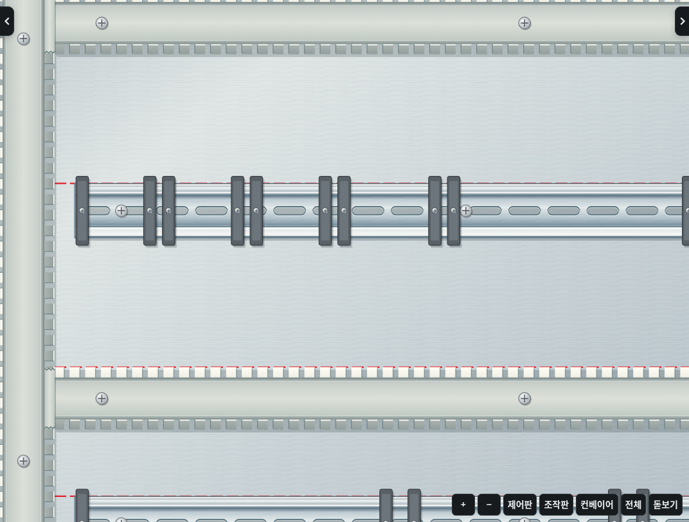
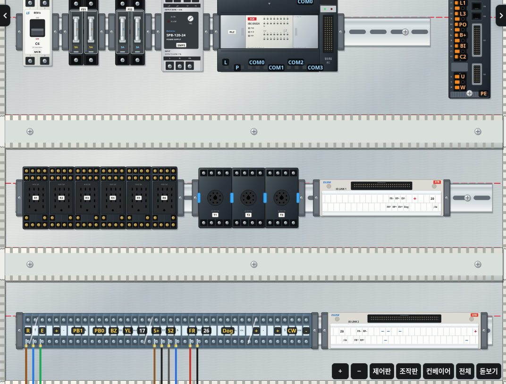
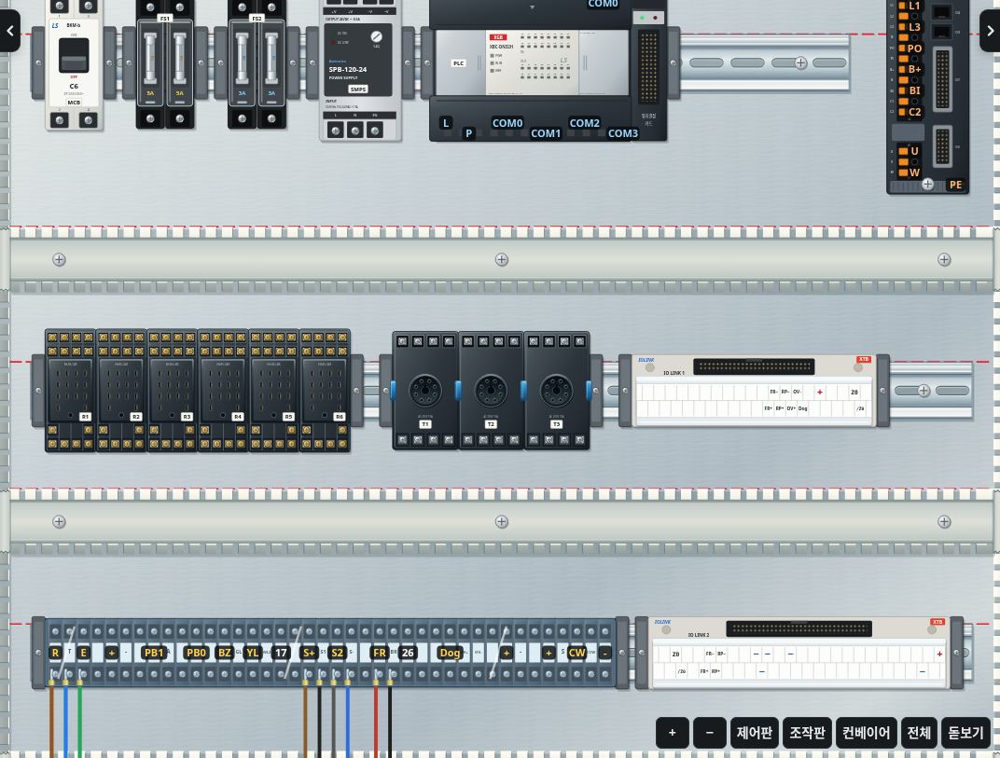
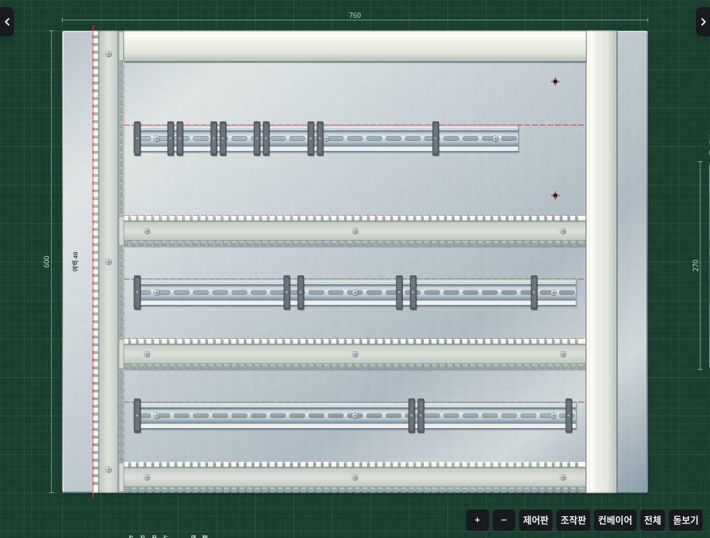

# 2.21.0 · 철판·덕트·찬넬·소켓

기존 정면 2D 작업판에서 네 가지 구조물의 외형을 개선했습니다. 기구 크기와 단자 위치, 드릴·볼트·덕트 이음부·덮개의 작업 조건, 회로 판정과 저장 형식은 유지합니다.

- **철판**: 차가운 금속 반사, 미세한 표면 결, 얇은 절단면과 모서리 명암. 조작판의 기존 타공에도 절단면을 표현합니다. 새 장식 구멍이나 가짜 고정 나사를 추가하지 않습니다.
- **덕트**: 빗살 사이가 열린 구조, 벽의 두께와 안쪽 바닥의 깊이, 슬롯 절단면의 빛과 그림자. 가로·세로는 같은 단면을 회전해 그리며 조명 방향을 맞춥니다. 이음부를 부러뜨리면 기존 조건에 따라 벽이 사라지고 파단면을 표시합니다.
- **덕트 커버**: 닫힌 플라스틱 면과 둥근 어깨, 가장자리의 결합부를 표현합니다. 닫히면 빗살과 내부 배선을 가리는 기존 순서를 유지합니다.
- **찬넬**: 35mm DIN 레일의 접힌 턱, 낮은 중앙면, 원래 위치의 길쭉한 타공과 금속 테두리. 구멍은 불투명한 회색 그림 대신 밑판이 보이는 형태로 그립니다.
- **소켓**: 14P 릴레이·8P 타이머 소켓의 성형 외장, 깊은 단자 홈, 금속 고정부, 핀 삽입부와 타이머 고정 클립. 릴레이 소켓 이름표는 핀 구멍을 가리지 않도록 아래쪽으로 옮겼습니다. 릴레이·타이머를 꽂고 빼는 상태, 실제 단자 번호와 좌표는 유지합니다.

## 철판·덕트·찬넬 비교

기구와 배선을 비운 동일 작업판에서 비교한 실제 게임 화면입니다.

개선 전:

개선 후:

## 소켓 비교

릴레이와 타이머를 뺀 상태입니다.

## 열린 덕트와 닫힌 커버

위쪽과 오른쪽 커버를 닫고, 나머지는 열어 둔 실제 게임 화면입니다.

## 렌더링 범위

그라디언트와 공유 SVG 경로를 사용하며 블러·노이즈 필터나 외부 이미지를 추가하지 않습니다. 소켓 단자 홈과 금속판은 개별 요소 대신 묶음 경로로 그리고, 같은 단자 배열·위치의 결과를 최대 256개까지 재사용합니다. 이 캐시는 작업 저장 데이터와 분리합니다.

동일한 완성 배선의 합성 입력 검사에서 SVG 요소는 5,951→5,880개, 버튼 20회 조작 중 교체 요소는 15,290→14,230개였습니다. 전후 모두 전선 기본 경로 재계산 0회, 타이 이동 입력 120개는 프레임당 이동 계산 1회, 타이의 DOM 교체는 78개였습니다. 이 수치는 표시 구조와 계산 횟수이며 실제 FPS나 모든 기기의 속도를 보장하는 값은 아닙니다.
