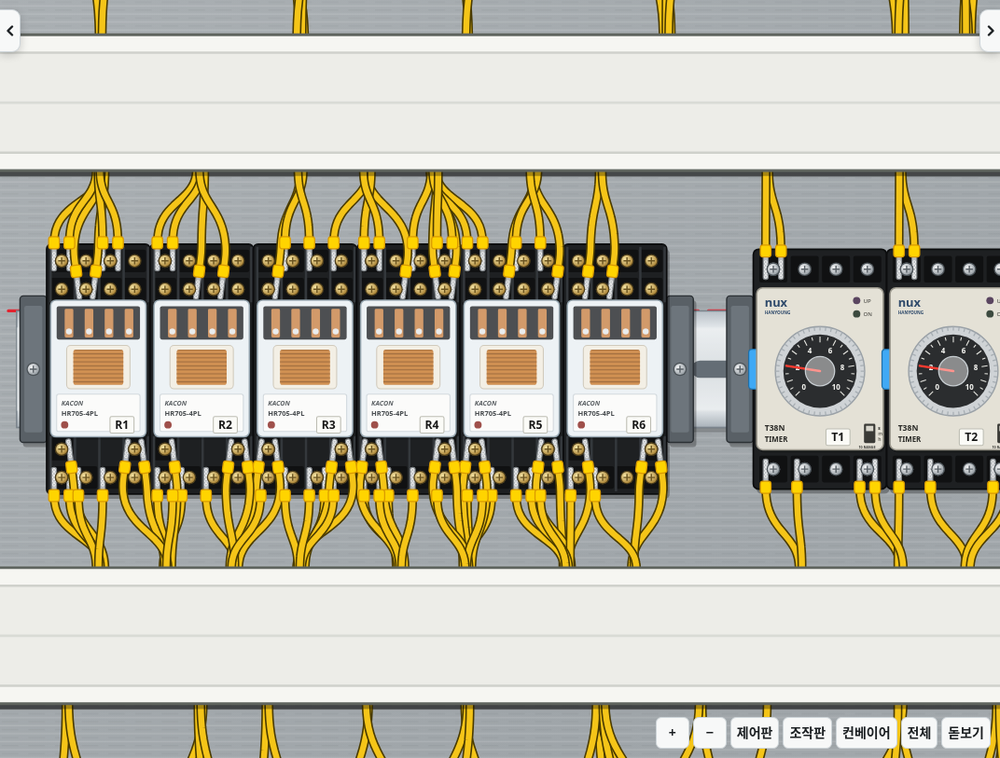
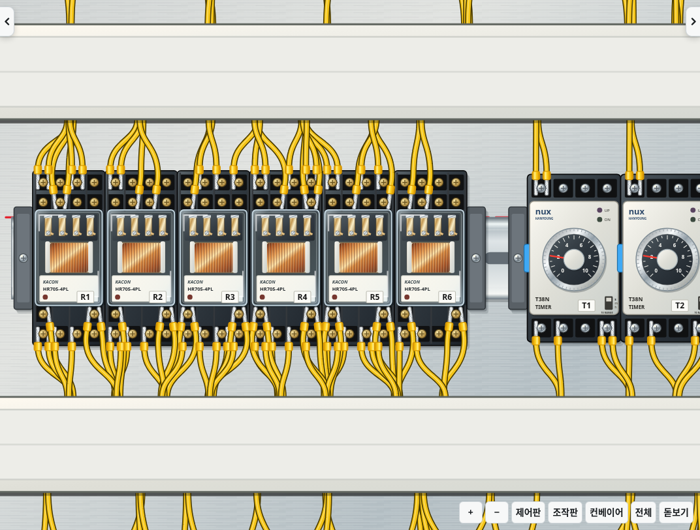

# 2.20.0 · 2D 재질 그래픽 1차

기존 작업판의 정면 2D 그래픽을 개선합니다. 표지의 분위기에서 금속·구리·투명 케이스·피복의 재질 표현을 가져왔으며, 표지의 원근 카메라나 3D 장면을 그대로 게임으로 옮기는 업데이트는 아닙니다.

- 제어판·조작판: 따뜻한 반사와 차가운 반사가 함께 있는 금속 명암, 가는 헤어라인, 얇은 판 테두리.
- 덕트·기구: 플라스틱 외장 명암과 안쪽 홈, 레일과 나사의 금속 반사. PLC·서보·SMPS·단자대도 기존 형상과 제품 표기를 유지한 채 재질을 갱신합니다.
- 릴레이: 투명 케이스의 가장자리·반사, 금속 접점과 구리 권선. 릴레이가 붙으면 내부 접점 표현과 표시등이 실제 코일 상태를 따릅니다. 단자대 접점 표시 기능을 다시 추가한 것은 아닙니다.
- 타이머: 크롬 다이얼 링·입체 손잡이·외장 재질. 눈금 범위·설정 값·조작 위치는 그대로입니다.
- 전선·페룰: 기존 경로 위에 가는 반사광을 추가하고 슬리브·금속 핀에 명암을 줍니다. 길이·중력 경로·헬리컬 고정·타이 이동 계산에는 손대지 않습니다.

단자 위치, 기구 치수, 전선 끝점, 배선/운전 판정, 기존 저장 데이터와 앱 아이콘은 유지합니다. 모든 그래픽은 앱에 포함된 SVG로 그려서 오프라인에서도 동작합니다. 그림자에 blur나 필터를 사용하지 않으며 금속·권선·유리 표현은 공유 그라디언트와 패턴으로 재사용합니다.

## 같은 회로의 화면 비교

개선 전:

개선 후:

## 성능 범위

기존 `scripts/benchmark-scene.cjs`로 같은 완성 배선 장면에서 측정했습니다. 전후 모두 릴레이 버튼 20회 조작 중 전선 기본 경로 재계산은 0회이고, 타이 이동 입력 120개는 프레임당 이동 계산 1회로 합쳐집니다. 변경 없는 전선/기구 노드를 재사용하는 구조도 유지합니다.

이 환경의 한 쌍 측정에서 SVG 노드는 5,708→5,951개, 버튼 조작 중앙값은 9.3→10.5ms, p95는 31.2→49.5ms였습니다. 추가 재질의 렌더링 비용은 있으며, 이 숫자는 합성 조작의 처리 시간으로 실제 화면 FPS나 모든 기기의 성능을 보장하는 값이 아닙니다. 타이 입력의 DOM 교체는 76→78개였습니다. 화면의 밝은 부분을 추가하는 전선 반사광도 기존 경로 문자열을 재사용합니다.
