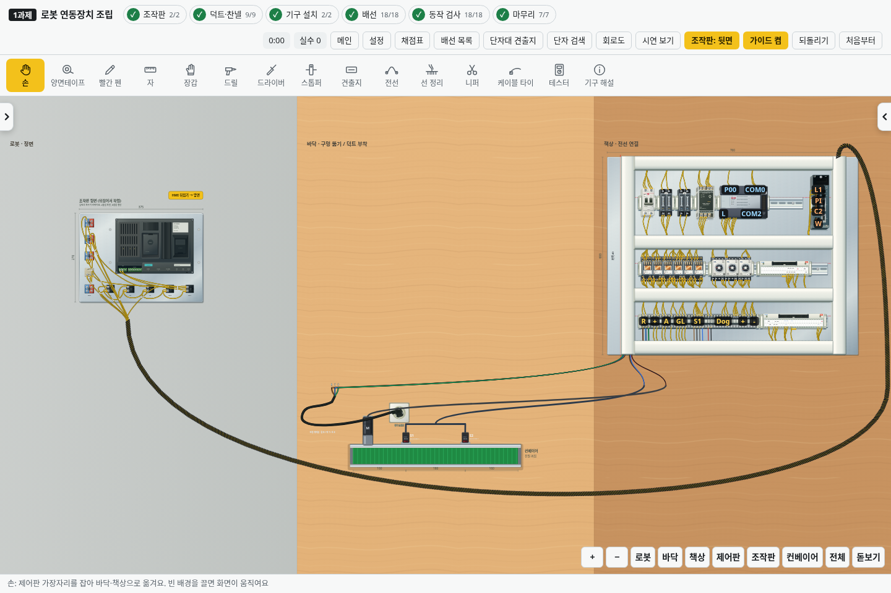

# v2.37.1 · 오른쪽 위 출구에서 HMI 아래로 도는 다발

완성된 외부 배선은 **아래 단자대(TB) → 아래 덕트 → 오른쪽 세로 덕트 → 오른쪽 위 출구 → 제어판 바깥의 큰 곡선 → HMI 아래** 순서로 이어집니다. 밴드는 출구에서 나온 전선 다발과 같은 곡선을 감쌉니다. 제어판 위나 작업 공간 가운데를 직선으로 가로질러 HMI 단자에 꽂힌 것처럼 보이던 경로를 수정했습니다.

로봇과 제어판 사이 거리, 제어판 이동, 조작판 앞·뒷면에 맞춰 경로를 계산합니다. 큰 곡선은 제어판 바깥과 컨베이어 아래를 지나 HMI 아래에서 올라옵니다. 밴드를 감기 전의 늘어진 선, 감는 중, 감은 뒤 출구로 정리하는 조작은 유지합니다. 위쪽 출구를 누를 때 제어판을 들어 올리는 동작이 먼저 실행되지 않도록 했습니다.

전기 연결과 채점 규칙은 유지합니다. 기준 배선의 HMI +24V는 TB 5번에서 SS·부저·WL1 공통선을 거쳐, 0V는 TB 6번에서 표시등 공통선을 거쳐 연결됩니다. 기존 저장은 감긴 상태와 연결 관계를 유지하고, 외부 다발에 걸린 타이 위치만 새 곡선으로 한 번 맞춥니다.

검사는 바닥·책상·높이가 바뀐 세 위치에서 단자대 연결, 위쪽 출구, 제어판 바깥 경유, HMI 아래 도착, 밴드와 전선의 같은 경로, 앞·뒷면 전환을 확인합니다. 실제 포인터로 출구를 눌러 정리하고 저장·재실행한 뒤에도 감긴 상태가 유지되는지 검사합니다. 기존 램프 옆 진입, 밴드로 덮인 구간 고정, 타이 이동, 시연과 회로·채점 검사도 함께 사용합니다.
