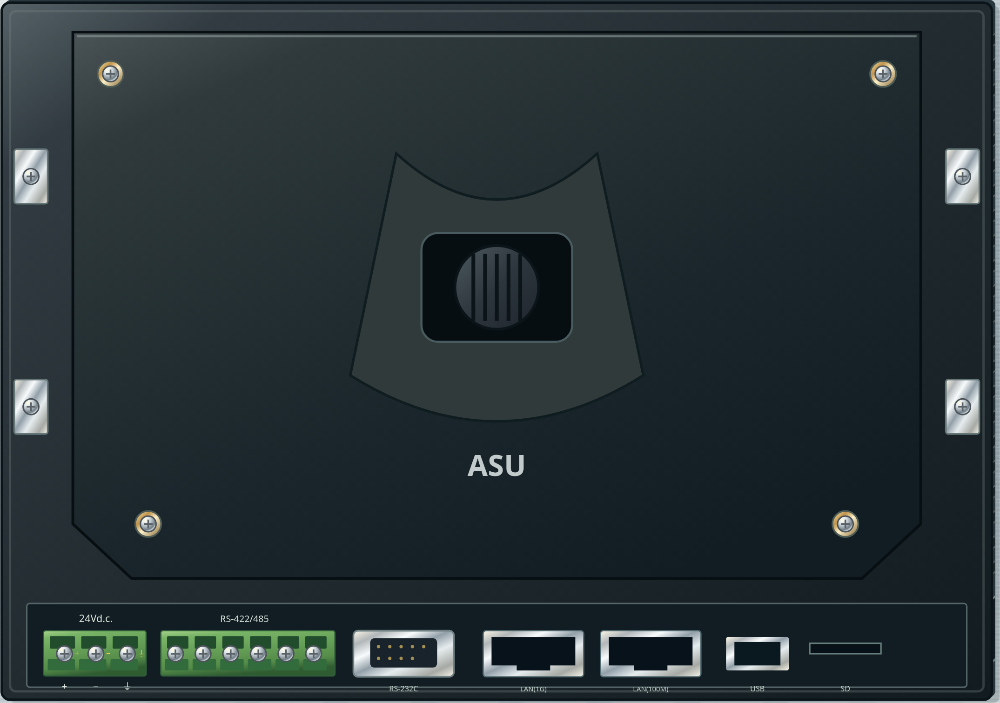
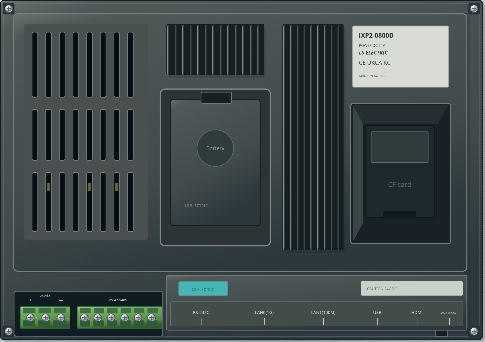
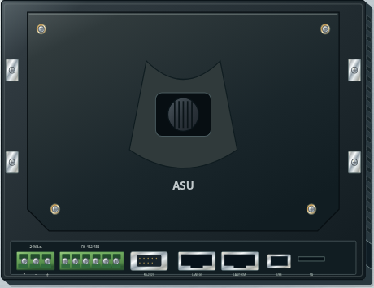
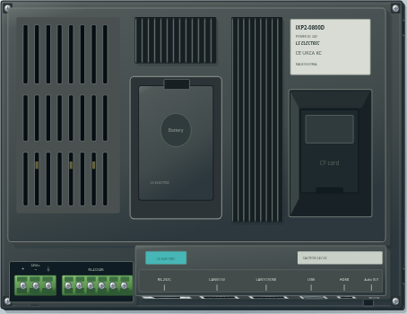
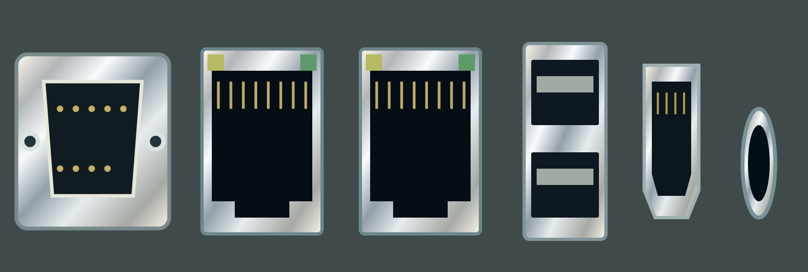

# v2.31.1 · LS iXP2-0800D 실제 뒷면

거치대를 벗긴 HMI의 뒷면·커넥터 면·좌우 사선 사진 다섯 장을 기준으로 교체했습니다. v2.31.0에서는 외부 거치대의 큰 금속판과 잠금 손잡이를 HMI 본체로 잘못 그렸습니다. 이번 그림은 거치대를 포함하지 않은 본체입니다.

아래쪽에 커넥터가 오는 방향으로 사진을 맞춰 배치했습니다.

| 위치 | 반영 |
|---|---|
| 왼쪽 뒷면 | 긴 통풍 슬롯 여덟 줄과 두 가로 지지대, 틈으로 보이는 내부의 어두운 공간 |
| 가운데 | 배터리 덮개·걸림턱과 성형 테두리, 위쪽의 짧은 방열 핀과 오른쪽의 긴 방열 핀 |
| 오른쪽 | iXP2-0800D 명판과 깊게 들어간 CF카드 공간, 안쪽 덮개 |
| 아래 왼쪽 | 낮게 들어간 녹색 3극 DC 전원 단자와 6극 RS-422/485 단자 |
| 아래 측면 | 고정 나사가 있는 9핀 RS-232C, LAN0(1G)·LAN1(100M), 위아래 USB 두 개, HDMI와 원형 오디오 출력 |
| 외장 | 무광 성형 플라스틱의 미세 질감, 낮은 고정 플랜지·네 고정 나사·체결 턱과 높은 본체 사이의 단차 |

새 사진에서 확인되는 HDMI·오디오 포트를 넣고, USB를 두 개로 수정했습니다. 이전 그림에 있던 SD 슬롯 표시는 CF카드 공간으로 바로잡았습니다. 명판은 제품명·전원·제조사 등 읽을 수 있는 공통 내용을 사용하며, 기기 일련번호나 QR코드를 새로 만들어 넣지 않습니다.

## 높이와 배선

기존 조작판 크기와 HMI 설치 영역, 단자 ID·전기 연결·전원 단자 좌표를 유지합니다. 그림에서 고정 플랜지는 높이 16, 본체 뒷면은 48, 방열 핀은 51, 전원 단자 홈은 38로 나눠 투영합니다. 이 숫자는 게임의 표시용 근사 높이입니다.

전원 나사와 전선 끝은 낮은 단자 홈의 표면을 함께 따라갑니다. 클릭도 보이는 단자 위치에서 원래 작업 좌표로 돌아옵니다. 커넥터의 실제 입구는 뒷면 평판에 그리지 않고 아래쪽 측면에 배치했으며, 아래에서 보는 시점에서 드러납니다. 기존의 부품 가림 순서와 바닥 고정·윗면 이동 방식을 사용합니다.

배터리와 CF카드 덮개는 외형 표현입니다. 이 변경은 새 배터리·저장장치 작업이나 통신 케이블 연결 기능을 추가하지 않습니다.

## 실제 화면

| 시점 | 변경 전 | 변경 후 |
|---|---|---|
| 뒷면 확대 |  |  |
| 아래쪽 측면 |  |  |

아래는 측면에 사용하는 포트 그림을 정면으로 펼쳐 확대한 검증용 이미지입니다. 게임의 시점 기울기를 바꾼 화면은 아닙니다.

## 검사

실제 HMI 전원 단자 세 개에서 나사 그림·전선 쪽 나사·투영 위치의 일치와 역변환을 좌우·위아래 시점에서 검사합니다. 단자 홈의 높이가 본체보다 낮은지, 포트 면이 아래쪽 시점에서 보이는지와 포트 종류·USB 개수를 확인합니다. 실제 화면에서 전원 +단자를 눌러 배선 대상으로 선택하고, 기존 기준 회로가 통과하는지도 확인합니다.

기존 기준 배선·채점, 모든 기구의 투영·저장 상태 유지, 조작판 뒷면 경계, 단자대·SMPS·조작판 단자 정렬, 기구 해설과 Electron 실행·저장 복원 검사를 함께 수행했습니다. 저장 형식은 VERSION 11을 유지합니다.
