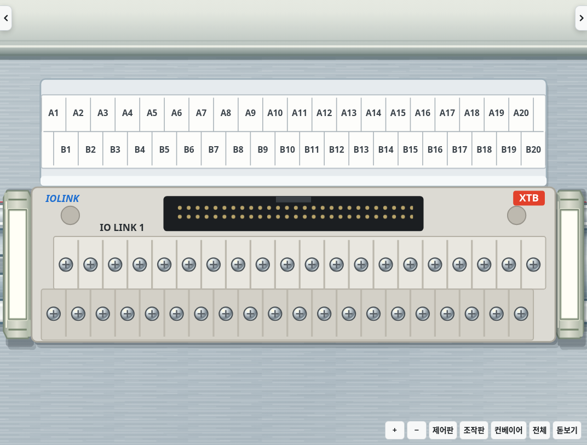
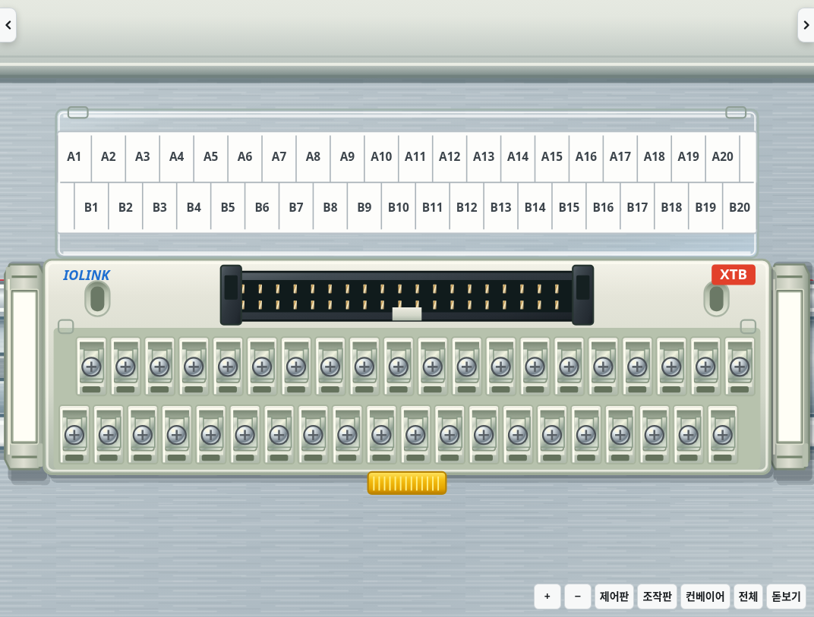
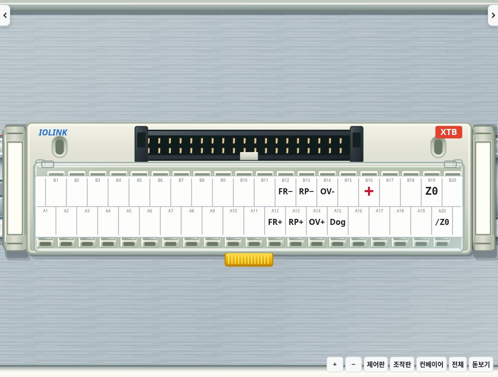
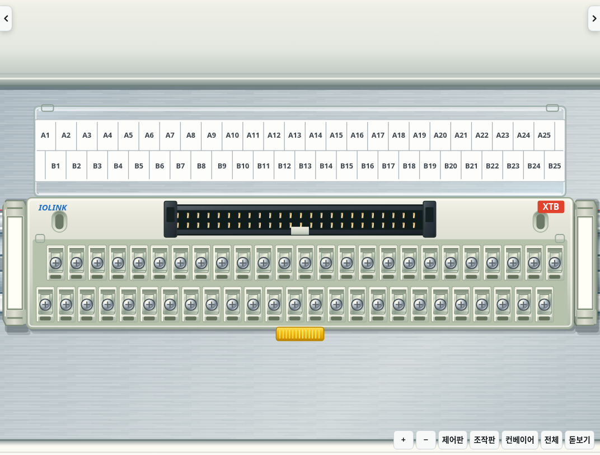
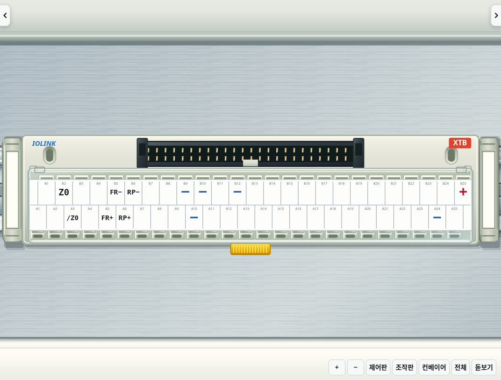

# v2.28.0 · 사용자 사진 기준 IO링크

이번 대화에서 제공된 제품 사진 3장(커버 닫힘, 커버 열림, 커넥터 쪽 뒷모습)을 외형 기준으로 사용합니다. 기존 게임 그림이나 생성된 표지를 실물 사진으로 취급하지 않습니다. 사진 속 인증 마크는 제품 주변에 배치된 설명 이미지이므로 부품에 새로 그리지 않습니다.

| 사진에서 보이는 구조 | 기본 작업 화면 반영 |
|---|---|
| 회백색 성형 몸체와 양 끝 고정 홈 | 부드러운 플라스틱 면과 외곽, 타원형 고정 홈 |
| 두 줄의 은색 나사 단자 | 각 단자의 움푹한 칸막이, 금속 조임판·나사·전선 입구 |
| 뒤쪽 검정 다핀 커넥터 | 40핀/50핀 두 줄 접점과 양 끝의 고정 귀, 가운데 키 홈 |
| 투명 힌지 커버와 두 줄 견출지 | 투명 가장자리·반사·힌지, 열림/닫힘 표시, 기존 A/B 단자 번호와 사용자 신호 표기 |
| 아래로 나온 노란 레버 | DIN 찬넬 고정 레버와 손으로 잡는 요철 |

사진의 사선 원근을 그대로 배경에 붙이는 방식 대신 기본 시뮬레이터의 위에서 보는 시점에 맞춰 그립니다. 기존 단자와 클릭 좌표, 7mm 간격, 반 칸 어긋난 A/B 두 줄, 배선과 덮개 동작은 유지합니다. 얕은 옆면은 기존 설정을 사용하며 이번 변경은 정면 자체의 구조와 재질을 개선합니다.

입체 효과를 끈 동일한 작업 상태·카메라에서 촬영한 실제 화면입니다.

40핀, 수정 전:

40핀, 커버 열림:

40핀, 커버 닫힘:

50핀, 커버 열림:

50핀, 커버 닫힘:

두 기구의 원래 커버 좌표를 실제 클릭해 열림/닫힘과 저장 복원을 확인합니다. 40/50개 단자 표시, 전기 단자 좌표와 작업 배선 유지, 완성 회로 검사도 함께 확인합니다. 재료함·바닥·손에 든 미리 보기에도 같은 부품 그림을 사용합니다.
