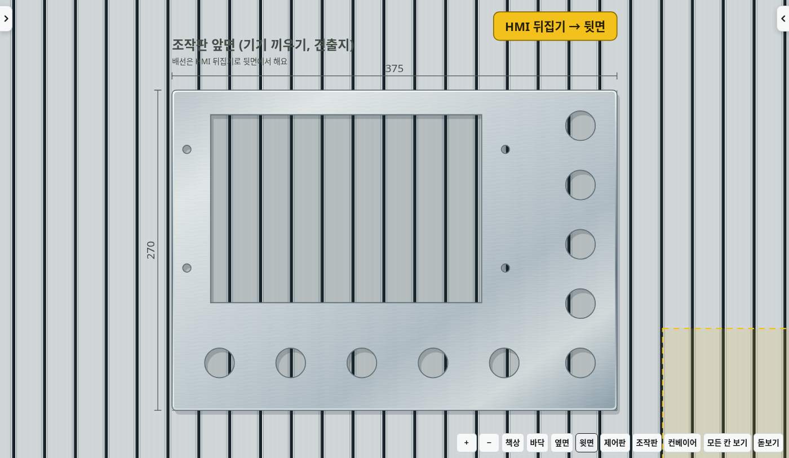
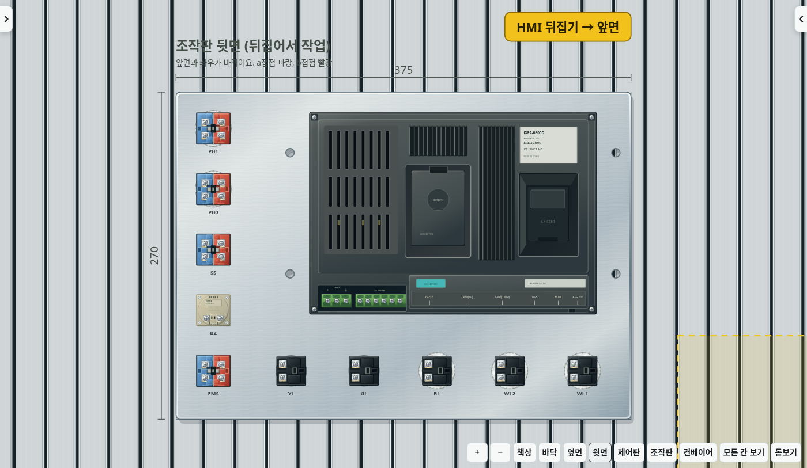

# HMI 철판 조립 순서 · 웹 수정

2026-11-18 웹 링크에 반영하는 변경입니다. Windows 설치 파일과 앱 자동 업데이트는 v2.51.0을 유지합니다.

## 작업 순서

1. 준비 시간에 HMI 철판, HMI, 기구 본체, 은색 고정 링 10개, 비상정지 캡 1개를 로봇 책상 윗면에 놓습니다.
2. 작업을 시작하고 **아직 지지대에 부착하지 않은 철판**에 HMI와 기구 본체를 끼웁니다.
3. 철판을 뒤집고 각 본체의 은색 고정 링을 뒷면에서 체결합니다.
4. 앞면으로 돌려 고정한 비상정지 본체에 빨간 캡을 끼웁니다.
5. 조립한 철판의 빈 부분을 집어 상판 지지대에 부착합니다. 이후 뒷면에서 배선합니다.

본체, 링, 캡은 각각 별도 재료입니다. 본체가 없는 구멍에 링을 체결하거나, 링 체결 전에 비상정지 캡을 끼우거나, 미완성 철판을 지지대에 부착할 수 없습니다. 분해할 때는 비상정지 캡 → 뒷면 고정 링 → 본체 순서입니다. 고정 링은 뒷면의 은색 테두리를 손 도구로 누르면 풀립니다. 연습 안내와 시연도 이 순서를 따릅니다.

## 표현과 저장

- HMI 사각 개구부와 원형 구멍은 모든 철판 재질 레이어에 실제로 뚫려 있어 아래 상판 무늬가 이어집니다.
- 알루미늄 프로파일은 어두운 T홈 안쪽, 밝은 양쪽 턱, 평평한 은색 면으로 표시합니다. 깊이 방향 부재도 같은 소실점과 직각 접합을 유지합니다.
- 조립 중인 느슨한 철판과 별도 부품의 저장·복원·되돌리기를 지원합니다.
- 이전 저장 파일의 설치된 기구는 링과 캡이 체결된 상태로 이어집니다. 준비 중인 기존 기구 세트는 별도 링·캡으로 한 번만 분리하며 원래 재료 ID와 배선·검사 기록을 보존합니다.
- 제어판·조작판 치수와 배선 단자명, 기존 30점 채점 체계는 유지합니다.

## 업데이트 운영

기본 작업은 웹 링크 수정입니다. 설치 파일 빌드·새 버전 태그·GitHub Releases·앱 자동 업데이트 게시 작업은 사용자가 명시적으로 요청할 때만 진행합니다. 웹 수정 시 Windows 빌드를 자동으로 실행하던 트리거를 제거했습니다.

## 확인

Chromium에서 관련 회귀 확인 23개를 통과했습니다. 실제 포인터 조립·분해·미완성 부착 차단·저장 복원·이전 저장 호환, 구멍의 투명도, 준비·시험·첫 연습·시연 순서, 30점 기준 회로, 프로파일 직각 접합, 화면 비율·프레임 전달을 확인했습니다. 설치 파일 빌드와 Windows 검사는 이번 웹 수정에서 실행하지 않습니다.
