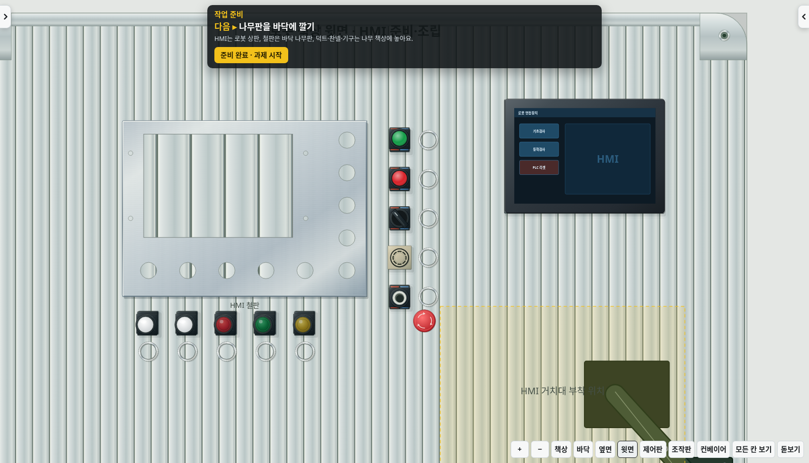
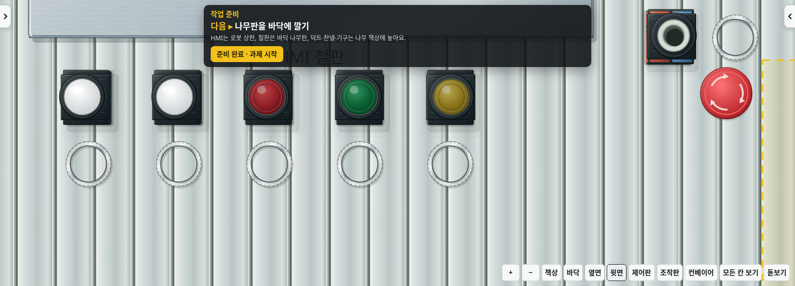

# v2.51.0 · 사진 기준 조작 기구 준비

사용자가 제공한 조립 전 사진을 기준으로 표시등·버튼·셀렉터·부저·비상정지의 준비 모습과 조립 후 전면을 다듬었습니다.

| 부품 | 표현 |
| --- | --- |
| 표시등 5개 | 백색 2개·적색·녹색·황색, 검은 사각 몸체와 원통형 목, 둥근 렌즈, 몸체 아래에 분리된 은색 고정 링 |
| 녹색·적색 버튼 | 평평한 색 버튼과 검은 베젤, 아래쪽 적색·청색 접점 블록, 오른쪽 고정 링 |
| 셀렉터 | 검은 돌출 손잡이와 밝은 방향 표시선, 나사산과 접점 몸체 |
| 부저 | 베이지색 사각판, 원통형 몸체와 둘레의 소리 구멍 |
| 비상정지 | 준비 중에는 흰 작동부가 드러나며 빨간 버섯형 캡은 따로 놓임. 조립 후에는 캡을 결합한 모습 |
| 고정 링 | 가운데가 실제로 뚫린 은색 링, 바깥쪽 미끄럼 방지 홈과 얇은 두께 |

## 조작

기구 본체·고정 링·분리된 비상정지 캡은 **한 기구 세트**입니다. 어느 쪽을 집어도 함께 들고 움직이며, 수량은 기존과 같습니다. 조작판의 맞는 구멍에 놓으면 기구를 끼우고 링을 함께 체결합니다. 뒷면에는 체결된 고정 링이 보입니다. 부품 선택·반납·설치·분리·되돌리기와 자유·시험·연습의 기존 작업 순서를 사용합니다.

겹침 판정은 분리된 링과 비상정지 캡까지 포함합니다. 배경은 링 구멍을 통해 보이며, 접촉 그림자는 본체·링·캡이 놓인 위치에만 표시합니다. 재질·옆면 세부·그림자·입체 효과를 끄는 설정도 적용합니다.

## 저장과 검증

이전 버전에서 촘촘히 꺼내 둔 기구는 새 외곽끼리 겹치지 않도록 한 번만 정리합니다. 기구 ID·수량과 다른 재료 위치, HMI 철판·준비 진행은 유지하며 다시 열어도 반복 이동하지 않습니다. 설치한 기구의 구멍·단자 ID·단자 좌표·배선과 채점 회로는 유지합니다.

실제 v2.50.0 준비 저장의 변환, 링과 캡을 실제 클릭해 집기·반납·재배치, 설치 후 뒷면 단자 선택·분리·저장 복원을 검사합니다. 기존 전기 동작·채점·고장 실습·카메라·프레임 전달·Windows 앱 검사도 수행합니다.
