# v2.31.0 · 부품 가림 순서와 조작판·단자대

HMI 뒷면의 외형은 거치대를 벗긴 사진이 추가된 뒤 [v2.31.1의 실제 본체](hmi-real-back.md)로 교체했습니다. 아래 HMI 그림은 v2.31.0 당시의 비교 기록입니다.

## 앞뒤 가림

기존에는 스토퍼를 먼저 그리고 모든 기구를 나중에 그렸습니다. 이 순서 때문에 가까운 스토퍼가 뒤쪽 기구의 옆면에 가려졌습니다. 스토퍼를 무조건 마지막에 그리는 방식도 반대 시점에서는 틀리므로, 설치 위치와 높이·현재 시점을 함께 사용합니다.

덕트·찬넬·스토퍼·설치 기구·서보·콘센트를 독립된 SVG 부품으로 나눴습니다. 조작판 뒷면과 바닥의 부품들도 같은 방식으로 순서를 계산합니다. 높이를 반영한 투영 외곽이 실제로 겹치는 부품을 찾고, 겹치는 지점에서 시선이 먼저 만나는 부품을 뒤에 그립니다. 부품을 나타내는 사각 기둥의 높이 범위를 사용하며, 소켓 위 본체나 돌출 전면처럼 겹쳐진 층도 포함합니다. 전선·덕트 이빨·커버의 기존 별도 겹침 처리는 유지합니다.

클릭 판정도 단순히 전체 높이가 가장 큰 기구를 고르지 않습니다. 클릭 지점에서 실제로 보이는 면의 깊이로 대상을 고릅니다. 이 때문에 낮은 스토퍼가 높은 기구의 아래쪽 옆면을 가리는 경우에도 스토퍼를 누를 수 있습니다.

같은 시점과 설치 상태의 계산 결과를 재사용합니다. SVG 부품을 삭제하고 다시 그리지 않고 필요한 경우 순서만 옮깁니다.

| 시점 | 변경 전 | 변경 후 |
|---|---|---|
| 오른쪽: 스토퍼가 POS 옆면 앞에 보여야 함 | 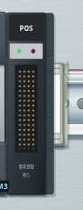 | 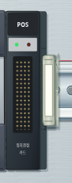 |
| 왼쪽: POS 앞면이 겹치는 부분을 가려야 함 | 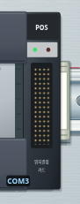 | 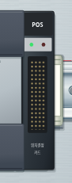 |

## SMPS 투명 보호판

SMPS **위쪽 출력 단자 보호판과 아래쪽 입력 단자 보호판**을 손 도구로 누르면 각각 열리고 닫힙니다. 경첩은 두 단자 줄의 **안쪽 가장자리**에 있습니다. 위 보호판은 아래쪽 가장자리, 아래 보호판은 위쪽 가장자리를 축으로 삼아 가운데 쪽으로 젖혀집니다. 전선 도구를 들고 있어도 보호판을 누를 수 있고, 선택 중인 전선은 유지합니다.

닫힌 보호판은 나사·압착단자·전선 끝 위에 투명하게 겹쳐집니다. 닫힌 쪽 단자에는 연결·분리·다시 꽂기·전선 자르기를 통한 배선 변경이 막히며, 해당 보호판을 열어야 한다고 안내합니다. 반대쪽 열린 보호판의 단자는 계속 작업할 수 있습니다. 보호판 개폐는 전기 연결과 전원 상태를 바꾸지 않습니다.

개폐 상태는 저장·되돌리기에 포함합니다. 이전 저장에 이 정보가 없으면 위·아래를 열린 상태로 시작하여 기존 작업을 계속할 수 있게 합니다. 새로운 채점 필수 조건을 추가하지 않습니다.

| 열림 | 닫힘 |
|---|---|
| 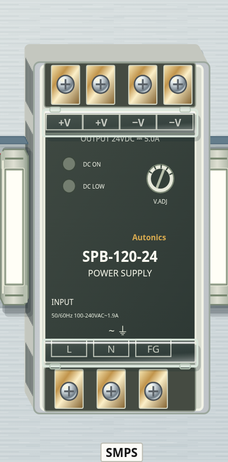 | 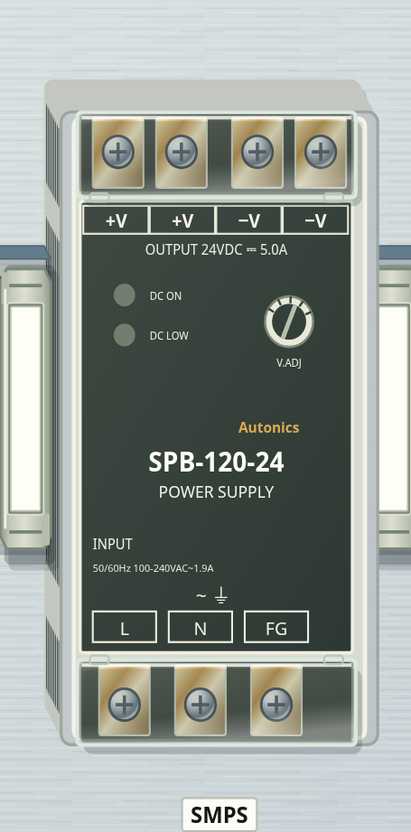 |

## 조작판 뒷면 실물 사진

사용자가 제공한 다섯 사진에서 확인되는 형태를 반영했습니다.

| 부품 | 반영 |
|---|---|
| 스위치 접점 | 왼쪽 파랑 a접점·오른쪽 빨강 b접점, 네 금속 나사 받침, 성형 칸막이·원형 금형 자국·중앙 작동부 |
| 표시등 소켓 | 검정 절연 몸체, 왼쪽 두 나사 단자, 중앙 사각 체결부와 고정 턱. 뒷면의 색 원판 제거 |
| 부저 | 베이지색 사각 고정판과 네 고정 나사, 원통형 몸체·테두리 슬롯, 두 금속 단자와 중앙 두 구멍, 극성·명판 |
| HMI | 넓은 검정 금속 커버·중앙 지지판과 잠금 손잡이, 측면 고정 브래킷, 초록 전원·통신 단자, 금속 직렬 포트와 두 네트워크 포트·USB·메모리 슬롯 |

회로 기호와 단자 ID·기존 단자 좌표를 유지합니다. 사진에 맞춰 외형을 그리되 현재 작업판의 조작 크기에 맞춰 작은 글자와 일부 비율을 조정합니다.

변경 전:

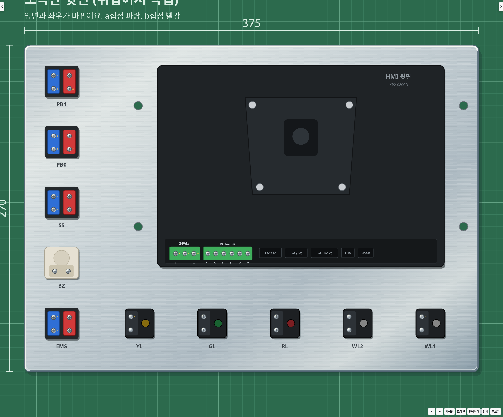

변경 후:

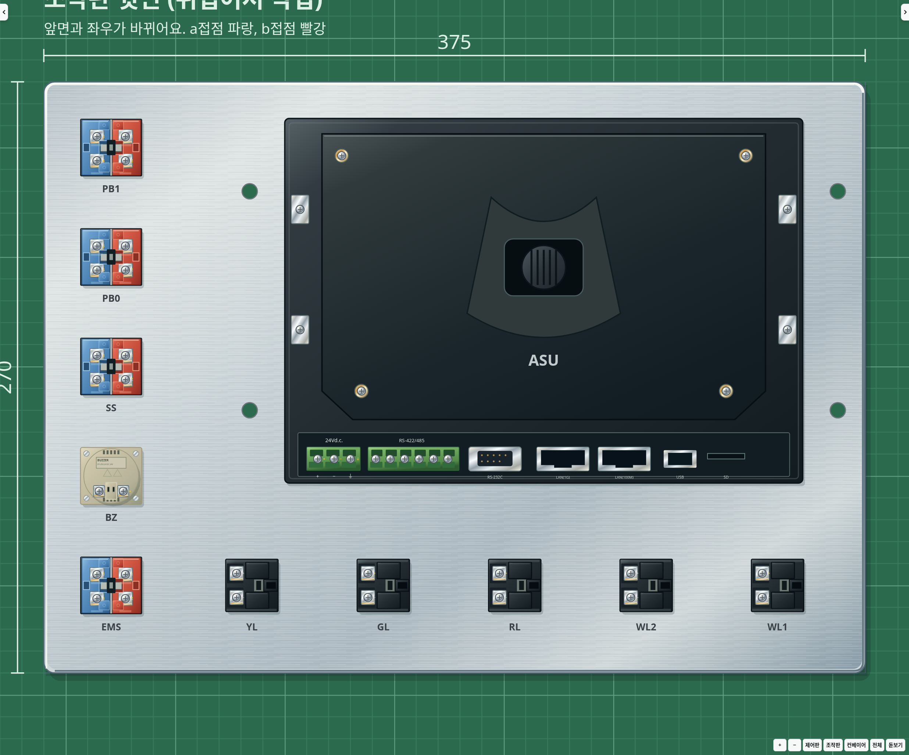

| 접점 블록 | 표시등 소켓 | 부저 |
|---|---|---|
| 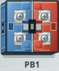 | 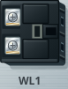 | 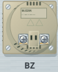 |

## 40P 단자대

추가로 제공된 세 제품 사진의 검정 절연 외장·단자 칸막이·황동 받침·은색 조임판·나사·가운데 흰 견출지·투명 보호 커버를 반영했습니다. 사진의 10P·20P 형태를 현재 게임의 40P 길이에 맞춰 반복하며, 단자 수·간격과 편집 가능한 견출지 기호는 유지합니다.

몸체 높이와 시점에 따라 보이는 측면의 전선 입구, 커버의 얕은 두께와 빛 반사를 표현합니다. 투명 커버는 몸체에 붙어서 움직이고, 전선 끝은 커버 아래의 실제 나사 위치를 따라갑니다. 기존 커버 탈착·견출지 편집·단자별 연결 기능을 사용합니다.

| 상태 | 변경 전 | 변경 후 |
|---|---|---|
| 열린 단자대 | 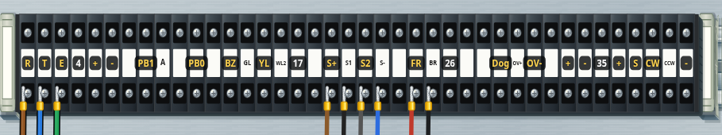 | 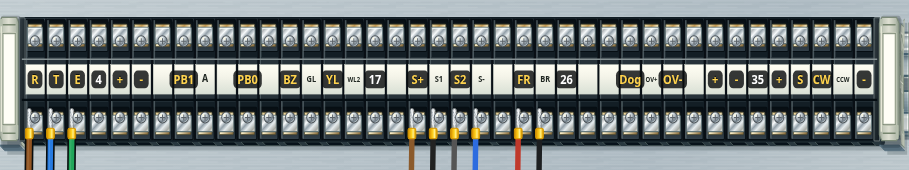 |
| 투명 커버 장착 | 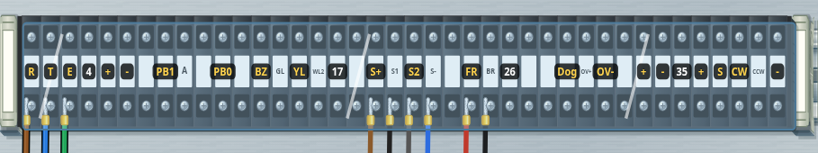 | 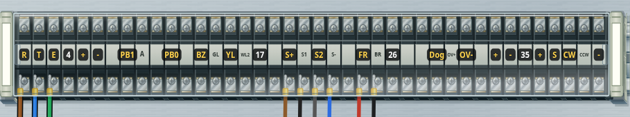 |

## 검사

좌우·위아래 여섯 시점에서 실제 SVG의 앞뒤 순서와 클릭 대상을 확인합니다. 스토퍼가 가까울 때는 스토퍼를 실제 클릭해 분리하고 되돌립니다. 같은 화면을 다시 그릴 때 부품을 불필요하게 옮기지 않는지도 검사합니다.

SMPS 보호판의 독립 조작·배선 잠금·선택 중인 전선 유지·되돌리기·저장 복원·이전 저장의 기본값을 검사합니다. 단자대·SMPS·조작판 단자에서는 나사 그림과 전선 쪽 나사 그림의 화면 좌표가 일치하는지 확인합니다. 기존 회로·고장·채점·저장·랭킹·입력 처리 회귀 검사와 Electron 실행 검사도 수행합니다. 저장 형식은 VERSION 11입니다.

전체 자동 검사 109개와 Electron 실행·저장 복원 검사를 통과했습니다. 안쪽 경첩의 연결 위치와 개폐 방향, 앞뒤 순서 재사용과 실제 동작 중 갱신도 추가 검사했습니다. 합성 화면 이동 입력 120개는 카메라 적용 1회·viewBox 쓰기 1회·작업판 크기 재조회 0회였고, 동작 버튼 20회에서도 배선 경로 재계산은 0회였습니다. 이는 작업 횟수 확인이며 화면 FPS 보장은 아닙니다.
