# v2.30.0 · 사진 기준 기구 정면과 옆면

사용자가 대화에 제공한 일곱 장의 제품 사진을 기준으로 기본 시뮬레이터의 SVG 기구를 다시 그렸습니다. 별도 작업실이나 엔진을 추가하지 않습니다. 외부 사진의 판매점 워터마크, 설명용 번호·화살표는 부품에 그리지 않습니다.

| 사진 | 반영한 정면 | 반영한 옆면 |
|---|---|---|
| MCB.png, MCB2.jpg · LS BK63H | 회백색 2극 몸체, 네 원형 단자 자리, 빨간 명판 띠와 LS 표시, 두 검정 스위치와 이를 연결하는 회색 손잡이 | 꺾여 이어지는 성형 홈·이음선과 원형 성형 자국 |
| PLC.jpg, PLC2.jpg · LS XGB | 매끈하고 넓은 짙은 회색 단자 덮개, 연한 중앙 명판, 왼쪽 OPEN 덮개, IN/OUT·PWR/RUN/ERR 표시 | 연한 외장, 아래쪽 가로 통풍 격자·지지대, 측면 라벨 자리와 상부 슬롯 |
| PS1.webp · Autonics SPB-120-24 | 위 네 단자·아래 세 단자, 투명 보호판과 빛 반사, 짙은 명판, DC ON/DC LOW·조절 다이얼, 출력·입력 표시 | 위·중앙·아래로 나뉜 긴 세로 통풍 슬롯과 성형 경계 |
| SD.jpg, SD2.gif · LS L7S | 검정 조작부, CHARGE·주의 표시·USB, 주황 레버와 검정 전선 구멍, 두 통신 포트, 나사 고정부가 있는 금속 CN1/CN2, 아래 모터 단자와 접지부 | 촘촘한 세로 방열 슬롯, 사진에 보이는 왼쪽 면의 밝은 명판, 상부 통풍 패턴과 아래 방열 구조 |

통풍구를 정면 명판이나 단자 덮개에 임의로 더하지 않습니다. 사진의 명판·몸체·구멍 위치와 큰 형태를 따르며, 얕은 시점에서도 보이도록 일부 선 굵기와 작은 글자 크기는 조정합니다. 사진에 드러나지 않은 내부 구조를 재현하는 CAD 모델은 아닙니다.

PLC 사진의 외관 표기는 XBC-DR32H입니다. 이번 변경은 외형이며, 기존 시뮬레이터에서 사용자가 정한 단자 기호·배열·전기 판정은 유지합니다. 이 단자표를 제조사 DR32H의 공식 핀 배치로 바꾸는 작업은 포함하지 않습니다.

## 옆면 표시

v2.29.0의 고정된 바닥과 이동하는 윗면 방식을 유지합니다. 옆면 세부 그림도 그 두 가장자리 사이의 면에 놓습니다. 좌우 시점에서 통풍구가 뒤로 떠 있거나 정면 바깥에 독립된 줄무늬처럼 남지 않습니다. 왼쪽에 표시하는 명판의 글자 방향도 뒤집히지 않습니다.

옆면의 슬롯·홈 SVG 노드는 생성 후 재사용합니다. 카메라를 움직일 때 옆면의 변환만 갱신하며, 통풍구 전체를 매번 삭제하고 다시 만들지 않습니다. 설정에서 입체감을 끄면 옆면과 윗면 이동이 함께 사라집니다.

## 실제 화면

아래는 같은 설치 상태에서 배선을 숨겨 기구 외형을 비교한 화면입니다. 단자 안내 표시는 기존 시뮬레이터 기능입니다.

| 기구 | 변경 전 | 변경 후 |
|---|---|---|
| 차단기 · 오른쪽 시점 | 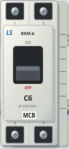 | 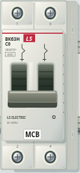 |
| SMPS · 오른쪽 시점 | 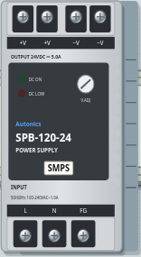 | 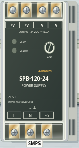 |
| PLC · 왼쪽 시점 | 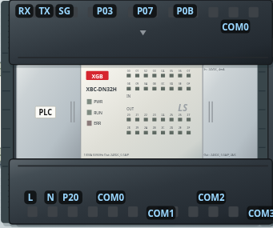 | 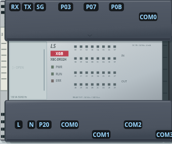 |
| 서보 · 왼쪽 시점 | 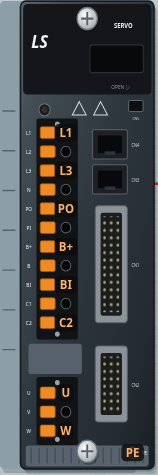 | 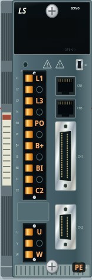 |

반대쪽 시점도 같은 방식으로 확인했습니다.

| 차단기 · 왼쪽 | SMPS · 왼쪽 | PLC · 오른쪽 | 서보 · 오른쪽 |
|---|---|---|---|
| 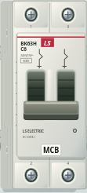 | 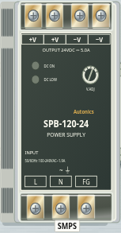 | 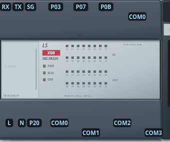 | 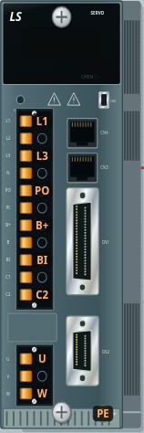 |

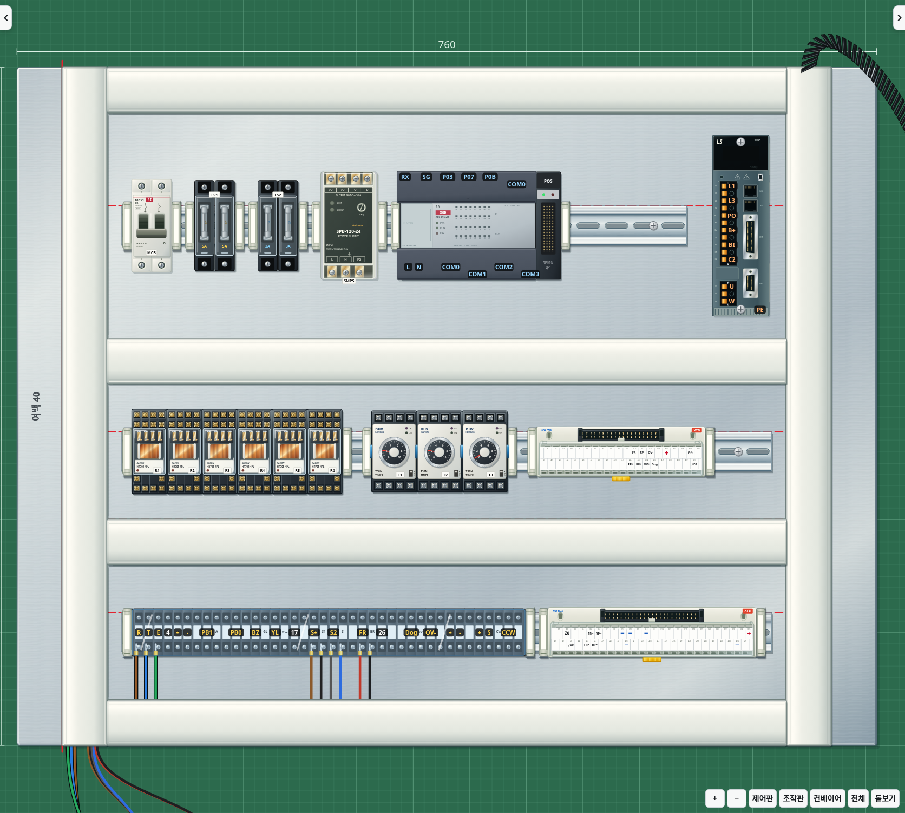

## 확인

좌우 시점 각각 두 위치에서 옆면 세부 그림의 양 끝이 윗면·고정된 바닥 가장자리에 맞는지 수치로 검사합니다. 카메라 이동 때 옆면 SVG 노드를 재사용하고 저장 상태·단자 좌표를 유지하는지도 확인합니다. 확대된 차단기 손잡이와 PLC 덮개를 실제 표시 위치에서 눌러 동작시키며, 덮개를 닫으면 배선 변경이 막히고 열면 가능해지는 것을 검사합니다.

기존 회로·컨베이어·고장·채점·배선·저장·랭킹을 포함한 자동 검사 106개와 Electron 오프라인 실행·저장 복원 검사를 통과했습니다. 추가로 위아래 시점의 상부·하부 면 연결도 확인했습니다. 화면 이동 합성 입력 120개는 카메라 적용 1회·viewBox 쓰기 1회·작업판 크기 재조회 0회였으며, 이는 화면 FPS 측정은 아닙니다. 저장 형식은 VERSION 11을 유지합니다.
