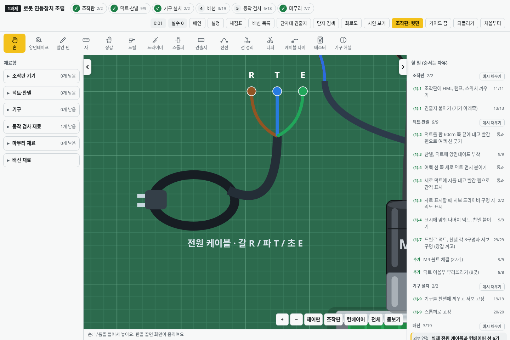
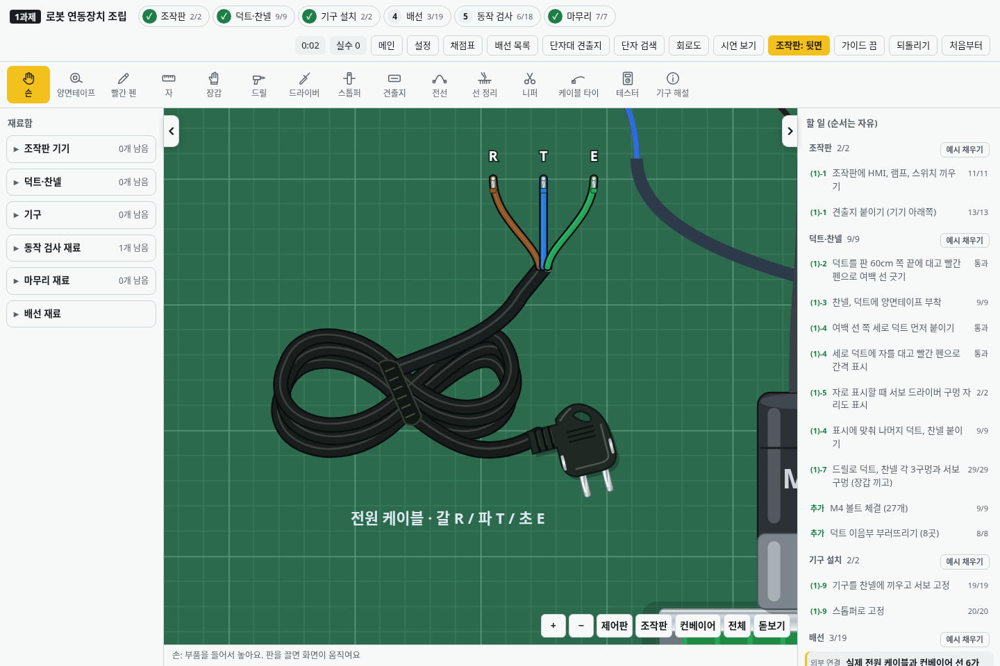

# v2.25.0 · 사진 기준 전원 케이블

사용자가 제공한 검정 전원 코드 사진을 기준으로 기본 시뮬레이터의 외형을 수정했습니다.

- 여러 번 접어 묶은 코드와 중앙 결속 띠, 검정 고무 외피의 얕은 반사광.
- 90도로 꺾인 플러그, 원형 금속 2핀, 잡는 구멍, 몰딩 주름과 옆면 접지 접점.
- 외피에서 갈라지는 갈색 R·파란색 T·초록색 E. 앞서 지정한 색을 유지합니다.
- 작고 가는 선 끝과 R/T/E 표시. 개별 연결 지점은 기존 위치를 사용합니다.

바닥·재료함·들고 놓는 미리보기에 같은 그림을 사용합니다. 플러그를 눌러도 케이블을 집을 수 있도록 본체 선택 범위를 새 외형에 맞췄습니다. 연결과 채점·저장 형식은 바꾸지 않습니다. 외형 표현에 별도 이미지나 라이브러리를 추가하지 않습니다.

## 실제 게임 화면

변경 전:

변경 후:

## 확인

바닥에 놓고 R·T·E를 한 가닥씩 실제 클릭해 연결, 오결선·중복 연결 차단, 연결 일부만 저장하고 복원·되돌리기, 연습과 시연, 기준 회로와 채점 검사 8개를 확인했습니다. 새 플러그 위치를 실제로 눌러 케이블을 집는 동작도 확인합니다. 설치형은 오프라인 실행과 저장·복원·업데이트 검사 및 Windows 패키지 실행 검사를 사용합니다.
