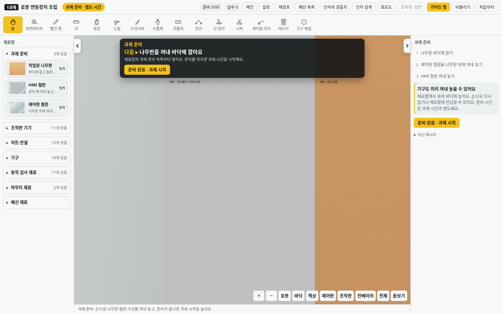
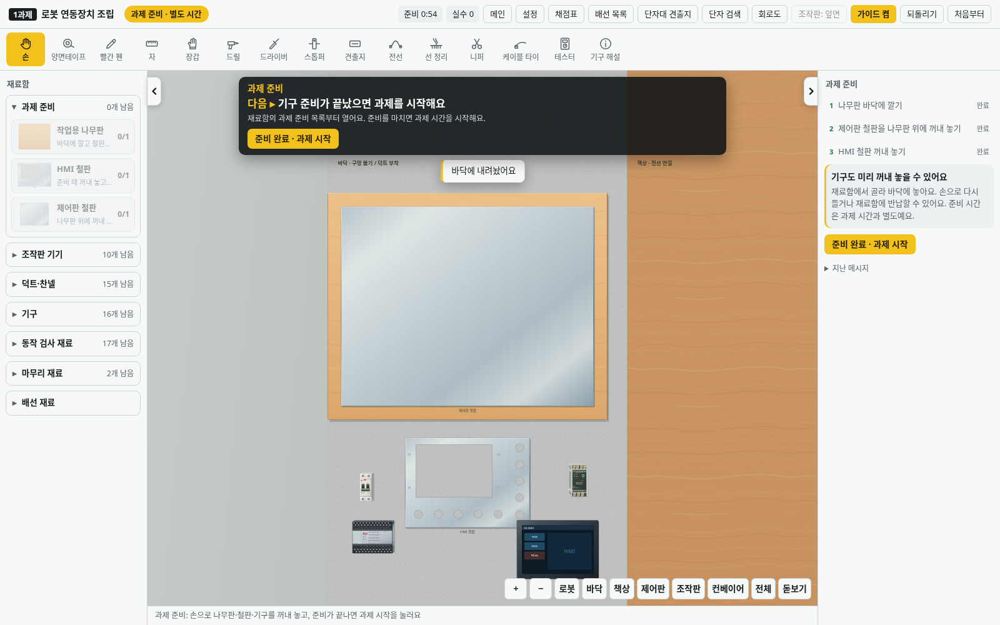

v2.42.0부터 로봇 상판은 로봇 정면의 위쪽에 연결됩니다. 과제 시작 후 바닥의 HMI 철판을 손으로 들고 **상판** 버튼을 누르면, 든 상태로 위쪽 부착 위치를 볼 수 있습니다. [ㄴ자 맵](robot-lmap.md)

# v2.38.0 · 실제 바닥에서 시작하는 과제 준비

새 자유 작업·시험·첫 HMI 연습은 빈 바닥에서 과제 준비를 먼저 합니다. 가운데는 사진의 회색 무늬 타일 바닥으로 바꾸고, 나무판은 재료함에서 꺼내는 별도 재료로 분리했습니다. 왼쪽 로봇의 정면 시점과 오른쪽 나무 책상의 위에서 보는 시점은 유지합니다.

1. 재료함 **과제 준비 → 작업용 나무판**을 골라 가운데 바닥에 깝니다.
2. **제어판 철판**을 꺼내 나무판 위에 놓습니다.
3. **HMI 철판**도 바닥에 꺼내 놓습니다. HMI·PLC·차단기·덕트 등 필요한 기구도 미리 꺼내 둘 수 있습니다.
4. **준비 완료 · 과제 시작**을 누르면 과제 시간을 시작합니다. 바닥의 HMI 철판을 손으로 들어 로봇 상판 위 지지대에 부착하고 HMI 조립을 진행합니다.

| 빈 바닥에서 준비 시작 | 나무판·철판·기구를 꺼내 놓은 상태 |
|---|---|
|  |  |

준비 중에는 손으로 재료를 놓고 다시 들거나 재료함에 반납할 수 있습니다. 나무판과 철판도 다시 옮길 수 있으며, 제어판 철판 전체가 나무판 위에 있어야 준비를 마칠 수 있습니다. 조립·구멍 뚫기·배선은 과제 시작 후 진행합니다. 꺼내 둔 기구는 과제를 시작해도 그 자리에 남습니다. 제어판을 책상으로 옮겨도 나무판은 바닥에 남습니다.

준비 시간은 상단에 따로 표시하며 시험의 3시간 30분과 연습 기록에 합산하지 않습니다. 자유·시험 준비는 자동 저장하고 이어 할 수 있습니다. 기존 저장 작업과 중간 단계 연습·고장 예제는 기존 진행 상태에서 계속하며 바닥의 나무판만 별도 재료로 표시합니다.

바닥 무늬는 작은 SVG 패턴으로 반복하고, 바뀌지 않은 배경은 재사용합니다. 재질·그림자를 끄는 기존 성능 설정도 적용합니다.

검사는 실제 재료함 선택과 포인터로 재료 배치·기구 반납·HMI 철판 이동·HMI 삽입, 준비 완료 조건, 준비 중 도구 제한, 저장·재시작, 시험·첫 연습의 시간 분리, 되돌리기와 재료 수량, 제어판 이동 후 나무판의 고정 위치, 기존 저장 호환을 확인합니다.
