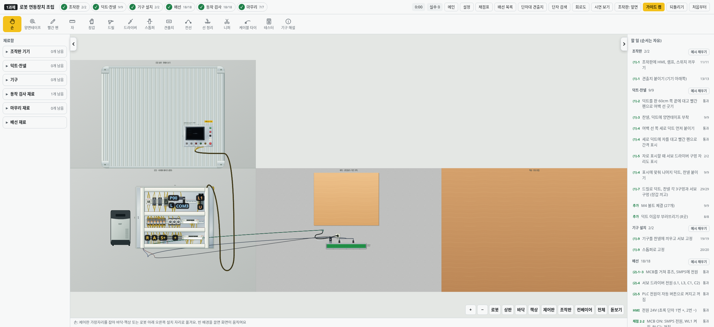
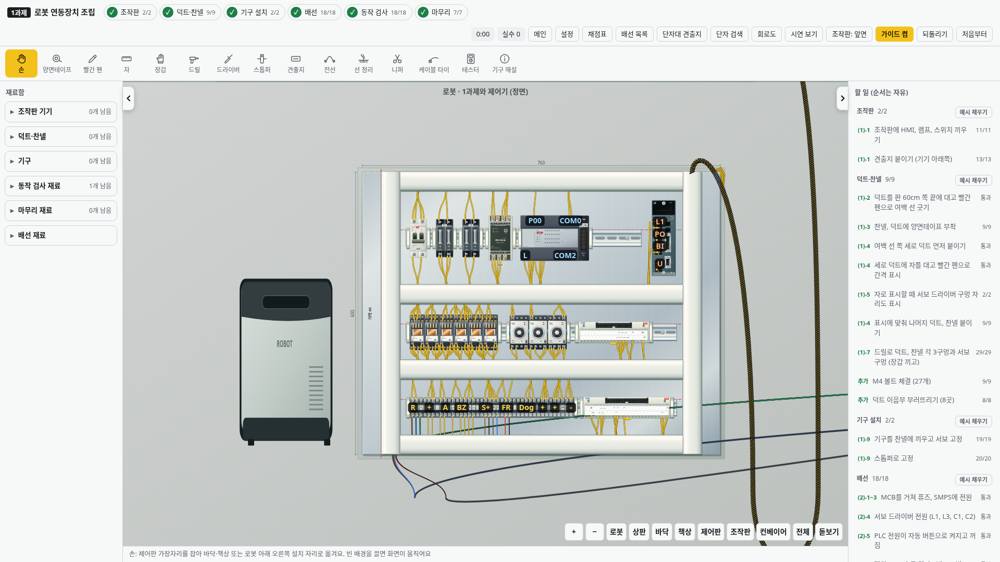
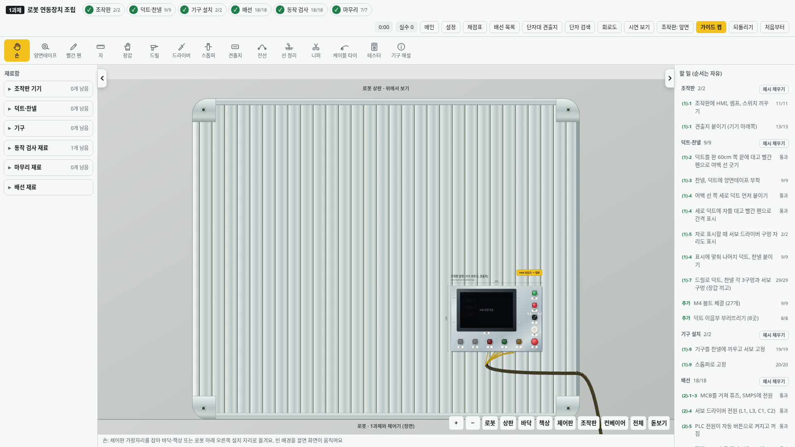

# v2.42.1 · ㄴ자 맵과 로봇의 두 평면

로봇 작업대를 90도로 펼친 두 면으로 표시합니다. 아래는 **1과제와 로봇 제어기를 정면에서 보는 구역**, 그 바로 위는 **책상 상판을 위에서 보는 구역**입니다. 아래쪽 오른편으로 기존 바닥과 배선 책상이 이어져 전체 지도가 ㄴ자가 됩니다.

```text
[로봇 상판 · 위에서 보기]
[로봇 정면] [바닥] [배선 책상]
```



| 로봇 정면 | 위에서 본 로봇 상판 |
|---|---|
|  |  |

정면의 책상 다리·기둥·바닥 케이블 장식은 걷어 내고 1과제와 로봇 제어기만 평면으로 남겼습니다. 설치한 1과제의 최근 크기(1.3배), 제어기의 절반 폭, 기존 조립과 기구 조작은 유지합니다. 상판에는 알루미늄 책상 윗면과 기존 HMI만 표시합니다. 사진처럼 네 바깥 모서리는 둥근 금속 연결판과 육각 볼트로 마감하고, 홈과 테두리도 같은 둥근 윤곽에 맞췄습니다. 유리판·파란 테이프·로봇·고정 장치·지지대 장식은 추가하지 않습니다. 오른쪽 끝 HMI는 상판 구역에 있으며 앞·뒷면과 단자를 그대로 사용합니다.

하단 **로봇**은 정면, **상판**은 위쪽 상판, **바닥**과 **책상**은 기존 작업 구역을 봅니다. **전체**는 위쪽 상판까지 포함한 ㄴ자 지도입니다. 구역 버튼은 카메라만 움직이므로 재료를 들고 누른 뒤 원하는 위치에 놓을 수 있습니다. 화면을 직접 위아래·좌우로 끌어 이동해도 됩니다. HMI 철판은 준비 때 바닥에 꺼내 놓고 과제 시작 후 손으로 들어 **상판** 보기의 HMI 부착 위치에 놓습니다. 1과제는 기존처럼 손으로 가장자리를 잡고 옆 구역으로 옮깁니다.

상판과 정면의 경계는 맞닿으며, 바닥과 배선 책상 위쪽은 작업 구역 바깥입니다. 바닥 재료를 지도 바깥에 내려놓지 않도록 위치도 확인합니다. 구멍 뚫기·덕트 부착은 바닥, 배선 연결은 책상에서 합니다.

기존 저장의 기구·배선·채점·타이·1과제 설치 상태를 보존합니다. HMI의 새 상판 위치에 맞춰 외부 전선 타이의 기준점만 한 번 보정합니다. 외부 다발은 오른쪽 위 출구에서 제어판 바깥을 돌아 HMI 아래로 이어집니다. 상판은 고정 배경이며 새 전기 단자를 만들지 않습니다. 재질과 그림자 끄기 설정도 유지합니다.

검증은 네 구역의 ㄴ자 연결과 빈 위쪽 영역, 상판 맞춤·전체 보기·창 크기 변경, 실제 포인터로 든 HMI 철판과 HMI를 상판에 설치하기, 1과제 이동·저장·되돌리기, 확대된 기구와 그래픽 끄기의 조작 위치, HMI 다발 경로를 확인합니다. v2.41.0에서 설치한 완성 작업을 저장한 뒤 새 버전으로 열어 배선·기구·30점·타이 12개와 바닥 재료 위치가 보존되는지 확인합니다.
