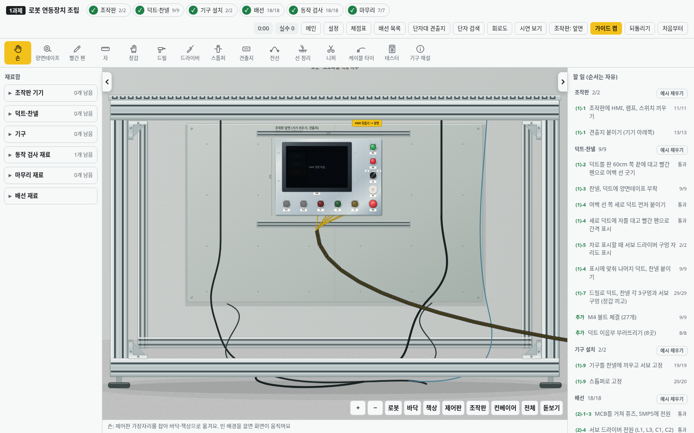
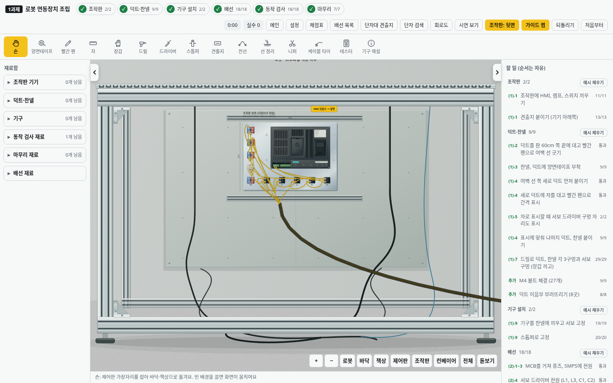

# v2.39.0 · 로봇 프로파일 책상 하부 정면

제공된 세 사진의 알루미늄 프로파일 작업대 아래쪽을 기준으로 로봇 구역을 바꿨습니다. 상판은 위쪽 가장자리만 보이고, 다리·아래 가로대 사이로 뒤 철판과 케이블이 보이는 정면입니다.

- 은색 프로파일의 길게 이어지는 T홈, 금속 반사와 모서리 밝기.
- 상판 앞쪽 단면의 슬롯, 앞·뒤 프레임, 안쪽 보강 브래킷과 연결 볼트.
- 회색 철판의 이음선·장착 구멍·고정 나사와 HMI 뒤쪽 가로 지지대.
- 하단 가로대, 나사식 높이 조절 발, 바닥 접촉 그림자와 아래로 내려오는 케이블.

| HMI 앞면 | HMI 뒷면 |
|---|---|
|  |  |

HMI 철판은 기존 위치에서 조립하고 뒤집으며 배선합니다. 준비 중에는 안쪽 철판과 지지 구조가 먼저 보입니다. 프로파일 책상은 카메라를 움직이거나 제어판을 옆 책상으로 옮겨도 로봇 구역에 고정됩니다. 배경 구조와 그 케이블은 단자·회로·채점 모델에 포함하지 않습니다.

고정 SVG 배경으로 그려 2.5D 기구 투영·단자 선택 계산에 추가하지 않습니다. 재질을 끄면 표면 무늬를 생략하고, 그림자를 끄면 바닥 그림자를 생략합니다. 새 필터·애니메이션·외부 이미지 로드는 추가하지 않습니다.

브라우저에서 준비·앞면·뒷면·그래픽 효과를 모두 끈 화면을 확인했습니다. 시점 변경 후 배경 노드 재사용, 정면 구조의 고정, 작업 상태와 단자 좌표 보존, 포인터 통과, 두 조절 발, 그림자와 재질 끄기를 확인합니다. 기존 구역 화면 맞춤·제어판 이동·HMI 뒷면 단자 클릭 검사도 실행합니다.
