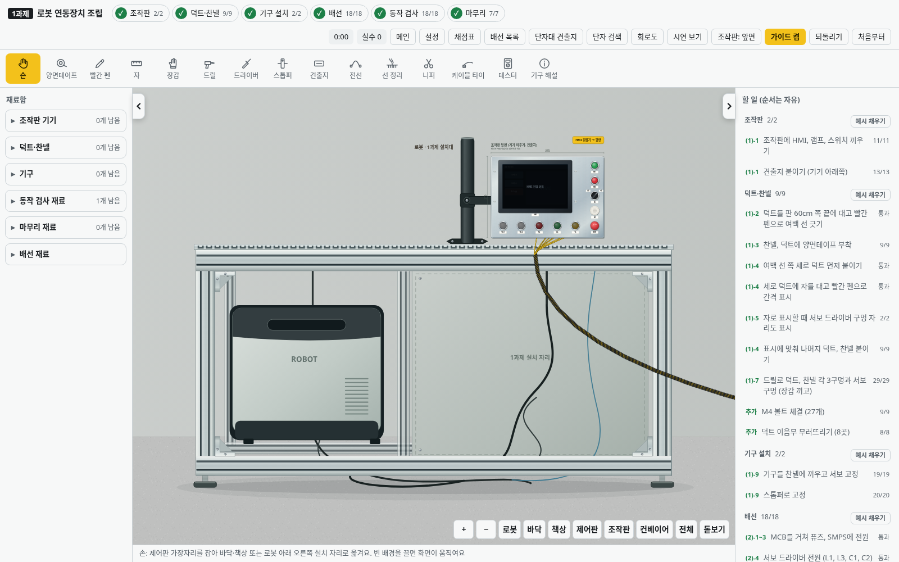
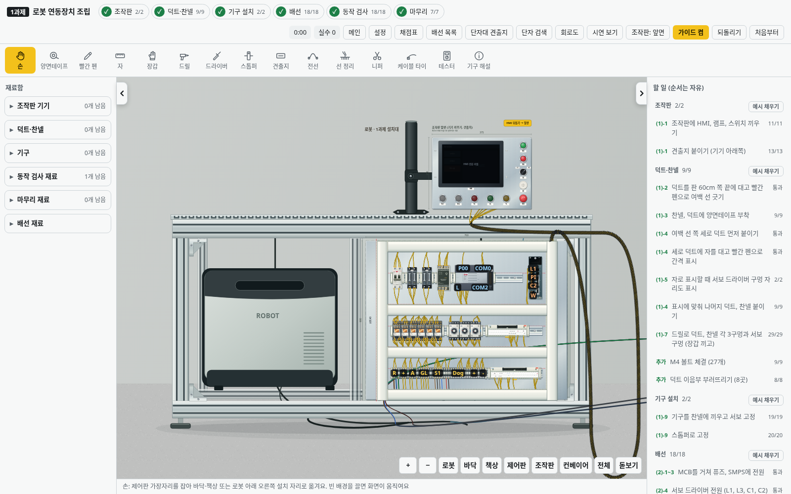

# v2.40.0 · 상판 HMI / 하부 왼쪽 로봇 제어기 / 하부 오른쪽 1과제

이전 사진은 작업대 뒷면이었습니다. 새 사진과 설명에 맞춰 작업자 정면에서 **왼쪽 아래에는 로봇 제어기, 오른쪽 아래에는 완성한 1과제를 놓는 철판**을 표시합니다. HMI는 아래쪽 철판이 아니라 **상판 위 검은 기둥과 암**에 부착합니다.

| 완성 제어판을 놓기 전 | 오른쪽 철판 자리에 설치한 상태 |
|---|---|
|  |  |

- 준비 때 꺼낸 HMI 철판은 과제 시작 후 상판 위 지지대의 부착 위치에 놓고 HMI·스위치·램프를 조립합니다. HMI 앞·뒷면 전환과 뒷면 단자는 그대로 사용합니다.
- 완성한 제어판은 손 도구로 가장자리를 잡아 끌고, 로봇 제어기 오른쪽 설치 철판의 중앙에 맞춰 놓습니다. 멀리 옮길 때는 **전체** 화면을 사용합니다. 별도의 자동 이동 버튼은 없습니다.
- 설치한 제어판도 가장자리를 잡아 다시 바닥이나 책상으로 가져올 수 있습니다. 구멍 뚫기와 덕트 부착은 바닥, 전선 연결은 책상에서 합니다. 왼쪽 제어기 쪽에 잘못 놓으면 원래 자리로 돌아갑니다.
- 설치 상태는 저장·재실행·되돌리기를 지원합니다. 기구·배선·묶은 타이·검사 기록과 점수를 보존하고, 나무판·내려놓은 재료·컨베이어·전원 케이블은 제자리에 남습니다.

설치된 제어판과 HMI는 정면을 유지합니다. HMI 외부 다발은 제어판 오른쪽 위 출구에서 나온 뒤 오른쪽 바깥으로 돌아 상판 HMI 아래로 올라가며, 설치된 기구 위를 가로지르지 않습니다. 기존 저장은 HMI 위치와 묶인 전선의 기준점만 새 지지대에 맞추고 전기 연결과 진행 기록을 유지합니다.

알루미늄 프로파일·T홈·브래킷·조절 발은 고정 배경입니다. 로봇 제어기와 지지대를 그리기 위해 전기 단자나 가짜 조립 부품을 추가하지 않습니다. 재질·그림자 끄기 설정도 적용합니다.

검사는 실제 포인터로 제어판을 설치하고 다시 책상으로 옮기기, 잘못된 왼쪽 위치에 놓기, 저장·재실행·되돌리기, 설치 상태의 정면 투영, HMI 다발이 제어판 바깥을 지나는지와 배선·점수·바닥 재료 보존을 확인합니다. v2.39.0에서 저장한 완성 작업을 새 화면으로 열어 30점과 조여 자른 타이 12개, 배선·기구·컨베이어를 유지하고 위치 보정이 한 번만 실행되는지도 브라우저에서 확인합니다.
