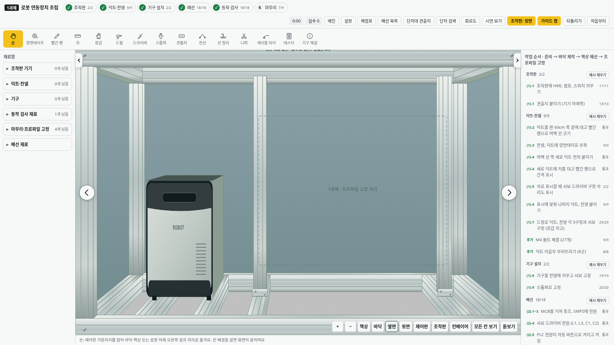

# v2.46.0 · 한 칸 화면과 좌우 화살표

책상·바닥·옆면·윗면을 선택하면 그 칸이 작업 화면을 채웁니다. 칸 바깥에 색을 채운 여백을 두지 않으며, 최대 축소와 드래그·핀치의 카메라 범위도 칸 안으로 제한합니다. 도형과 원근 비율은 유지합니다. 화면 비율에 따라 한 축의 가장자리는 잘릴 수 있으며, 해당 방향으로 끌어서 확인할 수 있습니다.

화면 좌우 가운데에 원형 화살표가 있습니다.

- 마우스를 화살표 위에 **1초** 올리면 왼쪽 또는 오른쪽 이웃 칸으로 이동합니다.
- 1초 전에 벗어나면 대기를 취소합니다. 같은 화살표 위에 계속 머물러도 여러 칸을 건너뛰지 않습니다. 다음 칸으로 더 이동하려면 마우스를 뗐다가 다시 올립니다.
- 클릭·터치 또는 버튼에 키보드 초점을 두고 Enter를 누르면 바로 한 칸 이동합니다.
- 들고 있는 재료와 조립·배선·저장 상태는 유지합니다.
- 첫 칸에서는 왼쪽 화살표, 마지막 칸에서는 오른쪽 화살표를 비활성화합니다.
- **모든 칸 보기** 또는 `0`은 기존처럼 네 칸을 함께 표시합니다. 전체 보기에서는 좌우 화살표를 숨깁니다.

화살표 대기 중 다른 칸을 직접 선택하거나, 전체 보기·메뉴로 전환하거나, 창을 떠나면 예약된 이동을 취소합니다. 기존 내부 프레임 전달은 계속 사용하며, 칸 이동 시 이전 칸의 늦은 프레임은 표시하지 않습니다.

검증은 데스크톱·울트라와이드·모바일 크기에서 카메라의 네 변이 칸 안에 있고 한 축은 칸 경계와 일치하는지 확인합니다. 1초 대기·이탈 후 재진입·연속 건너뛰기 방지·끝 칸·재료 보존·키보드 이동·전체 보기·다른 선택 및 창 전환 취소도 실제 포인터 이벤트로 검사합니다.
