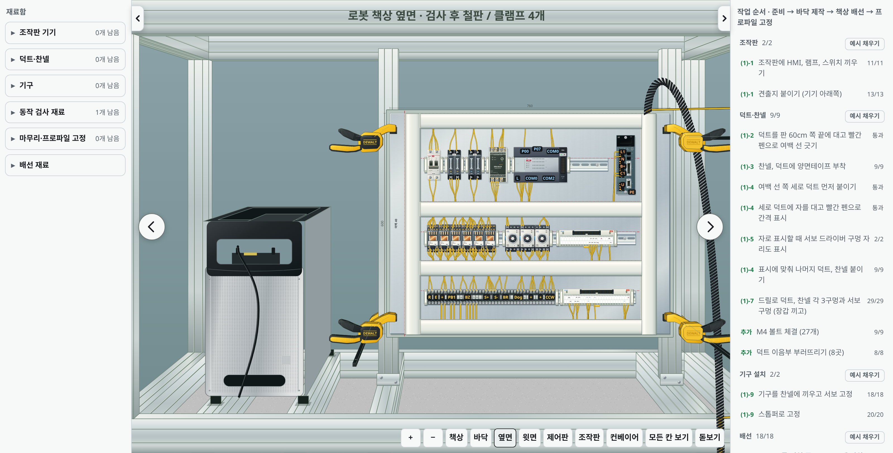
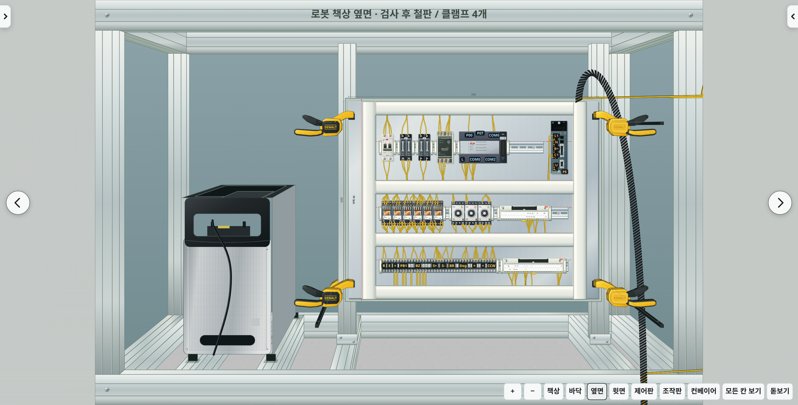
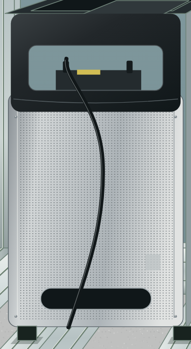
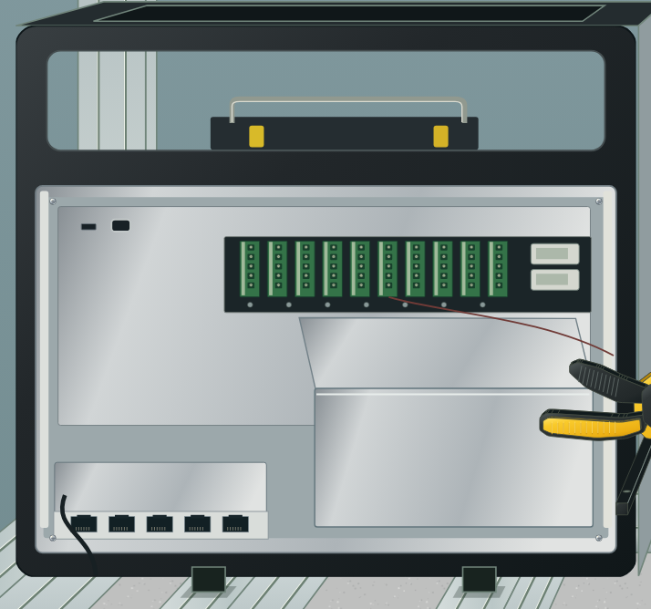
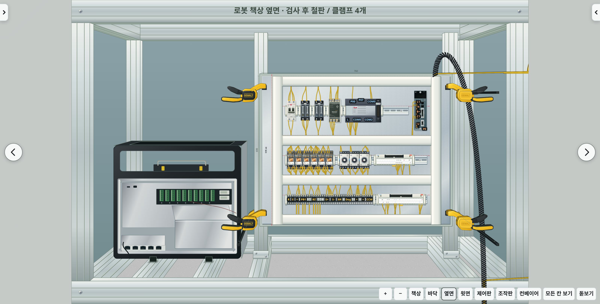

> 지도와 이동 방식은 v2.50.0에서 변경되었습니다. [현재 2×2 배치와 조작 방법](workspace-grid.md)을 확인하세요. 아래는 해당 버전의 변경 기록입니다.

# v2.49.0 · 화면 비율과 실제 제어기

작업 화면은 **메뉴를 모두 닫은 전체 크기**를 기준으로 맞춥니다. 재료함과 할 일 메뉴는 그 위로 열립니다. 메뉴를 열고 닫을 때 화면을 가로로 늘리거나 기구 위치를 옮기지 않으며, 가려졌던 부분만 드러납니다. 좌우 화살표와 하단 조작 버튼은 열린 메뉴에 가리지 않는 위치로 이동합니다.

창 크기가 바뀌면 기구의 가로세로 비율을 유지하며 선택한 칸 전체를 맞춥니다. 남는 방향에는 그 칸의 바탕을 이어 표시하고, 이웃 칸은 보이지 않습니다. 최대 축소에서는 상하좌우로 움직이지 않습니다. 네 칸 보기와 내부 프레임 전달도 같은 비율을 사용합니다.

사용자가 제공한 사진처럼 제어기의 기본 면은 **은색 타공 커버, 위쪽 검은 손잡이, 아래쪽 손잡이 구멍과 앞을 지나는 전원선**입니다. 손 도구로 누르면 90도 돌아 **열린 작업 면**을 보여줍니다. 녹색 연결 단자대, 금속 보호판, 아래쪽 통신 포트와 안쪽 손잡이·노란 표시를 사진 위치에 맞춰 표현했습니다. 추가로 제공한 제품 사진과 좁다는 의견을 반영해 옆면 모델을 넓히고 부품 배치를 다시 맞췄습니다. 높이를 유지한 채 90도 면의 폭을 약 1.5배 넓혔습니다. 다시 누르면 타공 커버 면으로 돌아옵니다.

전선 도구로 녹색 단자대의 연결 위치를 누르면 노란 표시로 선택합니다. **이번 버전은 외형과 연결 위치 선택까지 구현했습니다. 실제 전선 연결·단자명·신호 규칙·채점은 추가 설명을 받은 뒤 구현합니다.** 확인되지 않은 단자 번호와 신호를 임의로 만들지 않았습니다.

제어기는 기존 받침 프로파일 위에 두고 접촉 그림자도 받침에만 표시합니다. 회전 상태의 저장, 기존 철판 배선·기구·검사·점수는 유지합니다. 메뉴 네 상태에서 캔버스·기구 위치와 크기, 데스크톱·울트라와이드·모바일 화면 비율, 확대 후 연결 위치 선택, 프로파일 접촉과 90도 회전·복귀, 기존 단자 클릭과 철판 운반을 검사합니다.
