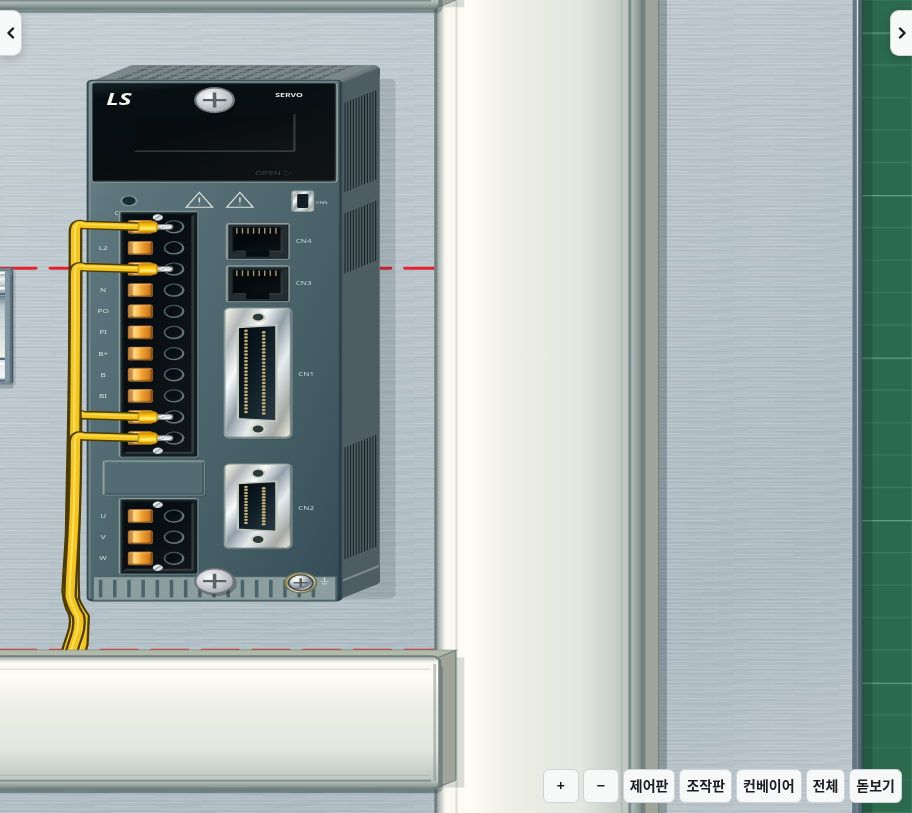
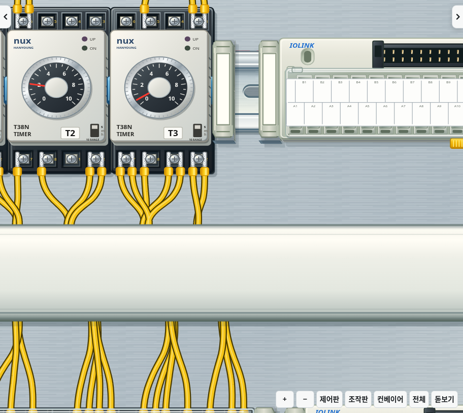

# v2.35.0 · 최고 그래픽 추가 최적화

모든 그래픽 효과를 유지하면서 전선 경로 생성과 불필요한 화면 갱신을 더 줄입니다. 별도 설정 없이 적용되며 기존 그래픽 설정은 유지합니다.

## 변경

- 전선 경로의 고정 명령·구분자와 좌표 출력 자리를 재사용합니다. 이동할 때 명령마다 배열을 복사해 문자열로 만들던 작업을 줄였습니다. 원래 좌표 연산 순서와 반올림은 같습니다.
- 화면 밖에 있는 전선 경로의 재투영을 미룹니다. 곡선 제어점의 범위, 기구 높이로 생길 수 있는 최대 이동량, 이전 시점의 위치와 선 두께까지 넉넉히 포함합니다. 화면 안으로 돌아오기 전에 같은 프레임에서 좌표를 갱신합니다. SVG가 반지름을 늘릴 수 있는 타원 호는 이 생략에서 제외합니다.
- 고정 광원의 바닥 그림자는 기구 형상이 같으면 재사용합니다.
- 화면과 그래픽 조건이 같으면 입체 면·전선·깊이 정렬 갱신을 생략합니다. 장면이 바뀌면 캐시를 무효화합니다. 같은 SVG 속성값의 반복 쓰기도 줄입니다.

기구 면과 그림자를 없애거나, 갱신 빈도를 제한하거나, 해상도를 낮추지 않습니다. 모든 도형은 유지하고 화면 밖에서는 계산만 미룹니다.

## 비교 측정

확장한 `npm run benchmark:full-graphics -- /path/to/index.html`로 v2.34.0과 같은 기준 작업·창 크기·전체 효과에서 비교했습니다. 시간은 5회 측정 중앙값이며 합성 입력의 CPU 처리 시간입니다. 실제 PC의 FPS 측정은 아닙니다.

| 항목 | v2.34.0 | v2.35.0 |
|---|---:|---:|
| 작업판 SVG 노드 | 12,737 | 12,737 |
| 모서리·측면 조명 레이어 | 699 | 699 |
| 일반 화면 이동 6회 | 149.3ms | 113.2ms |
| 자동 카메라 적용 6회 | 143.9ms | 105.2ms |
| 확대 화면 이동 6회 | 156.1ms | 80.5ms |
| 같은 장면 갱신 5회 | 48.2ms | 34.2ms |
| 확대 화면 이동 6회 중 경로 투영 호출 | 1,596회 | 538회 |
| 같은 화면 적용 8회·장면 갱신 3회 중 SVG 속성 쓰기 | 3,810회 | 0회 |
| 작업 상태·단자 좌표 | 동일 | 동일 |
| 기준 작업 점수 | 30 | 30 |

이 측정에서 일반 화면 이동의 처리 시간은 약 24%, 확대 화면 이동은 약 48% 줄었습니다. 개선 폭은 화면에 보이는 범위·배선 상태·실행 기기에 따라 달라집니다.

## 화질과 재진입 확인

제어판·좌우 시점·HMI·서보 확대·빈 화면·원래 화면으로 복귀·전선이 걸치는 가장자리의 8개 비교 화면에서 변경된 픽셀은 모두 0개였습니다.

| 부분 | 변경 전 | 변경 후 |
|---|---|---|
| 서보 확대 |  |  |
| 전선과 화면 가장자리 |  |  |

브라우저 검사는 화면 밖에서 경로 좌표 쓰기가 생략되는지, 돌아오는 프레임에서 바로 갱신되는지, 호의 경계를 보수적으로 처리하는지, 고정 그림자 경로와 멈춘 화면의 SVG 속성을 다시 쓰지 않는지 확인합니다. 원래 알고리즘과의 좌표 비교, 모든 효과 복원·끄기, 스토퍼 가림·실제 클릭·덮개 개폐·배선 정렬·카메라와 터치 입력 검사도 함께 사용합니다.
