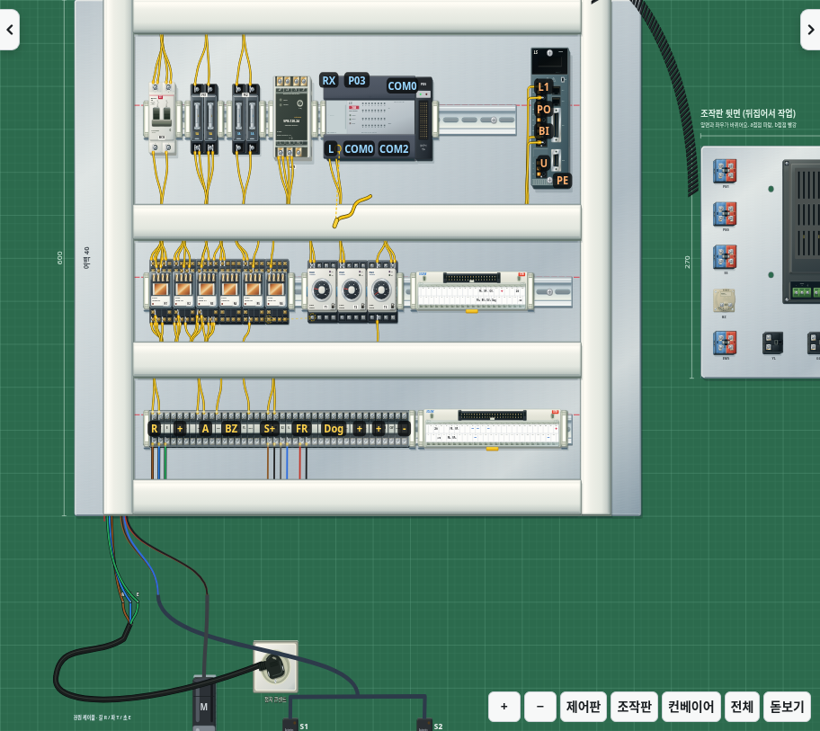

# v2.36.0 · 전선이 많은 배선 작업 최적화

전선이 늘어났을 때의 배선 편집 비용을 줄입니다. 그래픽 효과를 모두 켠 채로 기구·전선·옆면·그림자·조명과 원래 좌표를 유지합니다. 별도 설정 없이 적용됩니다.

## 변경

- 전선만 추가·삭제하면 그대로 설치되어 있는 기구의 원래 좌표와 표면 행렬을 재사용합니다. 부품을 이동하거나 덮개를 여닫아 도형이 교체되면 필요한 좌표와 연결 관계를 갱신합니다.
- 배선 포인터와 고무줄 전선이 움직일 때 안내선·단자 번호표를 다시 만들지 않습니다. 기존 그리기 순서를 유지하는 SVG 그룹으로 나누어 바뀐 부분만 교체합니다. 안내선의 맥박 애니메이션도 포인터 이동마다 처음부터 시작하지 않고 이어집니다.
- 단자 번호표의 배치 결과는 단자·전선 양 끝·화면 위치·축척·창 크기가 같으면 재사용합니다. 견출지를 수정하거나 연결 상태가 바뀌면 다시 만듭니다.
- 재료함의 복잡한 부품 미리보기를 제한된 개수로 캐시합니다. 그래픽·부품 표시 상태·단자 이름·동작 상태가 바뀌면 캐시를 비웁니다. 내용이 같은 재료함과 도구 버튼도 그대로 둡니다. 남은 수량·빈 재료·들고 있는 재료의 표시와 사용 가능 상태는 계속 갱신합니다.

배선 연결 판정·선택 거리·정리 경로·회로 계산·채점·저장 형식은 그대로 사용합니다.

## 비교 조건

`CHROMIUM_PATH=/usr/bin/chromium npm run benchmark:wire-load -- /path/to/index.html`로 v2.35.0과 비교합니다. 1440×900의 같은 헤드리스 Chromium에서 전체 그래픽을 켜고 기준 작업의 전선을 40개·122개로 설정합니다. 실시간 시뮬레이션 타이머는 멈추고, 각 조건에서 포인터 이동 50프레임과 마지막 전선의 제거·복원 40프레임을 측정합니다.

프레임 시간은 `requestAnimationFrame` 사이의 간격이고, 편집 처리는 전선 변경·단자 구성·화면 갱신의 동기 실행 시간입니다. p95는 표본의 95%가 해당 시간 이하라는 뜻입니다. 실행 순서를 번갈아 3회 반복한 각 통계의 중앙값을 사용합니다. 사용자의 PC에서 측정한 FPS는 아니며, 이 측정에서도 편집 중 50ms를 넘는 프레임이 남습니다.

| 항목 | v2.35.0 | v2.36.0 |
|---|---:|---:|
| 전선 40개 · 편집 프레임 중앙값 | 133.3ms | 83.4ms |
| 전선 40개 · 편집 프레임 p95 | 166.7ms | 133.3ms |
| 전선 122개 · 편집 프레임 중앙값 | 183.2ms | 133.3ms |
| 전선 122개 · 편집 프레임 p95 | 250.0ms | 183.3ms |
| 전선 122개 · 편집 처리 중앙값 | 154.4ms | 114.9ms |
| 전선 122개 · 포인터 이동 프레임 p95 | 33.4ms | 16.8ms |
| 전선 122개 · 편집 40회 중 좌표 행렬 조회 | 36,700회 | 420회 |
| 전선 122개 · 작업판 SVG 노드 | 12,737 | 12,737 |

이 조건에서 전선 122개의 편집 프레임 중앙값·p95는 각각 약 27%, 좌표 행렬 조회는 약 99% 줄었습니다. 편집 프레임 p95의 반복 측정 범위는 변경 전 216.7~350.0ms, 변경 후 166.6~283.3ms로 편차가 있으므로 모든 순간에 같은 개선 폭을 보장하지 않습니다. 세 번 모두 편집 40프레임 중 40개가 50ms를 넘었습니다. [반복 측정 결과](wire-frame-measurements.json)

## 화면과 동작 확인

일반 작업판·좌우 시점·HMI·서보 확대·빈 화면·원래 화면으로 복귀·전선이 걸치는 가장자리·두 위치의 배선 포인터·견출지 수정 후 화면까지 11개 화면을 비교했습니다. 안내 애니메이션을 같은 시각에 정지시킨 비교에서 바뀐 픽셀은 모두 0개였습니다. 작업 상태·단자 좌표·작업판 SVG 노드 수 역시 같습니다.

| 배선 중 화면 | 변경 전 | 변경 후 |
|---|---|---|
| 안내선·번호표·전선·포인터 |  |  |

회귀 검사는 전선 추가·삭제 중 설치된 기구의 재사용과 전체 재계산 결과의 일치, 부품 이동 후 좌표 갱신, 포인터 이동 중 안내·번호표 유지, 견출지 수정 후 번호표와 미리보기 갱신, 빈 재료와 들고 있는 재료의 사용 가능 상태를 확인합니다. 덮개 개폐·배선 잠금·가림 순서·카메라와 터치·입력 취소도 함께 검사합니다.
