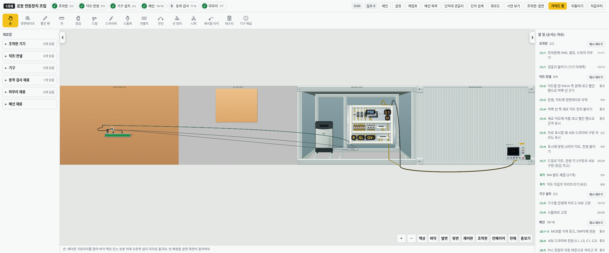
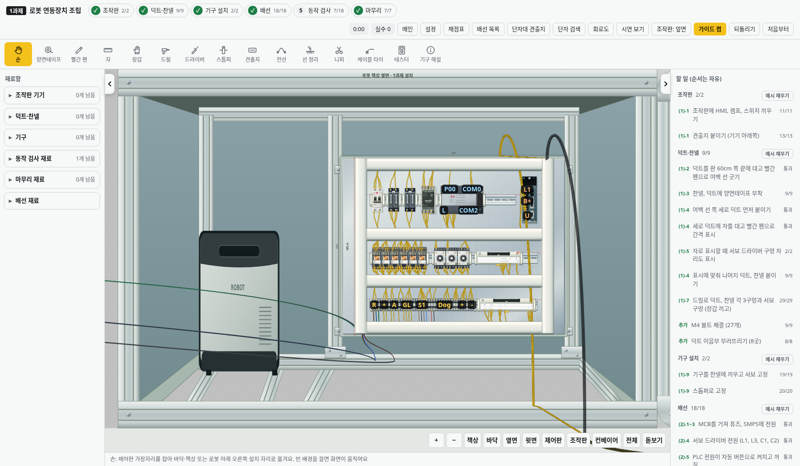
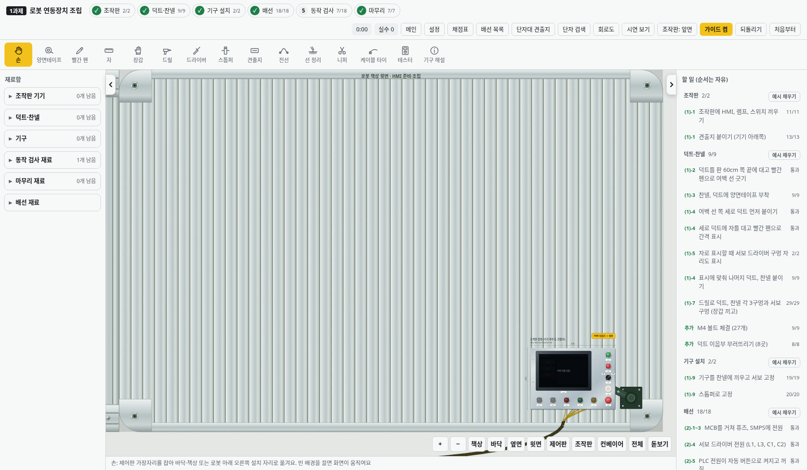

# v2.43.1 · 한 줄로 연결한 네 작업 구역

왼쪽부터 **작업 책상 → 바닥 → 로봇 책상 옆면 → 로봇 책상 윗면**으로 붙였습니다. 각 구역은 2400×1600이며, 로봇 옆면의 프로파일 프레임과 윗면 상판이 각각 구역 전체를 차지합니다. 옆면의 흰 여백은 뒤쪽과 같은 청회색으로 채우고, 프레임 아래 바닥 면은 옆 구역과 같은 회색 타일색으로 맞췄습니다. 옆면 왼쪽에는 로봇 제어기, 오른쪽에는 완성한 1과제를 부착하는 자리가 있습니다. 제어기의 받침발은 책상 안쪽에서 앞뒤로 이어지는 받침 프로파일 두 줄 위에 놓습니다. 철판 양쪽은 안쪽 세로 프로파일과 연결 브래킷·볼트로 이어져 공중에 떠 보이지 않게 했습니다. 이 세로 지지대 하단은 하부 가로·앞뒤 프로파일에 연결되고, 앞쪽 하단 프레임까지 이어집니다.

| 장소 | 하는 일 |
|---|---|
| 작업 책상 | 덕트·찬넬 준비, 양면테이프, 부착·볼트, 기구 설치, 모든 배선과 선 정리 |
| 바닥 | 나무판 깔기, 제어판 철판 준비, 드릴로 구멍 뚫기 |
| 로봇 옆면 | 완성한 1과제를 제어기 오른쪽에 부착하고 동작 확인 |
| 로봇 윗면 | HMI 철판·부품 준비, 거치대에 철판 부착, HMI·스위치·램프 조립 |

준비 시간에 나무판과 제어판 철판은 바닥에 놓습니다. HMI 철판과 HMI 기구는 **로봇 윗면**에, 나머지 기구·덕트·찬넬은 **작업 책상**에 꺼내 놓습니다. 준비가 끝나면 과제 시간을 시작하고 HMI 철판을 같은 상판의 거치대에 부착합니다.

제어판은 손으로 가장자리를 잡아 옆 구역으로 끌어 옮깁니다. 설치는 책상에서 하고, 구멍을 뚫을 때는 나무판이 있는 바닥으로 옮겼다가 책상으로 가져옵니다. 하단 **책상·바닥·옆면·윗면** 버튼은 카메라만 움직이고, **전체** 버튼은 네 구역을 보여 줍니다.

| 로봇 책상 옆면 | 로봇 책상 윗면 |
|---|---|
|  |  |

상판은 둥근 모서리와 연결판·볼트를 유지하고, 오른쪽 아래 끝의 HMI 거치대도 위에서 보는 시점으로 표시합니다. HMI 전선은 제어판 오른쪽 위로 나간 뒤 아래로 크게 돌아 HMI 아래에 들어갑니다.

이전 저장의 제어판·완성품 부착 위치와 준비 재료를 새 구역으로 옮깁니다. 기구·배선·점수·타이 상태와 바닥의 나무판은 보존하며, 같은 저장을 다시 읽어도 이동이 반복되지 않습니다. 연습과 시연도 새 작업 장소를 따릅니다.
