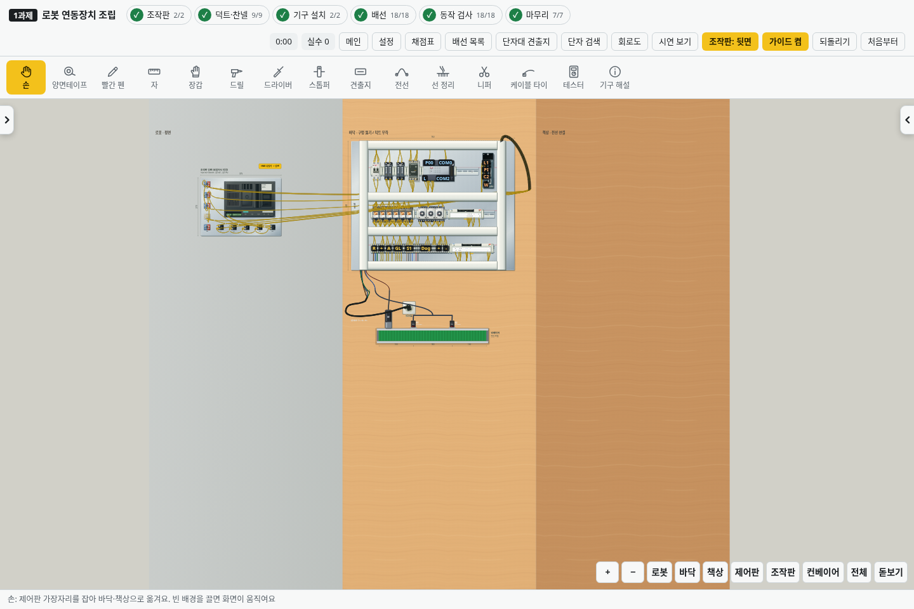
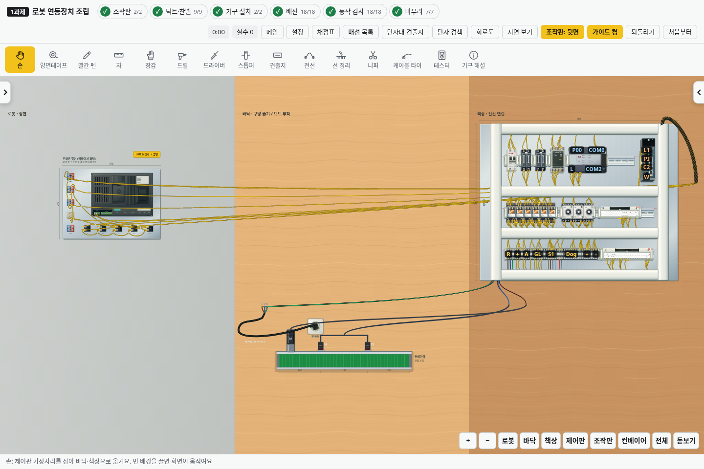

# v2.37.0 · 연결된 로봇·바닥·책상

세 공간이 왼쪽부터 **로봇 → 바닥 → 책상** 순서로 붙어 있습니다. 로봇은 밝은 회색의 정면이고, 바닥과 책상은 위에서 내려다보는 시점입니다. v2.38.0부터 가운데는 회색 무늬 타일 바닥이며, 준비 시간에 나무판을 꺼내 깝니다. 오른쪽 책상은 나무 면입니다. [과제 준비 방법](preparation.md) HMI와 조작판은 로봇 쪽에 둡니다.

손 도구로 제어판의 노출된 가장자리를 잡고 누른 채로 옆으로 끌어 옮깁니다. 놓은 위치에서 작업을 계속하며, 빈 배경을 끌거나 휠 버튼을 누르고 끌면 화면이 움직입니다. 하단 로봇·바닥·책상 버튼은 해당 공간을 확대해서 보는 용도입니다.

- 바닥: 덕트·찬넬의 뒷면 테이프 작업, 제어판에 부착, 드릴로 구멍 뚫기.
- 책상: 제어판을 옮긴 뒤 단자에 전선 연결·재연결.
- 로봇: HMI·램프·스위치의 앞면 조립과 뒷면 확인. 정면 시점은 화면을 옮겨도 유지됩니다.

제어판의 기구·덕트·찬넬·단자·배선은 함께 이동합니다. 로봇의 HMI, 컨베이어, 콘센트·전원 케이블과 내려놓은 재료는 제자리에 남습니다. 위치는 작업과 함께 저장되고 되돌리기도 지원합니다. 배선·고장 실습 예제는 책상에서 시작하며, 시연에도 제어판을 옮기는 단계가 표시됩니다. 전원이 켜져 있으면 MCB를 내린 뒤 제어판을 듭니다.

| 바닥에 둔 제어판 | 책상으로 끌어 옮긴 제어판 |
|---|---|
|  |  |

검사는 실제 포인터로 제어판을 끌어 옮기고, 기구·배선·점수 보존, 로봇·바닥 재료·컨베이어의 고정 위치, 저장·재실행, 이동 취소·창 포커스 상실·되돌리기, 그래픽 효과를 끈 상태의 이동을 확인합니다. 기존 배선·채점·저장·회로·고장·터치·카메라·덮개 검사도 사용합니다. 이전 저장의 타이는 새 로봇 위치에 맞춰 한 번 옮기되 연결 관계와 조임 상태를 유지합니다.
