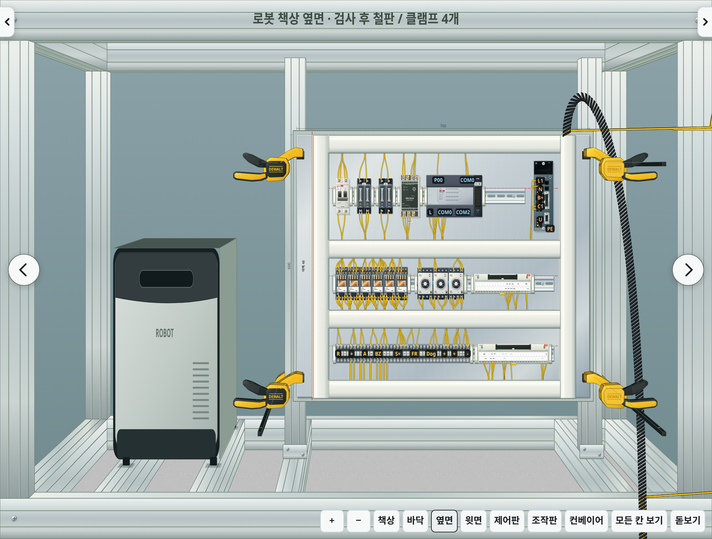
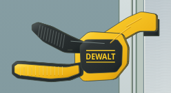
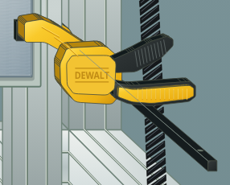
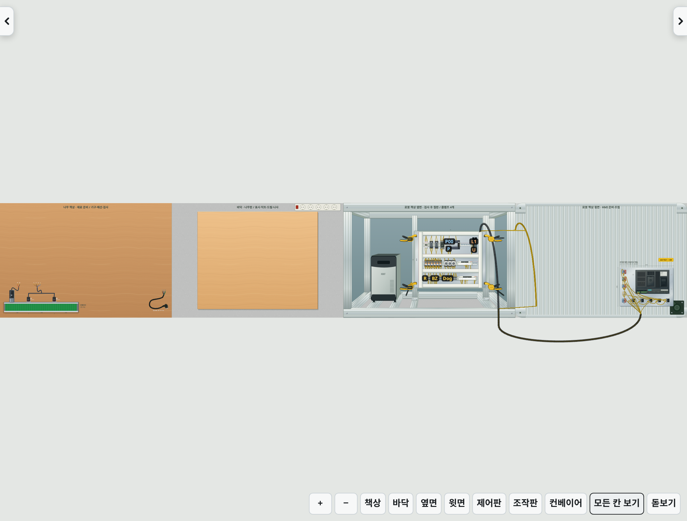
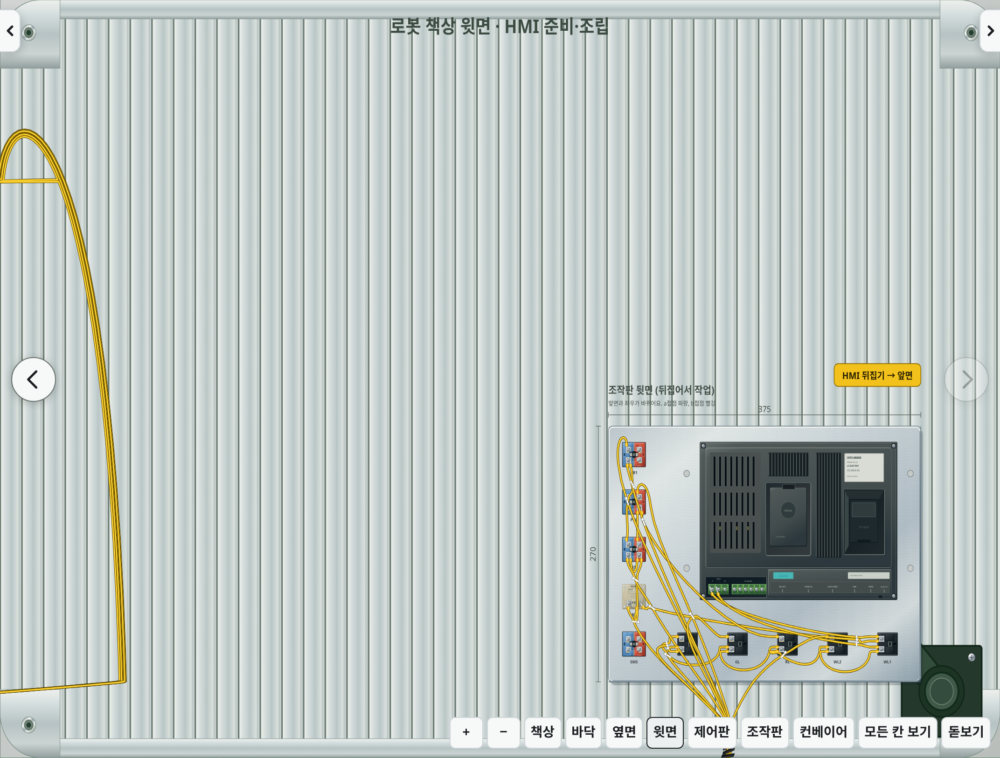
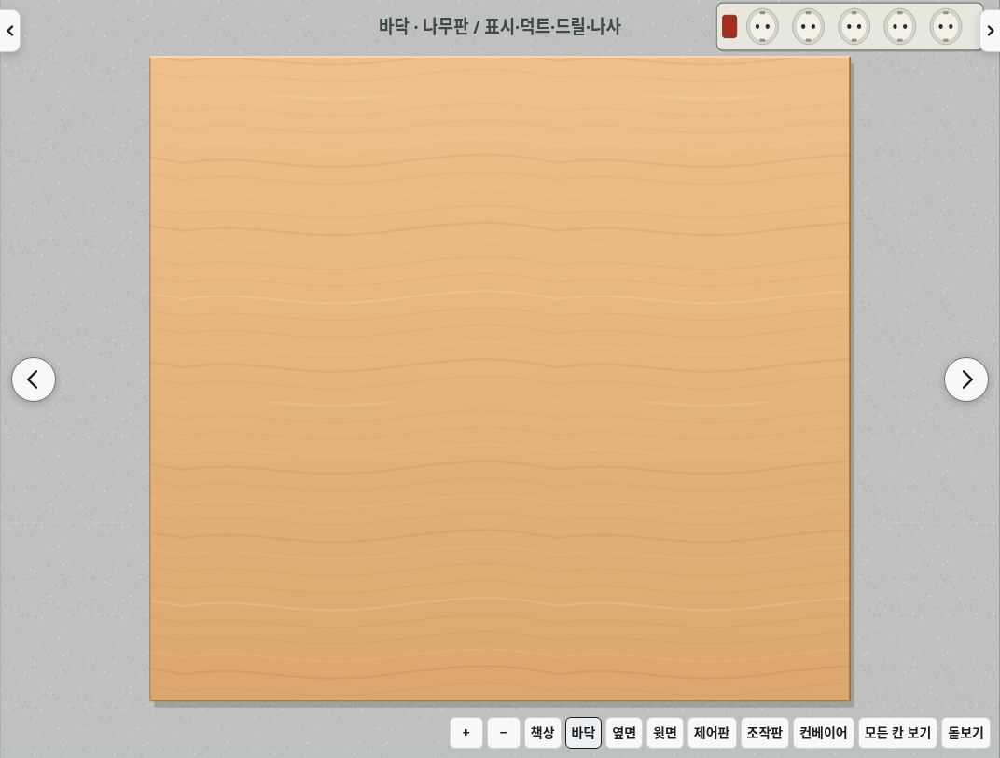

# v2.48.0 · 철판 운반과 사진 기준 클램프

v2.49.0부터 메뉴는 전체 화면 위로 열리며, 가로세로 비율을 유지합니다. [현재 화면 규칙](viewport-and-controller-photos.md). 아래는 v2.48.0의 변경과 측정 기록입니다.

손 도구로 철판의 빈 곳이나 기구 위를 누른 채 끌면 철판 전체를 듭니다. 누른 채 좌우 화살표에 **1초** 머물면 철판도 이웃 칸으로 이동합니다. 옮긴 칸 안에서 놓을 위치로 끌어 놓으세요. 클릭만 하면 기존처럼 기구·MCB를 조작합니다. 화살표의 노란 원은 대기 시간에 맞춰 한 바퀴 차오르고, 중간에 벗어나면 초기화합니다. 다음 칸으로 더 이동하려면 화살표를 벗어났다가 다시 올립니다.

이동 전에는 **MCB OFF → 연결 해제**로 전원 플러그·전원 세 가닥·컨베이어 여섯 가닥을 뺍니다. 케이블과 컨베이어 본체는 책상에 남습니다. 운반을 위한 분리 후에도 통과한 검사와 점수를 보존하며, 저장·재실행과 되돌리기를 지원합니다. 내부 배선·기구·퓨즈·타이머를 바꾸거나 잘못 다시 연결하면 기록을 무효로 합니다. 실제 전원 동작은 분리한 상태를 그대로 따릅니다.

설치한 클램프는 앞쪽 고무 패드가 철판, 뒤쪽 패드가 세로 프로파일 뒤에 닿습니다. 검은 바와 죠는 로봇 프레임과 같은 원근 기준을 사용합니다. 손잡이는 좌우 바깥쪽으로 90도 방향이며, 사진처럼 검은 곡선 트리거를 노란 손잡이 위에 배치했습니다. 둥근 성형 몸체, 죠 보강 리브, 손잡이 요철, 바 끝 구멍과 옆면 두께를 표현했습니다. 왼쪽은 검은 로고 면, 오른쪽은 노란 성형 면이 보입니다. 네 모서리를 각각 설치하고 손으로 눌러 해제합니다.







로봇 상판도 다른 세 칸과 같은 크기입니다. 선택한 칸의 네 변이 작업 화면에 맞고 최대 축소에서는 화면을 끌어도 움직이지 않습니다. 좌우 메뉴를 접거나 창 크기를 바꾸면 다시 맞춥니다. **모든 칸 보기** 또는 `0`으로 같은 크기의 네 칸을 함께 봅니다. HMI·기구의 실제 크기는 유지하므로 상판에서도 크게 보입니다.





접지 콘센트는 바닥 오른쪽 위에 고정된 **5구 멀티탭**입니다. 재료함에서 꺼내지 않으며, 전원 플러그를 집고 다섯 구멍 중 하나를 눌러 꽂습니다.



책상에 내려놓는 재료의 불필요한 충돌 여유를 없앴습니다. 본체끼리 닿게 놓을 수 있고, 마우스가 다른 재료 위에 있으면 더 가까운 좌우 빈자리에 맞춥니다. 이웃 재료가 있으면 그 바깥 빈자리로 이어 붙이며, 열린 뚜껑의 공간은 확보합니다. 설치 찬넬의 기존 배치 동작도 유지합니다.

기존 저장은 줄어든 상판 안으로 준비 재료와 HMI 철판 위치를 옮기며, 이전 콘센트 연결을 고정 멀티탭에 맞춥니다. 배선·단자 좌표·검사 기록과 제어기 단색 오른쪽 면은 유지합니다.

검증에는 실제 포인터를 사용한 철판 중앙 잡기·두 칸 운반·설치·되돌리기, 화살표 진행·이탈, 모든 멀티탭 구멍, 접하는 재료, 검사 기록 보존·무효화, 좌우 메뉴와 세 화면 비율, 입체/단순 그래픽에서 클램프 해제를 포함했습니다.

고장·연습 모드 진입 직후에도 사용자가 선택한 확대를 예약된 초기 맞춤이 덮어쓰지 않습니다. 안내 확대는 화면 비율과 하단 버튼 공간을 반영해 단자가 버튼에 가리지 않도록 합니다.

## 클램프 설치 화면의 프레임 전달 재검증

이번 버전의 같은 로봇 옆면에서 클램프 4개·전선 122개·모든 효과를 켜고, 내부 프레임 전달 적용 유무를 비교했습니다. 1440×900 헤드리스 Chromium에서 이미지 준비 후 매 프레임 휠 이벤트 4개를 보내 90프레임씩 3회 측정했습니다. 실제 `requestAnimationFrame` 간격이며, 실시간 회로 타이머는 멈췄습니다.

| 항목 | SVG 직접 표시 | 내부 프레임 전달 |
|---|---:|---:|
| 프레임 간격 중앙값 · 3회 통계의 중앙값 | 133.3ms | 16.7ms |
| 프레임 간격 p95 · 3회 통계의 중앙값 | 250.0ms | 33.4ms |
| 50ms 초과 프레임 · 270회 합계 | 268 | 6 |
| 실제 전달 프레임/회 | 0 | 99~101 |

이 조건에서 50ms 초과 프레임이 약 **97.8% 감소**했습니다. 양쪽 모두 작업 상태가 그대로이고 모든 효과가 켜져 있음을 확인했습니다. 이 수치는 캐시가 준비된 확대·이동 구간이며, 최초 장면 준비나 기구 편집·철판 운반 전체의 속도를 뜻하지 않습니다. 이전 버전과의 비교도 아닙니다. [측정 원본](workspace-clamp-frame-measurements-v2.48.0.json)

```sh
CHROMIUM_PATH=/usr/bin/chromium BENCHMARK_MOUNTED=1 BENCHMARK_SVG_ONLY=1 npm run benchmark:frame-stream
CHROMIUM_PATH=/usr/bin/chromium BENCHMARK_MOUNTED=1 npm run benchmark:frame-stream
```
