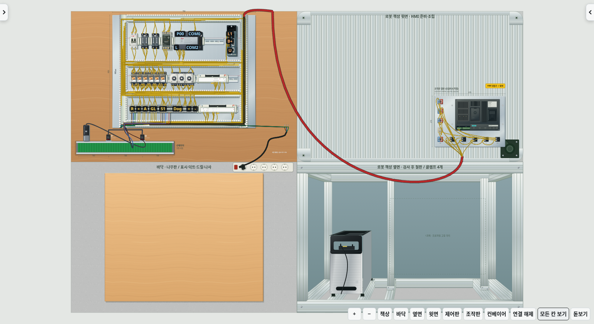
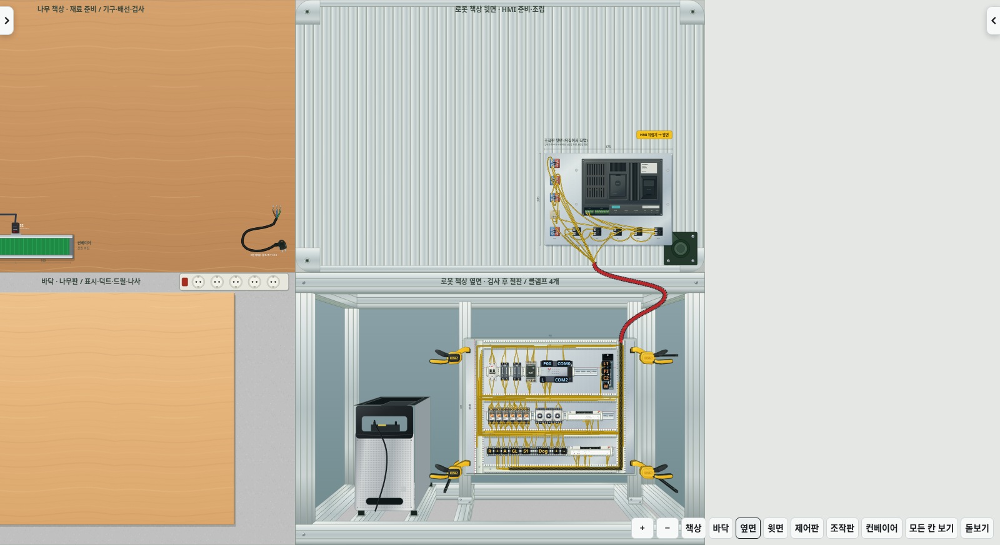

# v2.50.0 · 2×2 작업 지도

네 구역을 같은 크기(1200×800)의 사각형 지도로 연결했습니다.

| 왼쪽 | 오른쪽 |
| --- | --- |
| 나무 책상: 재료 준비·기구·배선·검사 | 로봇 책상 윗면: HMI 준비·조립 |
| 바닥: 나무판·철판·덕트·드릴 작업 | 로봇 책상 옆면: 제어기·검사 후 철판 고정 |

## 화면과 철판 이동

- **빈 배경 드래그**로 지도를 움직이고, **마우스 휠**로 확대·축소합니다. 두 손가락 확대도 사용할 수 있습니다.
- 재료나 철판을 들고 있을 때는 **휠 버튼을 누른 채 드래그**하면 화면만 움직입니다.
- 하단 **책상·바닥·옆면·윗면·제어판·조작판·컨베이어** 버튼은 해당 위치로 바로 이동합니다. 이후 드래그·확대는 이웃 칸까지 자유롭게 이어집니다.
- **모든 칸 보기** 또는 `0`으로 전체 지도를 봅니다. 좌우 원형 화살표와 1초 대기 전환은 제거했습니다.
- 손 도구로 철판 어디든 잡고 바닥에서 위쪽 책상으로 직접 옮깁니다. 전원선·컨베이어 연결은 먼저 **연결 해제**로 분리합니다. 검사 후 오른쪽 아래 로봇 옆면에 내려놓고 클램프 4개로 고정합니다.
- 메뉴는 화면 위로 열립니다. 기구 비율과 위치는 메뉴 개폐에 따라 늘어나지 않습니다.

## 헬리컬 밴드

칸별 잘라내기를 없애서 경계를 넘는 전선·밴드를 같은 지도에서 이어 표시합니다. 로봇 옆면에 철판을 설치하면 밴드는 오른쪽 위 출구에서 상판 HMI 아래로 올라갑니다. 입력 좌표와 표시 좌표를 함께 변환해 밴드를 누르는 위치도 맞춥니다.

## 저장 호환과 검증

v2.49.0 저장에서 책상은 오른쪽으로 1200·위로 800, 로봇 상판은 왼쪽으로 1200·위로 800 이동합니다. 바닥과 로봇 옆면은 원래 위치를 유지합니다. 준비 재료·HMI 철판·컨베이어·전원선을 각 표면과 함께 옮기며, 설치한 기구·배선 연결·검사 이력·클램프 수는 보존합니다. 변환 표식을 저장해 다시 열어도 중복 이동하지 않습니다. 더 오래된 저장은 기존 호환 처리를 거친 뒤 새 지도로 옮깁니다.

회귀 검사에는 실제 v2.46·v2.49 저장, 준비·배선 완료·이동 후 고정 상태, 철판 중앙 드래그·되돌리기, 메뉴 개폐, 데스크톱·울트라와이드·모바일 비율, 밴드 앞뒤 좌표와 단자 연결, 내부 Worker 프레임 전달을 포함합니다.
